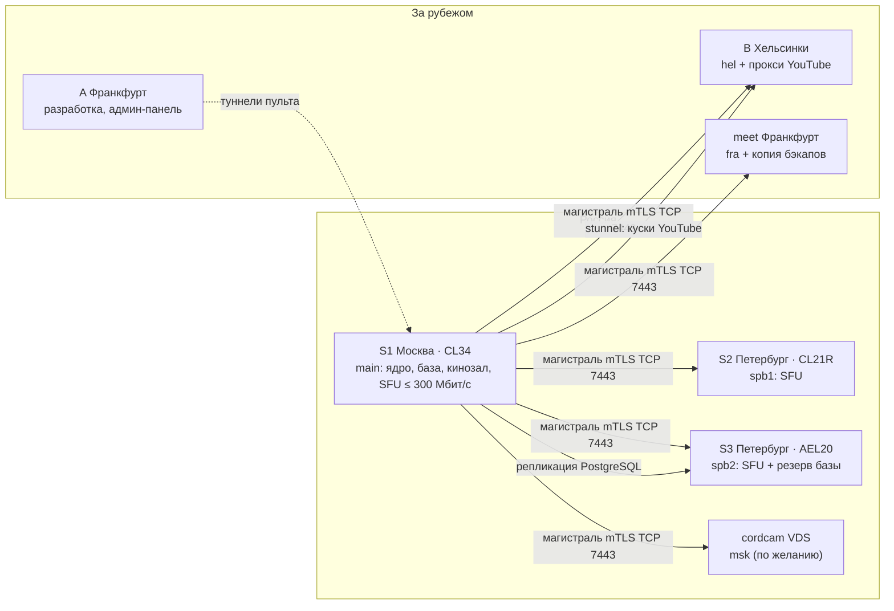

# Выделенные серверы в России для Cord: сколько нужно, какие, у кого и на сколько людей хватит (R218)

> **Имена — на дату документа.** С 12.11.2026 продукт — `cord.online` (вместо `cordcam.ru`), стенд и пульт —
> `callcord.ru`, узел `cordcam` зовётся `msk`; имён `nikg.tech` в системе нет. Действующая раскладка —
> `backlog/CONTEXT.md` и `docs/RELEASE.md` §6.

Статус: **исследование и рекомендация**, ничего на серверах не менялось. Дата: 09.11.2026. Цены проверены на страницах
провайдеров **09.11.2026** (браузером, как видит покупатель); где проверить не удалось — так и написано. Основа — наши
замеры и решения: `docs/load/2026-11-02-load-report.md` (T09), `docs/capacity.md`, `docs/codecs.md`,
`docs/architecture/distributed-media.md` (R195), `server-selection.md` (R200), `rollout.md`, `rollout-cordcam.md`,
`admin-panel.md` (Р-111), `backlog/DECISIONS.md` (Р-32, Р-96, Р-99′, Р-100…Р-111), журнал
`backlog/journal/2026-11-09-r208-r215.md` (узлы `hel` и `msk` подключены к продукту 09.11).

Вопрос владельца (дословно): «Можно ли на текущих VDS уже построить архитектуру? Или же нужно только выделенный сервера
и полноценная минимум гигабитная линия? Или в этом нет необходимости и нода будет сама мигрировать и выбираться?
Выделенные сервера то я куплю точно минимум с 1Гбит/с связи, таких будет 3-4 шт. Нужно ли между ними выстраивать
закрытую сеть и хватит ли 1Гбит/с или же нужно 2.5 или 5? Не избыточно ли? Сколько ядер понадобится? Найди лучшие и
самый бюджетные подходящие варианты архитектуры 3-4 серверов в России у каких провайдеров и чтобы общая стоимость была
явно меньше 50тыс в месяц. На сколько активных зрителей хватит?»

Пометки: **[измерено]** — снято на наших машинах (условия — в источнике); **[код]** — прочитано в репозитории;
**[источник]** — страница провайдера или чужая документация, ссылка в §11; **[оценка]** — расчёт или допущение, которое
ещё предстоит проверить; **[вывод]** — наше заключение из фактов выше.

---

## 0. Коротко — ответы на вопросы

| Вопрос | Ответ |
| --- | --- |
| Можно ли уже на текущих VDS? | **Да, архитектура уже работает на них** — с 09.11 узлы `hel` и `msk` подключены к продукту, встреча ставится на узел по замеру пути создателя и переезжает с мёртвого узла сама. Но ёмкость маленькая: ≈ 0,8–0,9 Гбит/с на всё, **≈ 100 человек** в обычных встречах; `msk` и `hel` (2 vCPU) — по одной встрече на 10 человек с камерами или по две на 6. Первым ломается ЦП маленьких узлов, затем meet, где ядро, база, кинозал и SFU делят 6 vCPU с чужими сайтами (§2). |
| Нужны ли только выделенные с гигабитом? | Не «только», но **для предсказуемого звука — да**: на VDS мы намерили steal 4–25 % (до 60 %) и 376 зависаний хоста за 15 суток; SFU при нехватке ядер встаёт целиком. Выделенный сервер убирает steal и чужих соседей, гигабит без лимита убирает вопрос «хватит ли канала» (§3). |
| Нода сама выбирается и мигрирует? | **Выбирается — да** (Р-100, Р-103): по замеру пути с устройства создателя и ступени нагрузки узлов, полный узел не берётся. **Мигрирует — только при смерти узла** (Р-105, измерено 15,5 с до звука; цель ≤ 8 с) и по руке создателя. Ради нагрузки, VPN или задержки идущая встреча **не переезжает никогда** (Р-102). |
| Закрытая сеть между серверами? | **Не нужна сейчас.** Встреча живёт на одном узле, медиа между узлами не ходит; между ними — только управление (Twirp, вебхуки, `forward_auth`, метрики) — меньше 1 Мбит/с, уже в mTLS по TCP 7443. WireGuard в России опасен: ТСПУ режет его по сигнатуре (§4.3). |
| 1 Гбит/с или 2,5/5? | **1 Гбит/с на каждый сервер хватает**, 2,5/5/10 — избыточно. Один узел на 1G честно отдаёт ≈ 850 Мбит/с, планируем 700. Больше гигабита нужно только одной комнате, которая не влезает в узел: все камеры у > 19 человек или вебинар > 100 зрителей с экраном 1080p. Дешевле добавить узел за 7–10 тыс. ₽ с безлимитом, чем платить за трафик 10G (§4.1). |
| Сколько ядер? | **Медиаузлу на 1 Гбит/с — 6–8 физических ядер** (SFU ≈ 200 Мбит/с на ядро + ≈ 1 ядро на сеть ОС); 4 ядра старого Xeon — узел на ≈ 0,5 Гбит/с. **Ядру с базой и кинозалом — 6–14 ядер, 32–64 ГБ.** 16 ядер на 1G-медиаузле простаивают на 70 % (§3). |
| Лучший вариант до 50 тыс. ₽ | **«Баланс», 35 140 ₽/мес** (31 626 при оплате за год): ядро, база и кинозал — Selectel CL34-NVMe в Москве (i5-14500, 14 ядер, 64 ГБ, NVMe), медиа — Selectel CL21R-SSD и AEL20-SSD в Петербурге. У всех — безлимит 1 Гбит/с, защита от DDoS L3–L4, IPv4, НДС 22 % в цене, без установочного платежа, посуточная аренда для проверки (§6, §7). |
| На сколько хватит? | **≈ 200 человек одновременно** во встречах на 2–6 человек с камерами только на российских серверах (≈ 300 вместе с Франкфуртом и Хельсинки); **две комнаты по 50** с несколькими камерами (после подъёма предела комнаты с 20 участников, §5.4); **вебинар до ≈ 100 зрителей** с экраном 1080p и камерой (≈ 200 — экран 720p без камеры); **кинозал — 50–100 зрителей** разом. Узкие места: канал узла для камер и показа, ядро — для больших шумных комнат и волн входа, канал машины ядра — для кинозала (§5). |
| Что избыточно? | Порты 2,5/5/10G, Kubernetes (Р-111), частная сеть/VLAN, 16 ядер и 128 ГБ на медиаузле, ECC на медиаузлах, колокация, облака с оплатой исходящего трафика за гигабайт (§7.4). |

---

## 1. Исходные данные: что измерено, а что посчитано

### 1.1 Измерено у нас

| Что | Число | Где и как |
| --- | --- | --- |
| Канал ВМ во Франкфурте (тот же хостер и /23, что у meet) | TCP 845–848 Мбит/с отдачи; UDP 1 200 Б 300/600/900 Мбит/с — 0 % потерь | T09 §2, iperf3, 02.11.2026 |
| SFU (LiveKit 1.13.6) на ядро, видео одним слоем | **180–260 Мбит/с** | T09 §3, cgroup контейнера, ВМ Ryzen 9 5950X со steal |
| SFU на ядро, мелкие пакеты (звук, нижние слои simulcast) | 80–100 Мбит/с, ≈ 30 тыс. пакетов/с | T09 §3 |
| Сетевой стек ОС | ≈ 1 vCPU на 0,9 Гбит/с UDP | T09 §2 |
| SFU + весь стек на 4 vCPU | ≈ 450–500 Мбит/с отдачи — дальше кончается ЦП, не канал | T09 §3, §8.1 |
| Память SFU | 60 МиБ + 5–8 МиБ на участника; при `mem_limit 1g` — ≈ 150–200 участников на SFU | T09 §3; `compose.yaml`, `compose.node.yaml` [код] |
| Steal и зависания хоста (ВМ A, тот же хостер, что meet) | steal 4–25 %, пиками до 60 %; 376 soft lockup за 15 суток | T09 §1, `OWNER-ACTIONS.md` п. 2 |
| Фильтр перед хостером A/meet (`zero-loss.net`) | UDP B→A режется от 0,5 Мбит/с; A→B — потери с 25 Мбит/с и блок на минуты | `distributed-media.md`, поправка 08.11 |
| Ядро (Java + PostgreSQL) | 200 человек в комнатах по 20, сообщение раз в 10 с — 1,31 + 0,79 ядра, p95 события 0,57 с; комнаты по 45 — p95 1,3 с; входы 30–60/с и падают с числом строк `rooms` | T09 §5 |
| Отказ узла | 15,5 с от остановки SFU до звука у обоих | `rollout.md` §4.1, 08.11 |
| Узлы продукта 09.11 | `main` (meet, 6 ядер, 8 встреч), `hel` и `msk` (по 2 ядра, по 2 встречи) | журнал 09.11 |

### 1.2 Из кода и решений

| Что | Значение | Где |
| --- | --- | --- |
| Камера 720p30 | 2,5 Мбит/с H.264; VP9/H.265 ×0,8 = 2,0; AV1 ×0,7 = 1,75; одним слоем у веба и телефона, слоями — у клиента Windows | Р-96, Р-32, Р-36, `docs/codecs.md` |
| Показ экрана | 720p30 ≈ 3,0 Мбит/с; 1080p30 ≈ 6; 1080p60 ≈ 10; звук показа с RED ≈ 0,26 | `docs/capacity.md`, T09 §14 п. 9 |
| Голос | ≈ 0,13 Мбит/с на говорящего на подписчика (Opus + RED), молчащие не шлют (DTX) | T09 §7 |
| Кинозал | идёт **с машины ядра** (служба → шлюз → edge), а не через SFU; 1080p ≈ 6–8 Мбит/с на зрителя, без потолка окна до 20; кусок качается один раз на всех; пул 100 соединений | Р-99′, T09 §5.4 |
| Встреча | целиком на одном узле; каскада в LiveKit OSS нет | Р-95…Р-105, `distributed-media.md` §3 |
| Пределы продукта по умолчанию | **20 участников** в комнате (`STREAM_MAX_PARTICIPANTS`), 8 встреч на узел управления, 2 встречи на новый медиаузел, `uplinkMbps` 1000 | `application.yml:53`, `scripts/node-config.mjs:87–112` [код] |

### 1.3 Чужие числа

- **LiveKit, бенчмарк** на `c2-standard-16` (16 vCPU Cascade Lake, т. е. 8 физических ядер с HT): 1 издатель 720p → 3 000
  зрителей — **531 МБ/с отдачи (≈ 4,2 Гбит/с) при 92 % ЦП**, 561 тыс. пакетов/с; 150 × 150 видео — 93 МБ/с при 85 %; звук
  10 → 1 000 — 80 % [источник 1]. На vCPU это ≈ 290 Мбит/с крупных пакетов и 38–75 тыс. пакетов/с — тот же порядок, что
  наши 180–260 Мбит/с. **Поправка к T09 §10:** там этот прогон записан как «≈ 0,53 Гбит/с» — в документации LiveKit
  единица МБ/с (мегабайты), то есть ≈ 4,2 Гбит/с. Вывод T09 «узлу на 16 ядер нужен 10G» от этого только крепче.
- LiveKit рекомендует для продакшна 10 Гбит/с, вычислительно-оптимизированные машины и сеть хоста [источник 2] — это
  совет для узлов на тысячи участников; на наших 1G-узлах канал кончается раньше ЦП (§3).
- Пинги из Москвы 09.11.2026: Петербург **9,3 мс**, Казань 12,9, Новосибирск **43,8**, Хельсинки 39,9, Франкфурт 49,1,
  Хабаровск 100,3 [источник 12].

---

## 2. Текущие VDS: что уже работает и что сломается первым

### 2.1 Что есть на 09.11.2026

| Машина | Ресурсы | Роль | Ёмкость SFU | Чем ограничена |
| --- | --- | --- | --- | --- |
| **meet**, Франкфурт | 6 vCPU Ryzen 9 5950X, 15–16 ГБ [измерено 16.09] | продукт `cordcam.ru`: ядро, база, Redis, сайт, службы, кинозал + SFU узла `main` | ≈ 500–600 Мбит/с [оценка: 4 vCPU с ядром дают 450–500, здесь 6 vCPU, но рядом чужие сайты и чужой мониторинг ≈ 9 % ЦП] | ЦП делят все; steal и зависания хоста; фильтр хостера режет UDP с других ВМ |
| **B**, Хельсинки | 2 vCPU @ 3,09 ГГц, 3,8 ГиБ [измерено] | узел `hel` + прокси YouTube (stunnel + squid) | ≈ 150 Мбит/с [оценка, `distributed-media.md` §5.11] | 2 vCPU; канал и тариф не измерены |
| **cordcam**, Москва | 2 vCPU, ≈ 4 ГБ, диск 25 ГБ | узел `msk` + сайт владельца | ≈ 150 Мбит/с [оценка] | 2 vCPU; канал и тариф не измерены; YouTube оттуда режут (тайм-ауты) |
| **A**, Франкфурт | — | разработка, админ-панель `callcord.ru`; людей нет (Р-110) | — | — |

Итого **≈ 0,8–0,9 Гбит/с** на медиа и не больше **12 встреч** по реестру (8 + 2 + 2).

### 2.2 Выбор и переезд узла — что делается само

- **Выбор при создании** (Р-100, Р-103) [код, выпущено в 1.2.1–1.2.2]: клиент меряет TCP и UDP до каждого узла (`node-probe.ts`),
  ядро берёт лучший по замеру создателя узел с запасом по ступени нагрузки (встречи, люди, ЦП со steal, отдача к
  `uplinkMbps`); полный — не берёт, третью ступень понижает, если рядом (± 20 мс) есть свободный. Москвич попадёт на `msk`,
  пока там есть место, затем — на `main` или `hel`.
- **Смерть узла** (Р-105): два признака — промахи опроса и жалобы половины людей узла → эвакуация на живой узел;
  измерено 15,5 с до звука (старое правило), цель нового — ≤ 8 с; живая приёмка нового правила ещё не сделана.
- **Не делается само** (Р-102): переезд ради нагрузки, задержки, VPN одного участника. Узел заполнился посреди встречи —
  входящих пускают, SFU снижает картинку, новые встречи идут на соседей. Ручной перевод создателем — есть (через разрыв
  `relocate`), тёплый без разрыва (Р-105′, §8.4 R200) отложен.

### 2.3 Что сломается первым — по порядку

| # | Что | При какой нагрузке | Как выглядит |
| --- | --- | --- | --- |
| 1 | ЦП `msk` и `hel` (2 vCPU) | ≈ 150 Мбит/с: одна встреча на 10 человек с камерами (≈ 180 Мбит/с при 2 Мбит/с на камеру) или две по 6 | рывки и обрывы у всех на узле; ступень нагрузки уводит новые встречи на соседей, идущие остаются |
| 2 | ЦП meet | ≈ 70–100 человек в смеси (как T09 §8.1 на 4 vCPU, здесь чуть больше) | то же, но на машине ядра — страдают и чат, и входы во всей сети |
| 3 | Ядро | большие активные комнаты (чат, доска, игры) и волны входов: p95 0,6–1,3 с при 200 людях; 30–60 входов/с | чат и ходы опаздывают, «Подключаемся…» по 1–4 с |
| 4 | Память SFU | `mem_limit 1g` → ≈ 150–200 участников на узел | падение SFU — эвакуация всех встреч узла |
| 5 | Путь из России к ядру во Франкфурте | риск в любой момент: с июня 2025 российские провайдеры режут соединения с Cloudflare до 16 КБ, по сообщениям — и с рядом зарубежных хостеров (OVH, Hetzner, DigitalOcean) [источник 13]; нашего хостера это пока не задело | сайт и API у части людей в России не открываются; медиа на `msk` не спасает — без ядра нет входа |
| 6 | Канал и тариф `msk`/`hel` | неизвестно: у VDS часто «1 Гбит/с до» на общем порту и лимит трафика | — |

**Вывод.** Архитектура на текущих VDS **уже работает** и правильна; её предел — ≈ 100 человек и маленькие комнаты на
узлах в 2 vCPU. Покупка выделенных серверов — не смена архитектуры, а добавление узлов в тот же реестр и перенос ядра в
Россию (решение владельца 09.11).

---

## 3. Выделенный сервер или VDS, и сколько ядер

### 3.1 Чем выделенный лучше для SFU

1. **Нет steal.** SFU — программа реального времени: при steal 25–60 % пакеты задерживаются у всех встреч машины разом, а
   «status update delayed» на 32–48 с (сборка образов, `docs/capacity.md`) показывает, что бывает при нехватке ядер. Все наши
   числа на ядро сняты под steal — на выделенном те же ядра дадут больше и ровнее [вывод].
2. **Свой порт без соседей.** «1 Гбит/с до» у VDS — общий порт гипервизора; у выделенного с безлимитом 1G — свой.
3. **Без фильтров хостера перед ВМ** — или с понятными (§4.4).

### 3.2 Сколько стоит один поток

```
отдача узла, Мбит/с ≈ Σ по комнатам: камеры·(N−1)·b_cam + экраны·зрители·(b_scr + 0,26) + говорящие·(N−1)·0,13
ядра SFU            ≈ отдача / 200               (крупные пакеты; звук и нижние слои — пакеты / 30 000)
ядра ОС             ≈ отдача / 900
плюс                  ≈ 0,5–1 ядро на edge (TLS, TURN/TLS), экспортёры, систему
память SFU          ≈ 60 МиБ + 5–8 МиБ × участники
```

Одна подписка на камеру 2 Мбит/с стоит ≈ 0,01 ядра; 100 таких подписок — ядро. Память — не предел для выделенного
сервера: 300 участников — ≈ 2,5 ГиБ, но **`mem_limit` SFU надо поднять с 1 до 3 ГиБ** (вместе с `GOMEMLIMIT`), иначе
голосовые и 1:1-нагрузки упрутся в него раньше ЦП (T09 §9, этап 0, п. 1).

### 3.3 Ядра под N встреч × M людей [оценка по формуле §3.2, b_cam = 2 Мбит/с, все с камерами]

| Нагрузка | Отдача | Ядра SFU + ОС + система | Узлов на 1G (по 700 Мбит/с) |
| --- | --- | --- | --- |
| 10 встреч × 4 | 240 Мбит/с | 1,2 + 0,3 + 1 ≈ **2,5** | 1 |
| 20 встреч × 5 | 800 Мбит/с | 4 + 0,9 + 1 ≈ **6** | 2 |
| 10 встреч × 10 | 1,8 Гбит/с | 9 + 2 + 2 ≈ **13** на всё | 3 (≈ 4–5 ядер на узел) |
| 5 встреч × 20 | 3,8 Гбит/с | ≈ 25 на всё | 6, и комната 20 × 20 (760 Мбит/с) **не влезает** в один 1G-узел при 2 Мбит/с на камеру |
| 1 комната 50, 4 камеры + экран 720p | 565 Мбит/с | ≈ 4 | 1 |
| вебинар 1 → 100, экран 1080p + камера | 840 Мбит/с | ≈ 5–6 | 1, на пределе порта |

**Вывод по ядрам.** Узлу с портом 1 Гбит/с достаточно **6–8 физических ядер** современного класса (≈ 4 под SFU, 1 под сеть,
1–2 запаса). SMT добавляет ≈ 20–30 %, считать по физическим [оценка]. 4 ядра Xeon E3 2013–2017 годов — узел на
≈ 0,5 Гбит/с [оценка, старое поколение медленнее на ядро]. 16 ядер на 1G-узле загружены на 25–35 % — это запас под 10G
в будущем, а не потребность. **Машине ядра** нужно 6–14 ядер и 32–64 ГБ: Java (2 ГиБ), PostgreSQL, службы (1 ГиБ),
`sniffer` (1,5 ГиБ), мониторинг и при желании SFU на треть порта.

---

## 4. Сеть

### 4.1 Хватит ли 1 Гбит/с

Порт 1G на практике — **≈ 850 Мбит/с** (измерено), планируем **700** (ядро не ставит новые встречи на узел выше 75 %, Р-103).
Сколько это (подробно — §5):

| Что | Помещается в один 1G-узел [оценка] |
| --- | --- |
| Все с камерами в одной комнате | до **19 человек** при 2 Мбит/с (N·(N−1)·2 ≤ 700); до 24 при 1,2; до 17 при 2,5 |
| Вебинар, экран 1080p30 + камера | ≈ **85–100** зрителей |
| Вебинар, экран 720p без камеры | ≈ **200–250** зрителей |
| Встречи 2–6 человек с камерами | ≈ **70–140** человек, 18–35 встреч |

Когда понадобится больше гигабита на одном сервере: (1) одна комната больше строк выше — комната не делится между узлами,
каскада в LiveKit OSS нет (T09 §10: свой ретранслятор или HLS для эфиров); (2) парк из 6–8+ узлов, который проще заменить
меньшим числом крупных. Ни того, ни другого сейчас нет.

Почему не 2,5/5/10G «на вырост»:

- **2,5 и 5G в аренде в России почти не встречаются**; у Selectel порт больше 1G идёт с моделью «300 ТБ», сверх неё — доплата
  [источник 4]; 1G в среднем круглые сутки — это 324 ТБ, то есть 10G на деле платный по трафику.
- **ЦП**: узел на 6–8 ядер вывозит ≈ 1–1,5 Гбит/с, на 16 — ≈ 2,5–3 (T09). 10G без 16 ядер не используется.
- **Деньги**: медиаузел с безлимитом 1G у Selectel — от 7 000 ₽ (§6). Ещё один такой узел дешевле любого трафика 10G и
  заодно даёт резерв при отказе.

**Вердикт: 1 Гбит/с безлимит на каждый сервер; растём числом узлов, а не скоростью порта.**

### 4.2 Безлимит или лимит трафика

1 Гбит/с, занятый сутки, — 324 ТБ/мес; лимит 30 ТБ — это в среднем **93 Мбит/с**. Наша оценка для «Баланса» на пике:
200 человек × 8 Мбит/с = 1,6 Гбит/с отдачи по узлам, ≈ 6,5 «пиковых» часа в сутки (4 ч пик, 6 ч по 30 %, остальное ≈ 5 %) →
≈ 4,7 ТБ/сут ≈ **140 ТБ/мес на парк, ≈ 45–50 ТБ на узел** [оценка]. При лимите 30 ТБ и 200–230 ₽ за ТБ сверх это
+3–5 тыс. ₽ на узел — терпимо, но безлимит у Selectel входит в цену и снимает вопрос. Кинозал на машине ядра: 60 зрителей ×
8 Мбит/с × 3 ч/сут ≈ 20 ТБ/мес [оценка].

### 4.3 Частная сеть между серверами

**Что ходит между узлами сейчас** [код, `distributed-media.md` §5.5′]: Twirp ядра к узлу (`ListRooms` раз в 2 с,
исключение участников), вебхуки и `forward_auth` узла к ядру, метрики. Всё — в mTLS по одному порту TCP 7443. Медиа и сигнал
участников между узлами **не ходят никогда**: встреча целиком на одном узле. Объём — меньше 1 Мбит/с на узел [оценка];
репликация PostgreSQL на резерв — десятки–сотни КБ/с под нагрузкой чата [оценка]; ночной бэкап — сотни МБ.

**Когда частная сеть или VLAN имели бы смысл:**

| Случай | У нас |
| --- | --- |
| Медиа между узлами (каскад, mesh, ретранслятор эфиров) | нет; ретранслятор T09 §10 A будет слать одну копию на лист — тоже мало |
| Общий Redis/psrpc кластера LiveKit | отвергнут (узлы независимы, Р-95 и поправка R195) |
| Оверлейная сеть Kubernetes | Kubernetes не используем (Р-111) |
| Тяжёлая база или файлы на отдельной машине | база рядом с ядром |
| Публичная сеть режет UDP между серверами | было у хостера A/meet — решено TCP-магистралью |
| Безопасность: закрыть порты базы от интернета | закрыто брандмауэром и mTLS; частная сеть — приятное дополнение |

У Selectel частная сеть 1G **входит в цену** у большинства конфигураций, но работает внутри пула (одного ЦОД); между Москвой
и Петербургом — отдельная услуга «Глобальный роутер», цена — по запросу [источник 3]. Если два сервера окажутся в одном пуле —
включить бесплатный VLAN под репликацию PostgreSQL, ничего больше на нём не строить.

**WireGuard.** Переход с mTLS на WireGuard — замена одного `backbone.json` (`distributed-media.md` §5.5′). Но в России, по
сообщениям, ТСПУ с 2023 года распознаёт WireGuard и OpenVPN по сигнатуре и к февралю 2026 режет их повсеместно [источник 14]; магистраль между российским ядром и
узлами во Франкфурте и Хельсинки пересекает границу. TLS на 443/7443 выглядит как обычный веб и уже работает —
**оставляем mTLS по TCP**, WireGuard не делаем.

### 4.4 Защита от DDoS, IPv4, «фильтрованный» порт или чистый

- **Что мы уже знаем на своей шкуре:** постоянный фильтр перед хостером A/meet (`zero-loss.net`) режет честный UDP между
  серверами от 0,5 Мбит/с и блокирует на минуты. Для медиа нужен **чистый порт с защитой «по атаке»** (детект потока, очистка
  или блэкхол только во время атаки), а не вечный фильтр, который считает RTP атакой.
- **Selectel**: защита L3–L4 входит в цену выделенного [источник 3, 5]; L7 для сайта — от 2 600 ₽/мес, если понадобится.
  **Timeweb**: защита от DDoS — платная отдельно [источник 7]. **HOSTKEY**: «расширенная защита» — дополнительная услуга
  [источник 6].
- **Cloudflare перед сайтом для России не годится**: с июня 2025 российские провайдеры режут соединения с ним до 16 КБ
  [источник 13]. Р-109 (серое облако, оранжевое — в день атаки) для российского ядра меняется: при атаке на сайт — российская
  L7-защита (Selectel или аналог), не Cloudflare.
- **IPv4**: один адрес входит в цену у Selectel, FirstDEDIC, REG.ru [источник 3, 8, 11]; у HOSTKEY на странице не нашли. Второй адрес под
  TURN (чтобы блокировка TURN не задела SFU, T09 §9) — по желанию; цену дополнительной подсети на странице заказа не
  проверили.
- **Проверка до покупки на месяц.** У Selectel есть посуточная аренда (397–1 111 ₽/сут у конфигураций ниже): взять сервер на
  сутки и прогнать `iperf3` по `distributed-media.md` §1.2 — UDP 1 200 Б 300/600/900 Мбит/с по 5 минут в обе стороны с
  домашнего провайдера в России, с meet и с B; TCP 7443 до meet и B; `lk load-test` 10×10; steal = 0. Критерии: потери
  < 0,1 %, джиттер < 5 мс, ни одной блокировки на минуты.

---

## 5. Ёмкость: на сколько людей хватит

Допущения [оценка]: камера 720p30 — 2 Мбит/с типично (1,2 — как в T09, 2,5 — потолок Р-96, в скобках); показ по умолчанию
720p30; говорит 1–2 человека; узел на 1G планируем на 700 Мбит/с (предел 850). Всё ниже — **расчёт по формуле §3.2**, а не
прогон; прогнать — §8, шаг 1.

### 5.1 На один медиаузел 1 Гбит/с с 6+ ядрами

| Сценарий | Отдача | Помещается в узел | Что кончается первым |
| --- | --- | --- | --- |
| Встречи 2–6 человек, все с камерами, показ экрана в 30 % встреч | ≈ 8 Мбит/с на человека (5,1–9,6) | **≈ 90 человек, ≈ 22 встречи** (70–140 человек, 18–35 встреч) | канал |
| Комната 30, 3 камеры, остальные слушают | ≈ 180 Мбит/с (110–225) | 3 такие комнаты | канал; в ядре — чат и снимки на 30 человек |
| Комната 50, 4 камеры, без показа | ≈ 405 Мбит/с (250–500) | 1, и ≈ 300 Мбит/с на мелкие встречи | канал; ядро шлёт полный снимок ≈ 50 КБ каждому из 50 на каждое изменение (замер 4 комнаты × 45 с чатом — p95 1,3 с) |
| Комната 50, 4 камеры + показ 720p | ≈ 565 Мбит/с (410–660) | 1, рядом почти ничего | канал |
| Комната 50, 4 камеры + показ 1080p30 | ≈ 710 Мбит/с (555–810) | 1, на пределе порта | канал |
| Вебинар: экран 1080p30 + камера ведущего | 8,4 Мбит/с на зрителя | **≈ 85 зрителей** (до 100 на пределе) | канал |
| Вебинар: экран 720p + камера | 5,4 Мбит/с на зрителя | ≈ 130 (до 155) | канал |
| Вебинар: только экран 720p и голос | 3,4 Мбит/с на зрителя | ≈ 200 (до 250) | канал; ЦП по пакетам ≈ 2 ядра |
| Только голос или 1:1 | 0,13–0,25 Мбит/с на человека | ≈ 150–200 участников при `mem_limit 1g`; 400–600 при 3 ГиБ | память SFU, затем ядро (входы) |

### 5.2 Кинозал — это канал машины ядра, а не медиаузла

Видео кинозала идёт с машины ядра (Р-99′): 1080p ≈ 6–8 Мбит/с на зрителя, кусок качается из YouTube один раз на всех
(через прокси в Хельсинки, ≈ 6 Мбит/с на фильм входящих). На порту 1G машины ядра, если её SFU ограничен 300 Мбит/с
(`uplinkMbps`), на кинозал остаётся ≈ 400 Мбит/с → **≈ 50–65 зрителей** разом; без SFU на этой машине — ≈ 650 → **80–100**
(пул — 100 соединений у файловых источников). Сама встреча в кинозале (камеры, голос) идёт через медиаузел как обычная.
Байты кинозала проходят через один процесс Python (T09 §5.4) — на сотне зрителей это не измерено; кэш на Caddy/nginx
(T09 §13 п. 6) снимает этот риск.

### 5.3 Рекомендуемая конфигурация («Баланс», §7.2) целиком

| | Российские серверы | Вместе с Франкфуртом и Хельсинки |
| --- | --- | --- |
| Медиа | ≈ 1,5 Гбит/с: ядро-машина 0,3 + `spb1` 0,7 + `spb2` 0,45–0,5 | ≈ 2,2–2,3 Гбит/с (+ meet после ухода ядра ≈ 0,5–0,6, + `hel` и `msk` по 0,15) |
| Встречи 2–6 с камерами | **≈ 190 человек** (155–295), ≈ 45 встреч | ≈ 290 человек |
| Большие комнаты 50 с 4 камерами | 2 одновременно (на `spb1` с показом, на `spb2` без показа или с камерами потише) + мелкие на машине ядра | 3 |
| Вебинар | до ≈ 85–100 зрителей с экраном 1080p на одну комнату (предел — порт одного узла) | то же: комната на одном узле |
| Кинозал | ≈ 50–65 зрителей (≈ 100 без SFU на машине ядра) | то же — кинозал только на машине ядра |
| Голос и 1:1 | ≈ 500 участников при `mem_limit 1g` на трёх узлах; больше — после 3 ГиБ | — |
| Ядро | без steal на i5-14500; алгоритмические пределы T09 (входы 30–60/с, полные снимки) — комфортно до **≈ 200–300** одновременных в активных комнатах; дальше — этап 0 T09 §13 пп. 1–4 | — |

**Что упрётся первым** у «Баланса»: в обычных встречах — канал узлов (≈ 190 человек); в больших шумных комнатах — ядро
(задержка событий, полные снимки по 50 КБ каждому); при «все зашли в 19:00» — входы ядра; в кинозале — канал машины ядра.

### 5.4 Что надо поменять в конфигурации, иначе числа выше не получатся

1. `STREAM_MAX_PARTICIPANTS` — сейчас **20**: комнаты на 30–50 человек и вебинары без этого невозможны [код `application.yml:53`].
2. `mem_limit` SFU — 1 ГиБ на всех узлах → 3 ГиБ и `GOMEMLIMIT` [код `compose.yaml`, `compose.node.yaml`].
3. Реестр узлов: `maxRooms` (по умолчанию 2 у медиаузла) → ≈ 25 на 1G-узел; `uplinkMbps` — по замеру iperf3; `cores`, `country`.
4. `net.core.rmem_max/wmem_max` ≥ 16 МиБ и прочий sysctl — их ставит `node.sh bootstrap`; проверить на новой ОС.

---

## 6. Провайдеры в России: что есть на 09.11.2026

Цены — помесячно, **с НДС 22 %** там, где провайдер это пишет; «за год» — цена в месяц при оплате на 12 месяцев. «шт.» —
сколько было в наличии в момент проверки (быстро меняется). Ссылки — §11.

### 6.1 Selectel — основной кандидат [источник 3, 4, 5]

Общее для всех строк (страница конфигурации, 09.11.2026): **«Безлимитный интернет-трафик — 1 Гбит/с»**, публичный IPv4,
защита от DDoS L3–L4, автоустановка ОС, техподдержка 24/7, замена комплектующих за 3 часа, **«Цена с учётом НДС 22 %»**,
установочного платежа нет. Сроки: 1 день / 1 месяц / 3 мес. −3 % / 6 мес. −7 % / 12 мес. предоплатой −10 % / 12 мес. с
ежемесячной оплатой −15 % (так на странице). Если превысить модель трафика — скорость не режут, но доплата [источник 4].
Предоплата с баланса, для юрлиц — ЭДО «Диадок» [источник 3]; работают ли с физлицами — на странице не проверяли.

| Конфигурация | Процессор (ядра/потоки) | Память, диски | Сеть | Где | 1 мес. | За год | Сутки | Шт. |
| --- | --- | --- | --- | --- | --- | --- | --- | --- |
| **CL21R-SSD** | Intel Core i7-8700 (6/12) | 64 ГБ DDR4, 2 × 480 ГБ SATA SSD | 1G безлимит, частной сети нет | Петербург, SPB-4 | **7 000** | 6 300 | 397 | 1 |
| **AEL20-SSD** | Intel Xeon E3-1230 (4/8), поколение не указано | 32 ГБ DDR4 ECC, 2 × 480 ГБ SATA SSD | 1G + частная 1G, KVM, SLA 100 % | Петербург, SPB-3 | **8 540** | 7 686 | 486 | 2 |
| AEL10-SSD | Intel Xeon E3-1230 (4/8) | 16 ГБ DDR4 ECC, 2 × 240 ГБ SATA SSD | 1G + частная 1G, KVM | Петербург, SPB-5 | 9 500 | 8 550 | — | 1 |
| CL25-NVMe | Intel Core i3-14100 (4/8) | 32 ГБ DDR5, 2 × 1 ТБ NVMe | 1G | — | 15 600 | — | — | 8 |
| **CL34-NVMe** | Intel Core i5-14500 (14 = 6P + 8E / 20) | 64 ГБ DDR5, 2 × 1 ТБ NVMe | 1G + частная 1G | Москва, MSK-2 | **19 600** | 17 640 | 1 111 | **23** |
| EL49-NVMe-10GE | Intel Xeon E-2456 (6/12) | 32 ГБ DDR5 ECC, 2 × 1 ТБ NVMe | 1G + частная 10G, KVM, IPMI, SLA 100 % | Москва, MSK-7 | 19 900 | 17 910 | 712 | 1 |
| DL24 | 2 × Xeon Silver 4114 (20/40) | 64 ГБ DDR4 ECC, 2 × 480 SSD + 2 × 4 ТБ HDD | 1G + частная 1G | Москва, MSK-1 | 22 700 | 20 430 | 1 280 | 1 |
| **AR44-NVMe** | AMD Ryzen 9 7950X (16/32) | 128 ГБ DDR5, 2 × 2 ТБ NVMe | 1G + частная 1G | Москва, MSK-2 | **23 700** | 21 330 | 938 | 2 |
| DL-31 | 2 × Xeon E5-2630v3 (16/32) | 128 ГБ DDR4 ECC, 2 × 480 SSD | 1G + частная 1G | Москва, MSK-2 | 24 800 | — | — | 1 |
| AR43-NVMe | AMD Ryzen 9 9950X (16/32) | 128 ГБ DDR5, 2 × 2 ТБ NVMe | 1G + частная 1G | — | 27 300 | 24 570 | 1 130 | 0 |
| AR45-NVMe | AMD Ryzen 9 9950X (16/32) | 192 ГБ DDR5, 2 × 2 ТБ NVMe | 1G + частная 1G | Петербург, SPB-2 | 30 800 | 27 720 | 1 240 | 1 |

Замечания. (1) Страница линейки Chipcore в одном месте пишет «5 ТБ бесплатного трафика в месяц», а в карточках этих же
серверов — «безлимитный трафик 1 Гбит/с»; документация по моделям трафика — «1 Гбит/с безлимит» для всех портов 1G
[источник 4, 5]. **Перед заказом спросить у продаж письменно**, какая модель у конкретной конфигурации. (2) У Selectel есть
пул в Новосибирске, но готовой конфигурации там в списке на 09.11 мы не нашли (фильтр по региону не сработал в нашем
браузере) — Новосибирск только через конфигуратор, цена **не проверена**. (3) Есть «аукцион» со скидками — не смотрели.

### 6.2 Остальные

| Провайдер | Что нашли (09.11.2026) | Канал и трафик | Где | НДС, условия | Годится? |
| --- | --- | --- | --- | --- | --- |
| **HOSTKEY** [источник 6] | ru.v3-ultra-mini: Ryzen 9 5950X (16/32), 64 ГБ, 2 ТБ NVMe — **14 960 ₽** за год (−12 %; помесячно ≈ 17 000 [вывод из −12 %]); ru.v3-ultra 5950X 128 ГБ — 16 720 (≈ 19 000); ru.v5-micro Ryzen 7 9700X (8), 32 ГБ — 12 320 (≈ 14 000, нет в наличии); ru.v4-ultra Ryzen 9 7950X 128 ГБ — 22 000 (≈ 25 000, предзаказ); bm.ru-maxi+ Xeon E3 (4), 32 ГБ — 6 160 (≈ 7 000) | **1 Гбит/с, 30 ТБ** «Guaranteed»; сверх — ≈ 200 ₽/ТБ [агрегатор, на сайте не нашли] | Москва | НДС 22 % в цене [агрегатор whtop, источник 15]; сдача от 15 мин | да, но лимит 30 ТБ ≈ 93 Мбит/с в среднем |
| **FirstDEDIC / 1dedic** (одна компания) [источник 8] | Ryzen 9 9950X (16/32), 32 ГБ DDR5, 2 × 500 ГБ NVMe + 2 × 1 ТБ HDD — **22 504 ₽** | порт 1G, **30 ТБ включено, сверх 230 ₽/ТБ**; до 10G по запросу | Москва, ЦОД IXcellerate (Tier III) | НДС не указан; с 01.08.2026 +17 % к железу у серверов, взятых до 10.07.2026 | да, с лимитом трафика |
| **Timeweb Cloud** [источник 7] | i9-10900K (10/20), 64 ГБ, 2 × 1 ТБ NVMe — **15 900 ₽**; i5-14500 (14/20), 64 ГБ — 20 000; Ryzen 9 7950X (16/32), 128 ГБ, 2 × 2 ТБ NVMe — 22 950 | «Канал — 1 Гбит/с… трафик не ограничиваем» (страница timeweb.com) | Петербург и Москва (в списке у строки город не показан — уточнять при заказе) | DDoS — платно отдельно; НДС не указан | да, запасной к Selectel |
| **Yandex BareMetal** [источник 9] | BA-i220-2S: 2 × Xeon E5-2690v2 (20 ядер), 128 ГБ DDR3, 2 × 838 ГБ SSD — **16 485 ₽**; BA-i103-S-10G — 22 090 (1 мес.) / 19 357 (год), состав — только в консоли | включён пакет **10 ТБ в сутки на 1 Гбит/с** (≈ безлимит 1G) | ЦОД Яндекса, регион «Россия» | «все цены в рублях — с НДС»; **аренду нельзя прервать до конца периода** | да по каналу; железо 2013 г. |
| VDSina [источник 10] | «выделенные» 8 ядер / 30 ГБ / 350 ГБ — 9 870 ₽; 12 / 60 / 930 — 14 970; модель процессора не указана — похоже на ВМ с выделенными ядрами [вывод] | 1G, **64 ТБ/мес**, сверх 200 ₽/ТБ | Москва (DataPro), Амстердам | посуточно | как VDS получше, не как выделенный |
| REG.ru / REG.cloud [источник 11] | Xeon E3 DDR3 — от 5 110 ₽ (−30 % акция); есть AMD EPYC и Ryzen | **100 Мбит/с** без ограничения трафика; 1G — допуслуга, цена не указана; частная сеть до 100G | Москва | DDoS L3/L4 входит | нет без 1G |
| Rackstore [источник 16] | HP DL360 G9 E5-v4 — 15 180–55 900 руб. | **100 Мбит/с** безлимит | Москва, ММТС-9 | цены **без НДС 5 %** | нет |
| Aeza | — | — | — | **санкции США и Великобритании с 01.07.2025** [источник 17] — риск блокировок адресов и платежей | **нет** |
| Beget [источник 18] | баннер на сайте: «в ночь с 1 на 2 ноября 2026 года… кибератака», восстановление (обновлено 7 ноября) | — | — | — | **не сейчас** |
| Servers.ru | сертификат сайта просрочен на момент проверки — цены не видели | — | Москва | — | не проверено |
| Ihor | страница выделенных — 404 | — | — | — | не проверено |
| ITLDC | вне России (ЕС, США, Азия) — по постановке задачи | — | — | — | только как зарубежный узел |
| Serverspace, VK Cloud | облака ВМ, исходящий трафик тарифицируется | — | — | — | не смотрели детально |
| DataLine, IXcellerate, Miran, Linxdatacenter | колокация и корпоративные услуги, цены по запросу; свой сервер класса 7950X — покупка ≈ 150–300 тыс. ₽ [оценка] + юнит + порт | — | Москва, Петербург | — | не по бюджету и не по задаче |

**Кто режет UDP.** Первоисточников о провайдерах в России, режущих UDP на выделенных портах, мы не нашли; единственный
подтверждённый случай — наш собственный (фильтр хостера A/meet). На уровне страны: ТСПУ режет протоколы VPN по сигнатуре
[источник 14], провайдеры режут соединения с Cloudflare и рядом зарубежных хостеров [источник 13]. WebRTC к серверу в
России от этого не страдает по известным нам данным — но проверять на каждом новом сервере (§4.4), а TURN/TLS на 443 у
нас есть на каждом узле как запасной путь.

---

## 7. Три архитектуры до 50 000 ₽ и рекомендация

Общее у всех трёх: модель узлов не меняется — реестр, независимые SFU без Redis, встреча на одном узле, выбор по замеру
создателя, эвакуация, магистраль mTLS TCP 7443. Машина ядра — узел управления (`main`), медиаузлы — по шаблону
`distributed-media.md` §5.15 (1–2 часа на узел). Цены — Selectel, 1 месяц, с НДС, 09.11.2026.

### 7.1 «Бюджет» — три недорогих сервера в Петербурге, 25 040 ₽/мес

| Сервер | Конфигурация | Роль | ₽/мес (год) |
| --- | --- | --- | --- |
| S1 | AEL20-SSD, Xeon E3-1230 4/8, 32 ГБ ECC, SPB-3 | ядро, PostgreSQL, Redis, сайт, службы, кинозал; без SFU | 8 540 (7 686) |
| S2 | CL21R-SSD, i7-8700 6/12, 64 ГБ, SPB-4 | медиаузел `spb1` | 7 000 (6 300) |
| S3 | AEL10-SSD, Xeon E3-1230 4/8, 16 ГБ, SPB-5 | медиаузел `spb2` + резерв PostgreSQL + бэкапы | 9 500 (8 550) |
| | | **Итого** | **25 040 (22 536)** |

Ёмкость [оценка]: медиа ≈ 0,7 + 0,45 ≈ 1,15 Гбит/с → **≈ 140 человек** во встречах 2–6 с камерами, одна комната на 50 с
показом; кинозал — ≈ 80 зрителей (весь порт S1 под ядро и кинозал). Минусы: железо 2013–2017 годов на SATA SSD, ядро на
4 ядрах (на 150+ активных — тесно), каждой конфигурации 1–2 штуки в наличии — могут уйти; все три — один город.

### 7.2 «Баланс» — рекомендуемый: ядро в Москве, медиа в Петербурге, 35 140 ₽/мес

| Сервер | Конфигурация | Роль | ₽/мес (год) |
| --- | --- | --- | --- |
| S1 | **CL34-NVMe**, i5-14500 14/20, 64 ГБ DDR5, 2 × 1 ТБ NVMe, MSK-2 | узел управления `main`: ядро, PostgreSQL (основной), Redis, сайт и шлюз, службы и кинозал, `sniffer`, `tusd`, центр магистрали; SFU этого узла с `uplinkMbps` ≈ 300 и `maxRooms` ≈ 10 (Москва) | 19 600 (17 640) |
| S2 | **CL21R-SSD**, i7-8700 6/12, 64 ГБ, SPB-4 | медиаузел `spb1` (`uplinkMbps` по замеру, ≈ 700) | 7 000 (6 300) |
| S3 | **AEL20-SSD**, Xeon E3-1230 4/8, 32 ГБ ECC, SPB-3 | медиаузел `spb2` (≈ 450) + горячий резерв PostgreSQL (потоковая репликация через магистраль) + бэкапы | 8 540 (7 686) |
| | | **Итого** | **35 140 (31 626)** |

- **Как это ложится на модель узлов.** Москвич-создатель намерит `main` ≈ 3 мс и `spb*` ≈ 9 мс — получит Москву, пока у неё
  ступень ≤ 2; дальше Р-103 уводит новые встречи в Петербург (разница < 20 мс). Европеец получит `fra` или `hel`.
- **Сеть.** Частная сеть не нужна: S1 и S2/S3 в разных городах, всё межузловое — магистраль mTLS (к ней добавляется маршрут
  `pg.<узел>.cord` для репликации). Если S2 и S3 окажутся в одном пуле — бесплатный VLAN Selectel можно не трогать.
- **Ёмкость** — §5.3: ≈ 190 человек в обычных встречах (≈ 290 с зарубежными узлами), две комнаты по 50, вебинар до ≈ 100,
  кинозал 50–65 зрителей.
- **Почему CL34, а не Ryzen 9 7950X (AR44, 23 700 ₽).** Ядру нужно 6–14 ядер — у CL34 их 14 и 64 ГБ, NVMe, Москва, и
  **23 штуки в наличии** (AR44 — 2). Нужна двукратная фора по ЦП ядра — AR44 вместо CL34: итог 39 240 ₽.
- **Если CL21R или AEL20 уйдут из наличия** (их по 1–2): Timeweb i9-10900K 10/20 за 15 900 (безлимит 1G) или HOSTKEY
  5950X 16/32 за ≈ 17 000 (30 ТБ) — итог ≈ 42–45 тыс. ₽; либо второй CL34 в Москве — 46 200–47 740.
- **Четвёртый сервер, когда понадобится**: AEL10-SSD +9 500 → 44 640 ₽ (≈ +60 человек); второй CL34 +19 600 → выше 50 тыс.

### 7.3 «Гео» — Москва + Петербург + Новосибирск, ≈ 37–47 тыс. ₽ [цена Новосибирска не проверена]

| Сервер | Конфигурация | Роль | ₽/мес |
| --- | --- | --- | --- |
| S1 | CL34-NVMe, Москва | `main`: ядро, база, кинозал + SFU | 19 600 |
| S2 | CL21R-SSD, Петербург | `spb1` + резерв базы | 7 000 |
| S3 | Selectel Новосибирск (конфигуратор) или другой провайдер | `nsk` | **10–20 тыс. [оценка, не проверено]** |

Выигрыш: встреча сибиряков между собой — ≈ 5–10 мс до узла вместо 44+ до Москвы; узел выберется сам по замеру создателя.
Смысл есть, **только если в Сибири есть заметная аудитория** — сейчас данных об этом нет (аналитика R210 копит их с 09.11,
`cord_node_choice_total` покажет, откуда создают встречи). Екатеринбург: подходящих предложений с безлимитом 1G на
09.11 мы не нашли.

### 7.4 Что остаётся за рубежом и что избыточно

| Машина | После переезда ядра | Зачем |
| --- | --- | --- |
| **B, Хельсинки** | **обязательно**: прокси YouTube (stunnel + squid) для кинозала — из России YouTube режут; плюс медиаузел `hel` для Финляндии и Прибалтики | без него кинозал с YouTube не работает (Р-99′) |
| **meet, Франкфурт** | медиаузел `fra` для Европы (после ухода ядра его 6 vCPU свободны под SFU) + копия бэкапов вне России + холодный резерв ядра | если российский ЦОД или путь к нему лягут |
| **cordcam, Москва (VDS)** | маленький узел `msk` с низким `maxRooms` или вывести; там сайт владельца | с S1 в Москве он не нужен для задержки |
| **A, Франкфурт** | разработка и админ-панель, как есть (Р-110) | — |

**Избыточно сейчас:** порты 2,5/5/10G (§4.1); Kubernetes — Р-111 (k3s ≈ 0,7–1 ГБ и ≈ 10 % ЦП на узле, rolling update рвёт
встречи, оверлей на UDP; пересмотр при ≥ 6–8 машинах); частная сеть и VLAN (§4.3); 16 ядер, 128 ГБ и ECC на медиаузлах —
они без состояния; колокация; облака с оплатой исходящего трафика за ГБ (на нашем объёме 140 ТБ/мес — дороже серверов);
anycast и GeoDNS (`distributed-media.md` §0).

### 7.5 Рекомендация

**«Баланс», 35 140 ₽/мес (31 626 при оплате за год).** Почему:

1. **Явно меньше 50 тыс.** и оставляет 9–15 тыс. на четвёртый узел без пересмотра бюджета.
2. **Один провайдер для старта**: одна панель, один договор, безлимит 1G и защита L3–L4 в цене, НДС в цене, без установки,
   **посуточная аренда для проверки UDP до оплаты месяца**. Москва и Петербург — два города, резерв базы в другом городе.
3. **Ядро на современном CPU без steal** снимает то, что сейчас ломается первым (общая машина meet), а 14 ядер — запас и
   под SFU рядом, и под рост ядра до этапа 0 T09.
4. **Медиаузлы дешёвые, потому что канал, а не ЦП, — предел узла**: 6-ядерный i7-8700 за 7 000 ₽ даёт тот же гигабит, что
   Ryzen за 23 700.

Риск варианта — 1–2 штуки CL21R и AEL20 в наличии и их возраст; замены — §7.2. Второй провайдер (Timeweb или HOSTKEY) для
одного из медиаузлов — разумная страховка от аварии одного провайдера, когда узлов станет 4–5.

---

## 8. Переезд с текущего парка



| Шаг | Что | Проверка | Простой у людей |
| --- | --- | --- | --- |
| 0. Без покупок | Узлы `hel`, `msk` уже в продукте (09.11). Замерить их канал (`iperf3`, нужно разрешение владельца) и выставить `uplinkMbps`, `maxRooms`; поднять `mem_limit` SFU до 3 ГиБ в окне без встреч; включить метрики LiveKit на узлах (журнал 09.11) | `/api/v1/nodes`, панель «Флот» | нет |
| 1. S2 на сутки (397 ₽) | §4.4: UDP с домашних провайдеров в России, с meet и B; TCP 7443; `lk load-test`; steal | потери < 0,1 %, джиттер < 5 мс, нет блоков | нет |
| 2. S2 и S3 — медиаузлами | `node-config.mjs --node=spb1 …`, `node.sh spb1 bootstrap`, затем `deploy`, DNS `spb1.`/`rtc-spb1.`/`turn-spb1.cordcam.ru` (серое облако), включить в реестре после `node.sh check` | встреча с `preferredNode=spb1`; отказ узла по §5.4 R200 | нет |
| 3. S1 сначала медиаузлом | Поднять как узел, **проверить YouTube через Хельсинки из Москвы** (Р-99: из России не проверено), ivi (работает только с российских адресов), скорость `pg_dump`/восстановления | ролик ≥ 1 МиБ/с без «не робот»; ivi отдаёт каталог | нет |
| 4. Перенос ядра на S1 | Окно без встреч (`active-meetings.sh` = 0): бэкап meet, `pg_dump` → S1, реестр и секреты (`.env`, `.local/backbone`) на S1, `NODE_ID=main` на S1, `configure.mjs --refresh --app=cordcam.ru --ip=<S1>`; DNS апекса `cordcam.ru` → S1 с TTL 60 (Р-107); meet — медиаузлом `fra` по `compose.node.yaml`; перевыпустить `backbone.json` у всех узлов (центр теперь S1), правила 7443; туннели пульта с A | `smoke.mjs`, `turn-relay-check.mjs`, живая встреча, кинозал | минуты (окно ночью) |
| 5. Резерв базы на S3 | потоковая репликация через магистраль, ежесуточная базовая копия и WAL — в S3-хранилище и копией на meet | восстановление на чистую машину — по часам | нет |
| 6. Рост | 4-й узел, когда пик отдачи российских узлов > 60–70 % `uplinkMbps` неделю | метрики `cord_node_*`, `NodeUplinkSaturated` | нет |

Клиентам выпуск не нужен: домен `cordcam.ru` тот же, узлы клиент получает из `capabilities`.

---

## 9. Риски и неизвестное

- **Все числа ёмкости — расчёт**, а не прогон на этих машинах; SFU на ядро мерили на ВМ со steal. Первое, что сделать на S2, —
  `lk load-test` и сравнить с таблицей §5.1.
- **E3-1230 у Selectel — поколение не указано** (v2 2012 г. … v6 2017 г.); оценка «≈ 0,5 Гбит/с» для AEL20/AEL10 — с запасом в
  худшую сторону.
- **Модель трафика Chipcore** — противоречие на странице (5 ТБ / безлимит) — уточнить письменно.
- **YouTube через Хельсинки из России** не проверен (Р-99): DPI на пути может не пропустить stunnel. Запасной путь — кинозал
  остаётся на машине за рубежом (служба на meet), а российское ядро ходит к ней — это отдельный проект.
- **Ядро в России — юрисдикция**: данные встреч и база подпадают под российские требования к операторам связи и хранению;
  Р-110 рекомендовал базу вне России — владелец решил иначе 09.11; копия бэкапов за рубежом остаётся.
- **Ограничения в России меняются быстро**: блокировка VPN-протоколов, замедление зарубежных хостеров и Cloudflare. Узлы во
  Франкфурте и Хельсинки для российских пользователей могут стать недоступны — ровно поэтому медиа и ядро для них — в России.
- **Наличие дешёвых конфигураций** — 1–2 штуки; цены и наличие — на 09.11.2026. Цены растут: Selectel — с 15.01.2026
  (T09 §8.4), FirstDEDIC — +17 % к железу с 01.08.2026 [источник 8].
- **Нагрузка на машину ядра** растёт квадратично с размером комнаты (снимки, чат, доска) — 50-местные комнаты с живым чатом
  упрутся в ядро раньше канала, пока не сделан этап 0 T09 §13.

---

## 10. Что нужно от владельца

1. Выбрать вариант (рекомендация — «Баланс») и оплатить **S2 на сутки** для проверки (шаг 1); остальное — после проверки.
2. Спросить у Selectel письменно: модель трафика у CL21R-SSD и CL34-NVMe (безлимит 1G или 5 ТБ), политика защиты L3–L4 для UDP
   (постоянный фильтр или по атаке).
3. Разрешить замер канала `msk` и `hel` (`iperf3`, 5 минут без встреч) — чтобы выставить их `uplinkMbps`.
4. Окно без встреч для переноса ядра (шаг 4).

---

## 11. Источники (проверено 09.11.2026)

1. LiveKit, Benchmarks — https://docs.livekit.io/transport/self-hosting/benchmark/
2. LiveKit, Deployment (10 Гбит/с, host networking, compute-optimized) — https://docs.livekit.io/transport/self-hosting/deployment/
3. Selectel, выделенные серверы, список готовых конфигураций — https://selectel.ru/services/dedicated/ ; карточки (регион, пул,
   цены по срокам, «Цена с учётом НДС 22 %»): CL34-NVMe — https://selectel.ru/services/dedicated/config/?uuid=abf0be62-41f0-4851-b809-348acc6ae25f ,
   AR44-NVMe — https://selectel.ru/services/dedicated/config/?uuid=6ca6a0a0-cb25-49e7-90a9-598a008ba10d ,
   CL21R-SSD — https://selectel.ru/services/dedicated/config/?uuid=0df2c324-4b3b-5e4b-8574-770c7c601dc4 ,
   AEL20-SSD — https://selectel.ru/services/dedicated/config/?uuid=008364fc-0f12-5fee-a562-2a4c23f2cf12 ,
   AEL10-SSD — https://selectel.ru/services/dedicated/config/?uuid=00835804-bbfa-531d-94c2-bac286fa24ed ,
   EL49-NVMe-10GE — https://selectel.ru/services/dedicated/config/?uuid=b3ee5fa4-d876-403f-8fc6-b6fca5d398e1 ,
   DL24 — https://selectel.ru/services/dedicated/config/?uuid=a9c51e86-235b-4e13-a409-77285069d8d1 ,
   AR45-NVMe — https://selectel.ru/services/dedicated/config/?uuid=31206f62-d87f-4300-8562-d177c45958c0 ,
   AR43-NVMe — https://selectel.ru/services/dedicated/config/?uuid=63844b4a-5b43-4831-8d0a-f04f826de570 ;
   что входит (DDoS L3–L4, IPv4, частная сеть) — https://docs.selectel.ru/en/dedicated/about/about-dedicated/
4. Selectel, модели потребления трафика — https://docs.selectel.ru/en/dedicated/networks/traffic-plans/
5. Selectel, линейка Chipcore (посуточно от 99 ₽, без установки; «5 ТБ» в FAQ) — https://selectel.ru/services/dedicated/chipcore/
6. HOSTKEY, готовые серверы — https://hostkey.ru/dedicated-servers/instant/ и https://hostkey.ru/dedicated-servers/amd-ryzen/
7. Timeweb Cloud, выделенные серверы — https://timeweb.cloud/services/dedicated-server ; канал и трафик — https://timeweb.com/ru/services/dedicated-server/
8. FirstDEDIC — https://firstdedic.ru/ ; 1dedic (та же витрина) — https://1dedic.ru/
9. Yandex BareMetal, тарифы (обновлено 5 ноября 2026, пакет 10 ТБ/сут на 1 Гбит/с, цены с НДС) — https://yandex.cloud/ru/docs/baremetal/pricing ;
   витрина — https://yandex.cloud/ru/services/baremetal
10. VDSina, выделенные — https://vdsina.ru/en/pricing/dedicated-server
11. REG.ru, выделенные серверы — https://www.reg.ru/dedicated/
12. WonderNetwork, пинги из Москвы (данные 09.11.2026) — https://wondernetwork.com/pings/Moscow
13. Замедление Cloudflare и зарубежных хостеров российскими провайдерами (с июня 2025): https://zona.media/news/2025/06/27/cf-confirmed ,
    https://heise.de/-10465087
14. Блокировка VPN-протоколов ТСПУ (WireGuard, OpenVPN — февраль 2026): https://www.securitylab.ru/blog/personal/Bitshield/360765.php ,
    https://meduza.io/feature/2026/04/03/mozhno-li-deystvitelno-zablokirovat-vse-vpn
15. HOSTKEY, НДС в цене (агрегатор) — https://www.whtop.com/plans/hostkey.ru/149703
16. Rackstore — https://rackstore.ru/arenda-servera.html
17. Санкции против Aeza Group (OFAC, 01.07.2025) — https://www.globalsecurity.org/security/library/news/2025/07/sec-250701-treasury01.htm ,
    https://securityaffairs.com/179565/cyber-crime/u-s-sanctions-russias-aeza-group-for-aiding-crooks-with-bulletproof-hosting.html
18. Beget, баннер о кибератаке 1–2 ноября 2026 — https://beget.com/ru/dedicated
19. Внутренние: `docs/load/2026-11-02-load-report.md`, `docs/capacity.md`, `docs/codecs.md`,
    `docs/architecture/{distributed-media,server-selection,rollout,rollout-cordcam,admin-panel}.md`, `backlog/DECISIONS.md`,
    `backlog/OWNER-ACTIONS.md`, `backlog/journal/2026-11-09-r208-r215.md`, `server/src/main/resources/application.yml`,
    `compose.yaml`, `compose.node.yaml`, `scripts/node-config.mjs`.
