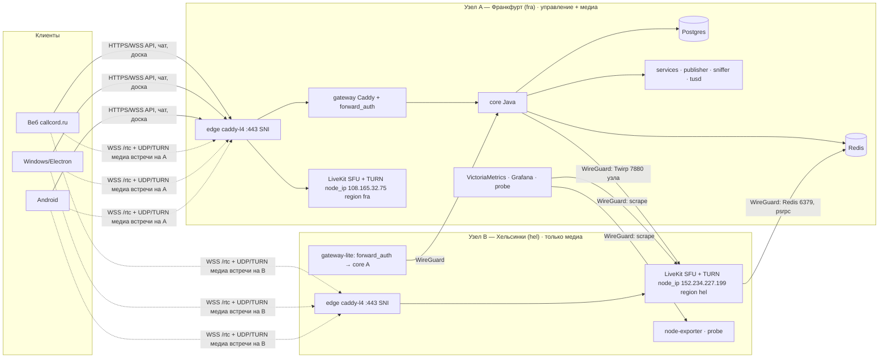

# Распределённая медиасеть Cord: Франкфурт + Хельсинки и дальше (R195)

Статус: **исследование, замеры и проектирование**. Ничего в проде не менялось. Дата: 07.11.2026, автор — архитектор
R195. Основа — `docs/load/2026-11-02-load-report.md` §9–11 (целевая архитектура T09); этот документ её уточняет
под реальные два узла и под новые требования владельца (callcord.ru, VPN, «убрать выбор сервера»).

**Продолжение (R200, 08.11.2026) — `server-selection.md`:** «Авто» и ручной выбор узла с флагами и загрузкой, политика
«когда встреча переезжает» (только отказ узла и рука создателя), плановый переезд без разрыва (make-before-break),
отказ узла за ≤ 8 с, **один домен `cordcam.ru` вместо `callcord.ru`** (владелец: «всё переходит на один — cordcam.ru,
вообще все сервера»), инструкция по Cloudflare и инструкция для GPT `rollout-cordcam.md`. Где ниже написано
`callcord.ru`, читать `cordcam.ru`; схема имён `rtc-<узел>.`/`turn-<узел>.` та же.

Пометки по всему тексту: **[измерено]** — снято руками на A и B 07.11.2026; **[код]** — прочитано в исходниках с
файлом и строкой; **[источник]** — прочитано в чужой документации/блоге, ссылка в конце; **[оценка]** — расчёт или
допущение, которое ещё предстоит проверить.

---

## Поправка 08.11.2026 (R195, реализация): что изменилось после замеров 07.11

Замеры 07.11 между A и B (`tcpdump` на обоих концах, не ICMP) опрокинули две посылки §5:

| Замер | Следствие для проекта |
|---|---|
| **UDP B→A**: от 0,5 Мбит/с на любом порту (51999, 443, 3478, 7882, 51820) доходят ровно 32–33 пакета, дальше — ничего; при ≤ 0,2 Мбит/с всё доходит. **UDP A→B**: 5 и 20 Мбит/с коротко чисто, 25 Мбит/с — потери 22 %, длинные прогоны на 20 Мбит/с через секунды падали в ~99 % потерь (один раз — сразу после всплеска 50 Мбит/с, пришло 2,2 Мбит/с): фильтр перед A умеет блокировать на минуты. Это **DDoS-фильтр хостера A** (трасса: `protected-by.zero-loss.net`); владелец: обе машины — VPS, фильтр хостер не снимет. | **WireGuard между A и B работать не будет** (§5.5 отменён). Межузловая плоскость управления — только **TCP**: TCP A→B 55 Мбит/с, B→A 136 Мбит/с (с ретрансмитами, но живой). Магистраль — **mTLS-туннель на `caddy-l4`** (тот же образ, что edge): один порт 7443/tcp на узле, маршрутизация по SNI, клиентский сертификат обязателен. Проверено на B 08.11: без сертификата — `certificate required`, чужой SNI — обрыв, Redis через туннель — PONG. Переход на WireGuard на чистой сети — замена одного файла `backbone.json`: локальные порты служб те же (§5.5′). |
| ICMP на A ограничен 3 пакетами/с — «40 % потерь пинга» §1 — артефакт, не потери. | §1.1 подтверждён. |
| Код LiveKit 1.13.6: с `RedisRouter` **каждое** сигнальное сообщение участника (offer/answer, ICE-кандидаты, подписки, активные говорящие) идёт `StartParticipantSignal → psrpc RelaySignal → Redis` — и тогда, когда комната на том же узле, что принял сокет; локального короткого пути в открытом коде нет. | Утверждение §5.3 п. 3 «psrpc-ретрансляция в горячем пути не участвует» — **неверно**. С Redis во Франкфурте каждое сигнальное сообщение финна ходило бы через фильтр A дважды (+≈ 90 мс), а блокировка фильтром на минуты делала бы B **мёртвым для входов и восстановлений** при живом медиа. |

**Решение: узлы — независимые SFU, маршрутизирует ядро.** Каждый узел — свой LiveKit **без Redis** (одноузловой режим, `LocalRouter`): сигнал участника и медиа — на одном узле, ни одного межузлового хопа в горячем пути. «Кластер» живёт в ядре: `RoomState.mediaNode` (уже объявлено источником правды в §5.2) решает, на какой узел идут токены (`MediaToken.url` узла комнаты), Twirp-вызовы (`ListParticipants`, `RemoveParticipant`, `MutePublishedTrack`, `DeleteRoom`) и проверка `forward_auth` (узел передаёт `X-Media-Node`, ядро сверяет с узлом комнаты — токен комнаты с A не открывает сокет на B). Явный `CreateRoom` (§5.3 п. 2) не нужен: гонка «кто создал первым» существовала только пока узел мог выбрать LiveKit; теперь узел назначен до того, как кто-либо получил URL. Это та же модель, что у Discord (голосовые серверы независимы, назначает управляющая плоскость) и Zoom (MMR). Что теряем: `RemoveDeadNodes`/статистику узлов LiveKit через Redis — вместо них ядро само опрашивает узлы (`ListRooms` раз в 5 с по магистрали, `cord_node_up{node}`), и `regionaware`-селектор — не нужен.

**Отказ узла** (§5.3 п. 4, уточнение): ядро, не достучавшись до узла ≥ 10 с (три опроса подряд), **переназначает** `mediaNode` всем открытым комнатам этого узла на лучший живой узел, переводит их людей в `RECOVERING` и шлёт `room.changed`; клиенты в окне восстановления берут новый токен (`/token` зовётся на каждую попытку `connect` — `web/src/media/session.ts:1703`) и приходят на новый узел. Ссылка, чат, права — те же. Узел вернулся — комнаты назад не ездят.

**Реестр узлов** — файл `infra/generated/nodes.json` на A (его пишет `scripts/node-config.mjs`), ядро перечитывает его раз в 10 с: добавить узел или снять его с размещения (`enabled: false` — дренаж перед выкаткой) можно без перезапуска ядра. Файла нет — ядро работает как раньше: один неявный узел из `LIVEKIT_URL`/`LIVEKIT_INTERNAL_URL`.

Остальное — §0, §2, §4 (выбор (a)), §5.4 (клиентский замер пути), §5.6–5.7 (имена, TLS, TURN на каждом узле), §6 (VPN), §7 (клиенты без выбора сервера) — в силе. Где ниже написано «WireGuard»/«WG», читать «магистраль» (§5.5′); где «кластер LiveKit через Redis» — «независимые узлы, реестр в ядре». Пошаговая выкатка для другого агента — `docs/architecture/rollout.md` (R198).

### Что сделано и измерено к 08.11.2026 (ветка `release/r195-infra`)

**Код.** Узел как код: `compose.node.yaml`, `infra/Caddyfile.node`, `scripts/node-config.mjs` (реестр
`infra/generated/nodes/registry.json`, файлы узла, внутренний ЦС и `backbone.json` обеих сторон), `backlog/bin/node.sh`
(`bootstrap|deploy|check|drain|undrain`), `active-meetings.sh --node`. Ядро: `nodes.MediaNodes` (реестр, выбор,
дренаж, полнота), `RoomState.mediaNode`, токены и Twirp на узел комнаты, `X-Media-Node` в `forward_auth`,
`media.NodeHealth` (опрос раз в 5 с, три промаха — переезд комнат `MediaService.evacuate`), `capabilities.nodes`,
метрики `cord_node_up/rooms/choice`, алерты `NodeDown`, `NodeScrapeDown`, `NodeSingle`, `NodeHostStalled`. Веб:
`media/node-probe.ts` (§5.4), `preferredNode` при создании, лестница §6.3 (отпечаток сетей раз в 10 с всю встречу →
resume; входящее молчание 3 с при живом соединении → resume; смена `mediaNode` в снимке → переподключение к новому
узлу), «Узел встречи» в настройках и диагностике; выбор сервера убран из веба и клиента Windows (окно «Серверы»,
автоподключение, пинг соседей, `/catalog/load`). Подробно — `rollout.md` и `backlog/journal/2026-11-08-r195-nodes.md`.

**Измерено на узле B (два headless Chrome на самом B, временное ядро на B, 08.11.2026):** замер пути выбрал `hel`
(TCP 17 мс до hel, до «fra» ответа нет); ведущий — медиа подключено через **2,1 с** после нажатия «Начать встречу»,
гость — **1,3 с** (цель §6.6 p95 ≤ 2,5 с — в этом прогоне выполнена; p95 по многим входам не мерили); остановка SFU узла →
клиенты в «восстанавливаем» через 9,4 с (SDK), ядро объявило узел мёртвым через 14,6 с и переселило комнату, звук у обоих
снова через **15,5–15,6 с** (цель ≤ 20 с выполнена). Магистраль mTLS на `caddy-l4` проверена между контейнерами на B; пара
A–B вживую — шаг главной сессии (`rollout.md` §5).

**Бюджет скорости (требование владельца «система должна быть очень быстрой»).** Замер идёт на главной в фоне, как только
получены `capabilities`; «Создать встречу» ждёт идущий замер **не дольше 400 мс** (`JOIN_BUDGET_MS`), готовый результат
не ждёт вовсе; кэш 60 с, последний выбор — сутки на устройстве. Один замер — 4 коротких запроса и один STUN на узел,
≤ 1,5 с на плохой сети (таймауты), узел без ответа считается далёким. Входящим замер не нужен.

**После ревью 08.11 (R195).** Молчание пути меряется **не по RTP** (в тихой встрече SFU не пересылает заглушённые
дорожки, `adaptiveStream` ставит видео на паузу), а по STUN-счётчикам выбранной пары кандидатов
(`requestsReceived + responsesReceived`) за окно 6 с, скрытая вкладка не считается, эпизод снимает только увиденная
жизнь (`web/src/media/silence-watch.ts`). Клиент переезжает по росту счётчика `Snapshot.mediaMoves`, а не по смене имени
узла; `relocate` не останавливает дорожки (`disconnect(false)`), начинает окно восстановления заново и перезапускает
идущий `start`. Ядро игнорирует реестр, чей узел управления ≠ `NODE_ID` (ошибка в журнале, `cord_node_registry_ignored`,
алерт `NodeRegistryIgnored`), полный узел по предпочтению не берётся, опрос здоровья — таймаут 1 с, переселение комнат с
мёртвого узла повторяется каждый проход. Замер пути для «Создать встречу»: устаревший или запомненный выбор отдаётся
сразу, замер освежается в фоне; ожидание ≤ 400 мс — только когда выбора нет вовсе.

**Поправки к §5.4 по замеру.** (1) Без NAT (публичный адрес на самой машине) Chrome не создаёт `srflx`-кандидата,
совпадающего с `host`, и проба считает UDP закрытым — выбор идёт по TCP; у домашних пользователей за NAT этого нет, медиа
всё равно идёт по UDP. (2) Ядро пишет в журнал `room … on node <id> (<причина>; asked …; measured […])` и метрику
`cord_node_choice_total{node,reason}` — по ним видно, работает ли замер у людей.

**Не сделано (осознанно, ждёт решений владельца или DNS):** §7.4 — редирект `cord.nikg.tech → callcord.ru` с переносом
настроек и новый каталог клиента Windows; §7.5 — `cordcam.ru`/`meet.nikg.tech`; перевод B в `strict` (нет записей DNS);
Grafana-панель «Узлы» (метрики есть); `probe` (куратор) на узлах; кнопка «Пересоединиться ближе» (§6.4 п. 6).

**Клиент Windows: канал обновлений и `deploy/cordcam`.** Клиент получает обновления с канала своей сборки
(`CORD_UPDATE_CHANNEL`, по умолчанию `<сервер>/downloads/windows/desktop/`), а не с сервера встреч; убранный выбор сервера
этого не меняет. Основная сборка — канал `cord.nikg.tech`, после переезда — `callcord.ru` (одна выкатка `publish-windows.sh`
на новый адрес, старый канал оставить зеркалом до конца переходного периода). Ветка `deploy/cordcam` собирает клиент для
отдельной установки cordcam со **своим** каналом и ключами; если cordcam становится узлом `msk`, этот канал исчезает вместе
с установкой — последний выпуск `deploy/cordcam` должен указывать на основной сервер и ключи (`rollout.md` §8 п. 4), иначе
его пользователи останутся без обновлений.

### 5.5′ Магистраль между узлами: mTLS по TCP на `caddy-l4`

- На каждом узле контейнер `backbone` (`livekit/caddyl4`, тот же образ, что edge): **серверная** сторона слушает `:7443/tcp` и пускает только соединения с клиентским сертификатом нашего внутреннего ЦС (`mode: require_and_verify`), маршрутизируя по SNI вида `<служба>.<узел>.cord` на локальный порт службы; **клиентская** сторона слушает на `127.0.0.1:<порт>` и дозванивается до `7443` соседа с клиентским сертификатом и этим SNI. Службы ничего о туннеле не знают: ядро на A зовёт Twirp узла `hel` как `http://127.0.0.1:17880`, LiveKit на B шлёт вебхуки в `http://127.0.0.1:18090/internal/livekit`, `forward_auth` на B ходит в `127.0.0.1:18080`, VictoriaMetrics на A скрапит `127.0.0.1:16789`/`19100` узла.
- Что ходит по магистрали: Twirp (ядро → узел), вебхуки и `forward_auth` (узел → ядро), метрики (A → узел). **Медиа и сигнал участников — никогда.** Redis по магистрали не ходит (узлы без Redis).
- ЦС: `scripts/node-config.mjs` заводит его один раз на A в `.local/backbone/ca.{crt,key}` (0600, вне git), выпускает сертификат узла с SAN `*.<узел>.cord` и `extendedKeyUsage=serverAuth,clientAuth`; на узел уезжают только `ca.crt`, свой `crt` и `key`. Срок — 825 дней; перевыпуск — тот же скрипт с `--renew`.
- Брандмауэр: `7443/tcp` на A — только с адресов узлов, на узле — только с адреса A. Всё остальное межузловое закрыто.
- Переход на WireGuard, когда появится чистая сеть: `backbone.json` клиентской стороны меняет `dial` с `<ip>:7443`+TLS на `10.77.0.X:<порт>` без TLS (или контейнер заменяется на `wg0` с теми же локальными портами через DNAT); ни ядро, ни LiveKit, ни scrape-конфиг не меняются.

---

## 0. Прямые ответы владельцу

**«Если я в Финляндии, а друг во Франции — каждый подключится к ближайшему серверу, серверы связаны между собой, и
весь трафик идёт так? Или система подберёт один сервер, и мы оба сидим на нём?»**

Второе — и это не компромисс, а то, как устроено у всех крупных, включая Discord:

- Discord **выбирает один медиасервер на весь звонок**: «We pick one SFU instance to host an entire call, and every
  participant connects to that one host» (Discord, 2025) [источник 2]. В 2018-м: «все голосовые каналы гильдии — на
  одном voice-сервере; гильдии назначается наименее загруженный сервер **в её регионе**» [источник 1]. Серверы
  Discord друг с другом медиа одного звонка **не** гоняют. Что у Discord есть — так это сотни точек присутствия
  (с 2025 — edge Cloudflare в 300+ городах), поэтому «ближайший» у них почти всегда рядом с **обоими**.
- Zoom: участник попадает в ближайший ЦОД, встреча — на одном MMR, каскад между MMR — только для очень больших
  встреч [источник 6]. Jitsi каскад умеет (Octo), но и он объединяет близкие регионы в группы (Франкфурт + Лондон),
  чтобы внутри группы не держать несколько мостов на одну встречу, и прямо пишет, что это даёт небольшой рост RTT при общем
  положительном эффекте каскада на больших расстояниях [источник 3].
- LiveKit (наш SFU) в открытой версии каскадировать **не умеет**: «комната должна помещаться на одном узле»
  [источник 4], а межсерверная ретрансляция (mesh) — закрытая часть LiveKit Cloud (§3).

Почему для Финляндия ↔ Франция каскад **не даёт выигрыша по задержке** [оценка на измеренных RTT]. Ретранслятор сам по себе
буфер держать не обязан, поэтому и большого проигрыша нет — но пакеты идут тем же магистральным путём:

| Путь звука «рот → ухо», только сеть, в одну сторону | Один SFU во Франкфурте | Каскад Хельсинки → Франкфурт |
|---|---|---|
| Финн → его ближайший узел | — | 2–5 мс (Хельсинки) |
| узел → узел | — | ≈ 21,5 мс (RTT 43 мс, измерено A↔B) |
| Финн → Франкфурт | ≈ 25–30 мс (43/2 + последняя миля) | — |
| Франкфурт → француз (Париж) | ≈ 6–8 мс | ≈ 6–8 мс |
| обработка на каждом SFU | ≈ 1–3 мс | 2 × (1–3) мс |
| **Итого** | **≈ 32–40 мс** | **≈ 32–40 мс** |

Что каскад мог бы дать по-настоящему: (1) много слушателей по обе стороны океана — по магистрали идёт одна копия вместо N;
(2) грязная последняя миля до далёкого SFU при чистой магистрали — потери восстанавливаются на своём участке (NACK рядом с
человеком). Второе — ровно ваша цель «минимизировать потерю пакетов», но работает лишь там, где потери действительно на
длинном участке; пока это не показал замер (§1), и цена высока: открытый LiveKit каскадировать не умеет, это собственный
медиастек. Discord получил «Франкфурт: пинг −34 %, потери −42 %» **не** от каскада, а от переноса SFU ближе к людям и от
пиринга с провайдерами [источник 2]. Поэтому каскад — решение по будущим замерам потерь (фаза 6), а не исходная архитектура.

**Что даёт второй узел по-настоящему.** Если оба в Финляндии (или в Петербурге/Прибалтике), встреча живёт в Хельсинки:
RTT до сервера ≈ 5–15 мс вместо 45–55 → звук приходит на ≈ 40 мс раньше у каждого, видео — на 1–2 кадра, а главное —
меньше стыков между сетями, на которых теряются пакеты. Для москвича Хельсинки тоже ближе Франкфурта (≈ 20–25 мс
против 39 [оценка; 39 — замер T09]) — проверить с реального адреса в России.

**«Встреча на инфраструктуре, а не на сервере»** — это именно про то, что мы и строим: человек никогда не выбирает
сервер; система сама ставит встречу на лучший узел для её участников, сама переживает отказ узла (встреча
пересоздаётся на другом за секунды, ссылка та же), сама подбирает путь при VPN и смене сети. Снаружи один адрес —
`callcord.ru`. Трафик **одной** встречи между серверами не гоняется — и не должен.

**«Убрать возможность выбора сервера»** — да, во всех трёх клиентах (§8). Остаётся только показ «Узел встречи:
Хельсинки · 12 мс» в диагностике.

**Anycast «как у Discord»** — нам не нужен и не по карману: свой ASN + арендованный /24 + BGP-сессии у двух
хостеров (≈ $8–10 тыс. за блок плюс членство RIPE) [источник 7, T09 §9]. И у самого Discord **anycast для медиа
нет**: они переходили на edge Cloudflare, где его делает Cloudflare. Для 2–10 VPS правильный аналог —
**клиент сам измеряет путь до каждого узла и говорит, где создать встречу** (как это делают LiveKit Cloud и Discord
на уровне клиента). Так же поступим мы (§6.4), а GeoDNS/геобазы не используем вовсе: узел B геобазы кладут в Орем,
Юта [измерено по данным владельца], хотя физически он в Хельсинки (трассировка заканчивается на
`core01.hel2.fi.aurologic.net` [измерено]).

---

## 1. Что измерено между A (Франкфурт) и B (Хельсинки) 07.11.2026

| Что | Результат | Пометка |
|---|---|---|
| RTT A→B ICMP, 60 проб, 0,5 с | **min 41,0 / avg 42,7 / max 59,2 мс, stdev 2,8; потерь 0 %** на конечном узле | измерено (`mtr -c 60`) |
| RTT B→A ICMP, 20 проб, 0,2 с | avg 42,5 мс, **потерь 40 %** | измерено (`ping`) |
| Трасса A→B | A → AS58212 (dataforest, фильтр `protected-by.zero-loss.net`) → GTT → Arelion (Twelve99, Франкфурт–Гамбург–Стокгольм–Хельсинки) → AS30823 aurologic hel1/hel2 → B; 16–18 прыжков | измерено |
| Трасса B→A | B → AS31500/AS49418 → AS6762 (Sparkle) → NTT Амстердам → NTT Франкфурт → AS58212 → A; 14 прыжков | измерено |
| Где «теряются» пробы | 40 % — на первом прыжке **обеих** ВМ (шлюз гипервизора); 48–53 % — на прыжках AS58212 (DDoS-фильтр перед A); промежуточные магистральные прыжки — 0–2 % | измерено |
| Path MTU A→B | **1434** (ядро A закэшировало `mtu 1434` после ICMP «fragmentation needed») | измерено (`ip route get`) |
| Path MTU B→A | 1476 (`ping -M do -s 1452` отклонён локально, 1406 проходит) | измерено |
| UDP/TCP пропускная способность, джиттер, потери на реальных скоростях, 5–10 мин | **не измерено**: запуск iperf3 с прод-стенда остановлен автоматическим классификатором разрешений («вмешательство в рабочую нагрузку»). Нужно разрешение владельца/координатора или запуск владельцем (команды — §1.2) | не измерено |
| Узел B | Ubuntu 22.04.5, ядро 5.15, KVM, 2 vCPU QEMU @3,09 ГГц, 3,8 ГиБ, swap нет, диск 59 ГБ (54 свободно), MTU 1500, адрес /32 через 10.0.0.1, DNS 1.1.1.1/8.8.8.8, Docker нет, ufw нет, открыт только 22/tcp; модуль WireGuard в ядре есть, `wireguard-tools` в репозитории есть; `rmem_max/wmem_max` 212 992 (мало для SFU); NTP активен, TZ Europe/Helsinki | измерено |
| Узел A | ens3 MTU 1500, ufw: 22/80/443/7881 tcp, 7882/3478 udp открыты; 7880/8080/8090/8091/5432/6379/5349 закрыты; модуль WireGuard есть, `wg` не установлен | измерено |
| Живые встречи во время замеров | нет (`backlog/bin/active-meetings.sh` из `/opt/ModernStreamingSystem`) | измерено |

### 1.1 Вердикт по «25 % потерь ICMP»

С высокой вероятностью это **артефакт измерения, а не потери медиа**: (1) ICMP A→B на конечном узле — 0 % из 60;
(2) потери в трассе сидят ровно на хопах DDoS-фильтра хостера A (`zero-loss.net`) и на шлюзах гипервизоров,
которые ограничивают частоту ICMP-ответов; магистраль (Arelion, NTT, GTT) чистая; (3) UDP-пробы `mtr -u` на последнем
хопе «теряются» на 73 % потому, что Linux ограничивает ICMP «port unreachable» до одного в секунду
(`icmp_ratelimit`), а не потому, что UDP не дошёл. Но **доказательством** это станет только после UDP-теста с
реальными пакетами (§1.2). До него полоса B и честные потери — неизвестны, и это первый пункт фазы 0.

### 1.2 Что нужно дорешить замером (фаза 0, ≈ 30 минут, без встреч на A)

```bash
# на B (сервер): iperf3 -s -D         # потом: pkill iperf3
# на A (клиент), пакеты как у RTP (1200 байт), 5 минут, обе стороны, не выше 50 Мбит/с:
iperf3 -c 152.234.227.199 -u -b 20M -l 1200 -t 300 -i 30        # A → B
iperf3 -c 152.234.227.199 -u -b 20M -l 1200 -t 300 -i 30 -R     # B → A
iperf3 -c 152.234.227.199 -t 30 ; iperf3 -c 152.234.227.199 -t 30 -R   # TCP, cubic
```

Критерии: потери **< 0,1 %**, джиттер **< 5 мс**, TCP ≥ 200 Мбит/с в обе стороны (иначе B — узел на 1–2 комнаты).
Пока нет встреч — можно 20–50 Мбит/с; при живых встречах — 5 Мбит/с.

### 1.3 DNS на момент 07.11.2026 22:38 MSK [измерено]

- `callcord.ru`: **в реестре .ru NS = `statuspage1.nic.ru`, `statuspage2.nic.ru`** (парковка nic.ru), резолверы
  кэшируют `ns3/ns4/ns8.nic.ru`, `A = 178.210.92.188` (парковочная страница). Делегирование на Cloudflare **ещё не
  вступило в силу** — либо смена NS у регистратора не завершена/не подтверждена, либо домен в статусе без DNS-услуги.
  Владельцу: в панели nic.ru проверить, что у домена стоят ровно два NS от Cloudflare (`*.ns.cloudflare.com`) и
  домен не заблокирован; после этого `dig NS callcord.ru @a.dns.ripn.net` должен показать Cloudflare. До этого
  никакие записи в Cloudflare снаружи не видны.
- `turncord.com`: **NXDOMAIN в реестре .com** — домен не делегирован (не зарегистрирован или без NS). Для
  архитектуры он **не нужен**: имя хоста B может быть любым, все имена живут под `callcord.ru` (§6.6). Рекомендую
  переименовать хост в `hel.callcord.ru` и забыть про turncord.com.
- `cord.nikg.tech`, `turn.cord.nikg.tech` → 108.165.32.75 (DNS only, Cloudflare NS `earl`/`poppy`). Работает как
  прод до переезда.

---

## 2. Как это делают другие — факты, а не фольклор

| Кто | Одна встреча = один сервер? | Как попадают «на ближний» | Каскад между серверами | Что берём |
|---|---|---|---|---|
| **Discord** [1, 2] | Да: один SFU на звонок; все каналы гильдии — на одном voice-сервере региона, выбор по загрузке | клиент/сервис выбирает регион; с 2025 — edge Cloudflare 300+ городов, выбор по пирингу, **не anycast** | нет | модель «комната = один узел региона», выбор узла по загрузке, честная работа с пирингом |
| **Zoom** [6] | Да (MMR внутри Meeting Zone) | геолокация → ближний ЦОД → наименее загруженный MMR | только для очень больших встреч | коммутация по размеру плитки (T09) |
| **Google Meet** | SFU в регионах Google, VP9 SVC; подробности закрыты | ближний edge Google | каскад по магистрали Google (не раскрыт) | SVC одним кодировщиком (T09 §12) |
| **Jitsi (Octo)** [3] | Нет — умеет каскад | `RegionBasedBridgeSelectionStrategy` по региону клиента | да, secure-octo (ICE/DTLS/SRTP между JVB); **внутри близких регионов сокращён группами регионов — RTT рос** | урок: каскад в радиусе ≈ 1500 км вреден |
| **LiveKit Cloud** [4, 5] | Нет — «distributed mesh», relay — закрытый код | клиентский SDK меряет RTT к регионам (`RegionUrlProvider`, только для `*.livekit.cloud`) | да, проприетарно | идею клиентского замера; код SDK для своего домена не годится (§3) |
| **LiveKit OSS 1.13.6** [4, код] | Да: «A room must fit on a single node» | Redis + `node_selector: regionaware` + «Geo or latency aware DNS (Route53, Cloudflare)» | нет | это наш SFU — используем как есть |
| **Cloudflare Realtime** [8] | Нет — anycast + деревья ретрансляции по дорожкам | anycast BGP (их сеть) | да | не для нас: платно за ГБ, доступность из РФ не гарантирована, другой домен в CSP (T09 §10 D) |
| **mediasoup** [9] | Нет — `pipeToRouter` между воркерами и хостами | своя логика | да, но ключевые кадры и повторы — вручную, «есть штраф задержки» | нет: второй медиастек, другой клиентский SDK |
| **Janus, Ant Media, Pion-мосты** | Janus — RTP forward без состояния; Ant Media — проприетарный кластер; на Pion мост пишется руками | — | ограниченно | нет: не лучше варианта (c) на Go SDK LiveKit |

Вывод по индустрии: для оператора с 2–10 VPS в Европе и СНГ правильная модель — **региональные узлы, встреча целиком
на одном узле, узел выбирает система по измеренному пути, без ручного выбора**. Каскад — инструмент для больших
трансляций и межконтинентальных встреч, не для качества разговора вдвоём.

---

## 3. Что умеет LiveKit 1.13.6 с открытым кодом [код, тег v1.13.6, `3cfbd12`]

- **Многоузловой режим через Redis**: `RedisRouter` держит в Redis карту «комната → узел» (`pkg/routing/redisrouter.go:100-114`,
  `GetNodeForRoom`/`SetNodeForRoom`), регистрацию и статистику узлов (`:69-98`, `RegisterNode`, `RemoveDeadNodes`),
  и перебрасывает сигнальный WebSocket на узел комнаты через psrpc (`StartParticipantSignal`, `:162-170`;
  `pkg/routing/signal.go:75-105`, `RelaySignal`). Это **ретрансляция сигнала**, не медиа: медиа всегда идёт прямо на
  узел комнаты (`rtc.node_ip`).
- **Размещение комнаты**: `pkg/service/roomallocator.go:136-167` — если комнаты нет или её узел мёртв, селектор
  выбирает новый узел и пишет его в Redis. `regionaware` (`pkg/routing/selector/regionaware.go:25-33, 70-95`)
  выбирает узлы **ближайшего к себе региона** (регион того узла, который обрабатывает запрос), среди них — по
  загрузке `sysload_limit`. Конфигурация: `region`, `node_selector.kind/sort_by/sysload_limit/regions[{name,lat,lon}]`
  (`pkg/config/config.go:94-98, 302-325, 578-584`); умолчание `kind: any, sort_by: random`.
- **Ретрансляции медиа между узлами нет**. Поле `"relayed": false` в наших журналах — это `IsRelayed` трека
  (`pkg/rtc/mediatrackreceiver.go:121,161,572`), которое в открытом коде задаётся **ровно в одном месте и всегда
  `false`**: `pkg/rtc/mediatrack.go:127`. Больше его никто не устанавливает — поле существует ради закрытого
  mesh-кода LiveKit Cloud, где трек может прийти с другого SFU [источник 5].
- **Переноса живой комнаты между узлами нет**: при смерти узла комната пересоздаётся на другом при следующем входе
  (`roomallocator.go:142-158`: узел недоступен → новый выбор), клиенты переподключаются сами.
- **Клиентский SDK 2.22.4**: `RegionUrlProvider` и `/settings/regions` работают только для адресов LiveKit Cloud
  (`isCloud(serverUrl)`, `livekit-client.esm.mjs:14571-14575, 26303`) — для `callcord.ru` замер узлов пишем свой.
- **Как сейчас у нас**: один узел, `redis.address 127.0.0.1:6379`, `rtc.node_ip 108.165.32.75`, `use_external_ip:
  false`, TURN встроенный (`turn.domain turn.cord.nikg.tech`, UDP 3478, TLS снимает edge на 443), `deny_peer_cidrs`
  разрешает релей **только на собственный IP** [код: `infra/generated/livekit.json`]. Ядро ходит в SFU одним
  адресом (`StreamProperties.livekitInternalUrl`) и выдаёт клиенту **один** `livekitUrl`
  (`server/.../media/MediaGateway.java:19-41`); комнаты в SFU создаются неявно первым входом — ядро `CreateRoom`
  не зовёт [код: grep по `server/src`].

---

## 4. Варианты и выбор

| | (a) Региональное размещение: комната на одном лучшем узле | (b) Пограничные TURN рядом с людьми + магистраль к SFU комнаты | (c) Настоящий каскад SFU (мост на Go/Pion или замена LiveKit) | (d) Многоузловой LiveKit через Redis/psrpc |
|---|---|---|---|---|
| Задержка FI↔FR | как один SFU (≈ 32–40 мс сети) | + 1 прыжок TURN, выигрыша по пути нет | без выигрыша (§0) | как (a) |
| Задержка FI↔FI | ≈ 5–15 мс RTT (узел рядом) | 45–55 мс (комната всё равно во Франкфурте) | ≈ 5–15 мс | как (a) |
| Потери | меньше стыков сетей для «локальных» встреч | лучше только если магистраль чище последней мили — не доказано | каждый прыжок добавляет место для потерь, восстановление (NACK/PLI) через 2 узла | как (a) |
| Что менять | ядро: список узлов, узел комнаты в `RoomState`; клиенты: замер и отказ от выбора | coturn на каждом узле, маршрутизация релея по WG; клиент: выбор TURN по RTT | новый сервис-мост (подписка в комнате A → републикация в B), потеря simulcast-слоёв, PLI через мост, идентичности участников в двух комнатах, чат/права в ядре на две комнаты; месяцы | конфигурация LiveKit + Redis на WG; **именно это и есть механизм, которым реализуется (a)** |
| Отказ узла | комната пересоздаётся на другом за секунды | SFU один — его отказ = всё | сложнее вдвое | как (a) |
| Расширение до 3–4 узлов | +1 compose-узел, +1 запись в списке узлов | +1 TURN | +N мостов | как (a) |
| Риск | низкий: всё — документированные механизмы LiveKit | низкий, но пользы почти нет | **высокий**, собственный медиастек | низкий |

**Выбор: (a), реализованное через (d)** — один кластер LiveKit на двух (потом N) узлах с Redis на A, комната целиком
на одном узле, **узел для новой встречи выбирает её создатель измерением пути**, остальные входят на узел комнаты.
TURN — встроенный LiveKit на **каждом** узле (это и есть «пограничный TURN рядом с людьми» из (b), но без отдельной
магистрали для медиа). Каскад (c) — не сейчас и не для разговоров: он остаётся в плане T09 §10 только для эфиров на
тысячи зрителей, отдельным сервисом, когда такие эфиры появятся.

Что не берём и почему: замена LiveKit на mediasoup/Janus (второй стек, другой SDK, потеря всего, что сделано в
`web/src/media` за два месяца); GeoDNS/Cloudflare Load Balancing (геобазы ошибаются — узел B уже «в Юте»; VPN делает
геолокацию бессмысленной; платно; клиентский замер точнее и бесплатен); anycast (§0).

---

## 5. Целевая картина



Одна встреча = один узел. Управление (ядро, база, Redis, службы, загрузки, музыка, кинозал) — на A, одно на всю сеть.
Между узлами — WireGuard. Снаружи — только `callcord.ru` и имена узлов для медиа.

### 5.1 Состав узлов

| Контейнер | A (управление + медиа) | B (медиа) | Узлы 3, 4 … |
|---|---|---|---|
| edge (caddy-l4, TLS, SNI) | да: `callcord.ru`, `fra.callcord.ru`, `rtc-fra`, `turn-fra` | да: `hel.callcord.ru`, `rtc-hel`, `turn-hel` | да |
| gateway (Caddy, веб-статика, `forward_auth` на `/rtc`) | полный | **lite**: только `/rtc*` с `forward_auth` → `http://10.77.0.1:8080` (ядро A по WG) и редирект всего остального на `https://callcord.ru` | lite |
| core, postgres, redis, tusd, services, sniffer, publisher | да | нет | нет |
| livekit (SFU + TURN) | да, `region: fra` | да, `region: hel`, `redis.address: 10.77.0.1:6379` | да |
| node-exporter, probe (`cord-publisher --probe` в комнату `cord-probe-hel`) | да | да (профиль monitoring) | да |
| WireGuard (`wg0`, 10.77.0.0/24) | 10.77.0.1 | 10.77.0.2 | .3, .4 |

Образы на B — только публичные (`livekit/livekit-server`, `livekit/caddyl4`, `prom/node-exporter`) и наш образ служб
для `probe`; сборки на B нет. Файлы на B: `compose.node.yaml`, `infra/generated/nodes/hel/{edge.json,livekit.json}`,
`.env.node` (0600). Всё это кладёт с A скрипт выкатки (§6.9).

### 5.2 Плоскость управления: одна, на A

- **Postgres, Redis, ядро, tusd, службы — один экземпляр на A** (фазы 1–3). Межузловая реплика Postgres на B не
  делается: B — 2 vCPU/3,8 ГиБ без swap, и 43 мс на каждую запись убили бы вход (T09 §9: «кросс-ЦОД Postgres
  намеренно не делаем»).
- **Если умирает A** — Cord недоступен целиком, как сегодня: встречи на B продолжают идти **пока жив медиапоток**
  (LiveKit на B не зависит от ядра для пересылки пакетов), но вход, чат, права, экран, игры — всё через ядро — не
  работают, и новые входы невозможны. Это честная граница фаз 1–3. Фаза 4 даёт A горячий резерв (§10).
- **Если рвётся WireGuard/Redis для B**: LiveKit на B перестаёт обновлять статистику в Redis → селектор исключает его из
  новых размещений (`RemoveDeadNodes`, `IsAvailable`); идущие комнаты на B продолжают медиа, но сигнальные сообщения
  участников, чьи сокеты ядро направило на B, ходят напрямую (не через psrpc), так что разговор живёт; ядро не
  может позвать `RemoveParticipant` на B — исключение из встречи сработает после восстановления (реконсилер
  повторяет). Клиенты видят это не раньше, чем через 20–30 с, если WG не поднялся.
- **Redis без персистентности** (`save ""`, `appendonly no` [код]) допустим: карта «комната → узел» в Redis —
  кэш; **источник правды — ядро** (§5.3), поэтому перезапуск Redis не раздваивает комнату.

### 5.3 Размещение комнаты и её жизнь при отказе

1. Создатель встречи (первый входящий) к моменту нажатия «Войти» уже имеет замер до всех узлов (§6.4) и присылает
   ядру `preferredNode: "hel"` вместе с результатами замера (для журнала).
2. Ядро проверяет, что узел жив и не перегружен (своя таблица узлов + `GET /api/v1/load` каждого узла по WG раз в
   5 с), иначе берёт следующий по замеру, иначе — `fra`. Записывает `RoomState.mediaNode = "hel"`
   (`@JsonInclude(NON_NULL)`, старые образы читают с `ignoreUnknown` — правило уже есть) и **явно создаёт комнату**
   `RoomService.CreateRoom` через Twirp **узла hel** (`http://10.77.0.2:7880`) — аллокатор этого узла с
   `regionaware` выбирает ближайший регион к себе, то есть себя (`regionaware.go:76-95`). Явное создание убирает
   гонку «комнату создал тот, кто первым открыл сокет».
3. Каждому входящему `MediaToken` несёт `url` узла комнаты: `wss://rtc-hel.callcord.ru/rtc`. Сигнал и медиа идут
   **прямо на узел комнаты**, psrpc-ретрансляция сигнала в горячем пути не участвует — зависимости от 43 мс до Redis
   у разговора нет.
4. **Узел умер.** Ядро видит это за ≤ 10 с (нет `load` от узла, вебхуки LiveKit молчат, `ListParticipants` на узле
   падает) и сбрасывает `mediaNode`. Клиенты по своему окну восстановления (`reconnect-plan.ts`: resume 1–2 с, затем
   `connect` с новым токеном) приходят в ядро; первый из них становится «создателем» снова — комната пересоздаётся на
   другом узле **с той же ссылкой и тем же `RoomState`** (чат, права, доска — в ядре, не в SFU). Цель: звук возвращается
   у всех за **≤ 20 с** от падения узла (ожидание; замерить в фазе 2 убийством контейнера на B).
5. **Переезд живой комнаты** между узлами не делаем (в OSS его нет; это разрыв у всех на 2–5 с ради одного человека,
   см. §7.5).

### 5.4 Как клиент выбирает узел — только измерением пути

«Локация» для нас — **не география, а сетевой путь**: откуда и как сейчас идут пакеты. Геобазы, язык, часовой пояс не
участвуют. Процедура (`web/src/media/node-probe.ts`, новый модуль; Electron и Android используют тот же код веба):

1. Ядро отдаёт в `capabilities` список узлов: `{id, title, rtcUrl, probeUrl, stun: "stun:rtc-hel.callcord.ru:3478"}`
   (из своей таблицы узлов, живые — впереди).
2. На экране до входа (предпросмотр/«Войти») и не чаще раза в 60 с клиент меряет **каждый** узел параллельно:
   - **TCP RTT**: 3 × `fetch(probeUrl + '/api/v1/ping', {cache:'no-store'})` после одного прогрева (TLS-рукопожатие не
     считаем), медиана; `connect-src` CSP расширяется ровно на имена узлов из каталога ядра;
   - **UDP открыт?** и **UDP RTT**: пустой `RTCPeerConnection` с одним `iceServers: [{urls: stun узла}]`, время до первого
     `srflx`-кандидата (STUN Binding — это один UDP-пакет туда-обратно); нет кандидата за 1,5 с — UDP до этого узла
     закрыт. Этот же механизм уже есть в `udp-probe.ts` — переиспользуется.
3. Выбор: среди узлов с открытым UDP — минимальная UDP-медиана; если UDP закрыт везде — минимальный TCP RTT (медиа
   пойдёт через `turns:` 443 этого узла). **Гистерезис**: узел меняется относительно прошлого выбора только если новый
   лучше **и на ≥ 15 мс, и на ≥ 30 %**; при разнице меньше — остаётся прежний. Результат и сырые числа уходят ядру с
   запросом входа (для журнала и метрик `cord_node_choice_total{node,reason}`).
4. Потери и джиттер до узла замерить одним STUN нельзя — их видит **куратор** (`cord-publisher --probe` на каждом
   узле, метрика `cord_probe_*`) и сам звонок (`getStats`). Узел с `ProbeLoss` в алерте ядро понижает в списке.

Этого достаточно для создателя. Для входящих выбор не нужен — они идут на узел комнаты (§5.3 п. 3).

### 5.5 Магистраль между узлами: WireGuard

- `wg0`, подсеть 10.77.0.0/24, порт 51820/udp, на A открыт **только с IP узлов**, на B — только с IP A. Ключи — пара на
  узел, публичные ключи — в репозитории (`infra/wireguard/nodes.yaml`), приватный — только на своём узле (0600).
  `PersistentKeepalive 25` с B (A за DDoS-фильтром).
- **MTU `wg0` = 1360** [по измеренному PMTU 1434: 1434 − 60 байт заголовков WG/IPv4 = 1374, запас на фильтр хостера].
  RTP LiveKit ≤ 1200 байт в теле → в тоннель помещается без фрагментации. Медиа участников по WG **не** идёт; через
  WG — Redis, psrpc, Twirp, forward_auth, метрики. Шифрование — само собой ChaCha20-Poly1305.
- Если провайдер A режет UDP 51820 (DDoS-фильтр) — запасной вариант SSH-туннель на TCP 22 для Redis/Twirp на время
  инцидента; постоянно — нет (head-of-line).

### 5.6 Домены, TLS и Cloudflare (`callcord.ru`)

Принципы: **один вход для людей** — `callcord.ru`; имена узлов — только для медиа и диагностики; **ничего, что несёт
WebRTC или TURN, не проксируется Cloudflare** (оранжевое облако не умеет UDP и ломает TURN/TLS по SNI).

| Имя | Тип | Куда | Облако | Зачем |
|---|---|---|---|---|
| `callcord.ru`, `www` | A | 108.165.32.75 | **серое** (DNS only) в фазах 1–3 | веб, API, WS событий; потом по желанию оранжевое — только если понадобится защита от DDoS; тогда ядру нужен настоящий IP из `CF-Connecting-IP` для rate-limit и `cord_joins_total` |
| `fra.callcord.ru` | A | 108.165.32.75 | серое | диагностика узла, `probeUrl` |
| `rtc-fra.callcord.ru` | A | 108.165.32.75 | серое | WSS `/rtc` + ICE/TCP 7881 + UDP 7882 узла A |
| `turn-fra.callcord.ru` | A | 108.165.32.75 | серое | TURN/TLS 443 по SNI и UDP 3478 узла A |
| `hel.callcord.ru`, `rtc-hel.`, `turn-hel.` | A | 152.234.227.199 | серое | то же для B |
| `msk.`, `rtc-msk.`, `turn-msk.` … | A | узел 3 | серое | по шаблону |
| `cord.nikg.tech`, `rtc.`, `turn.cord.nikg.tech` | A | 108.165.32.75 | серое | переходный период (§8.3), затем удалить |

Каждый узел — режим **`strict`** `edge-config.mjs` со своей тройкой имён (`APP_HOST` узла = `hel.callcord.ru`,
`RTC_HOST`, `TURN_HOST`). **Сертификаты — Let's Encrypt HTTP-01 самим Caddy на каждом узле**, как сегодня: имена
смотрят прямо на узел, токен Cloudflare серверам не нужен. DNS-01 через API Cloudflare понадобится только если
(а) включим оранжевое облако на apex (тогда origin-сертификат либо Cloudflare Origin CA), либо (б) захотим wildcard.
Если понадобится — токен **одной зоны** (§11). AAAA не публикуем, пока IPv6 и стена не проверены (правило
`docs/deployment.md`).

### 5.7 TURN

Встроенный TURN LiveKit на **каждом** узле, UDP 3478 и TLS 443 по SNI через edge узла (как сейчас на A). Клиент
получает `turn:`/`turns:` **узла комнаты** в `JoinResponse` — релей рядом с SFU, лишнего прыжка нет.
`deny_peer_cidrs` сегодня разрешает релей только на собственный IP узла [код]; в кластере оставить так же (релей →
SFU того же узла), а не «на все IP кластера»: сигнал и медиа и так на одном узле (§5.3 п. 3). `per_user_relay_allocation_limit 12`
— без изменений. Проверка — `scripts/turn-relay-check.mjs` против каждого узла в выкатке.

### 5.8 Секреты и их раздача

Общие на кластер: `LIVEKIT_API_KEY/SECRET` (один ключ — требование кластера LiveKit), `REDIS_PASSWORD`,
`LIVEKIT_METRICS_PASSWORD`, `INTERNAL_SECRET` (для `probe`). Свои на узел: приватный ключ WireGuard, сертификаты
(выпускает сам узел). Раздача: `configure.mjs --node hel` на A генерирует `infra/generated/nodes/hel/*` и
`.env.node`, `deploy.sh --node hel` кладёт их по SSH (`rsync -e "ssh -i /root/.ssh/cord_fi"`) с правами 0600 и
перезапускает контейнеры узла. На B нет git, нет токенов GitHub, нет пароля базы, нет ключа каталога. Ключ SSH к B —
только у root A (как сейчас). Смена `LIVEKIT_API_SECRET` = перевыкатка всех узлов (окно без встреч).

### 5.9 Выкатка по узлам и правило «без встреч»

- `backlog/bin/deploy.sh` остаётся местом правды, только из `/opt/ModernStreamingSystem` (из worktree
  `active-meetings.sh` отвечает «стек не поднят» — compose без `.env` не видит проект [измерено]; это стоит
  починить явной проверкой `docker ps`).
- Новое: `deploy.sh --node hel livekit edge` — (1) `active-meetings.sh --node hel` спрашивает ядро, есть ли живые
  комнаты с `mediaNode = hel`; (2) если есть — дренаж узла: ядро перестаёт размещать новые комнаты на hel
  (`POST /api/v1/admin/nodes/hel/drain`), ждём до 15 мин; (3) `rsync` конфигов, `docker compose -f compose.node.yaml
  pull && up -d` по SSH; (4) здоровье: `GET https://hel.callcord.ru/api/v1/ping`, LiveKit `/` на 7880 по WG, `probe`
  зелёный, `turn-relay-check`. Порядок всегда: сначала узлы медиа, потом A (ядро читает новые поля узлов).
- Сборки — только на A и только без встреч (правило сохраняется; B не собирает ничего).

### 5.10 Мониторинг

VictoriaMetrics на A скрапит по WG: LiveKit B (`6789`, тот же пароль), node-exporter B, `probe` B. Новые ряды:
`cord_node_up{node}`, `cord_node_load_level{node}`, `cord_rooms{node}`, `cord_node_choice_total{node,reason}`,
`cord_wg_handshake_age_seconds{peer}`, `cord_probe_*{node}`. Алерты: `NodeDown` (нет `load` 30 с), `BackboneDown`
(рукопожатие WG старше 180 с), `ProbeLoss{node}` (как сейчас, с меткой узла), `NodeSingle` (жив один узел — не
авария, но предупреждение), `NodeUplinkSaturated` (отдача узла > 70 % его `uplink-mbps`). Gatus на B проверяет
`callcord.ru` снаружи Франкфурта (фаза 4). Grafana — панель «Узлы».

### 5.11 Ёмкость узла B [оценка по замерам T09/`docs/capacity.md`]

- SFU: одно ядро ≈ 150–200 Мбит/с пересылки, ≈ 6 МиБ на участника + 57 МиБ. На 2 vCPU (одно ядро — SFU, второе — ОС,
  edge, TURN) B честно вывозит **≈ 150 Мбит/с отдачи**: 2 обычные комнаты по 5–6 человек с камерами (60–100 Мбит/с
  каждая, §3 capacity.md) **или** одна комната на 10–12, **или** ≈ 60 человек в голосе. Память — не предел (SFU
  `mem_limit 1g`, свободно 3,5 ГиБ).
- Канал B **неизвестен** до §1.2. `STREAM_UPLINK_MBPS` узла и `sysload_limit 0.7` в `livekit.json` узла ставим по
  замеру; ядро учитывает `load` узла при размещении и не ставит на него третью комнату.
- ОС B: `net.core.rmem_max/wmem_max` → 16 МиБ, `fq_codel` оставить, `ulimit nofile` для SFU, swap не включать (правило
  MEDIA-DIAGNOSIS), `oom_score_adj` SFU −500, `cpu_shares` как на A.
- `max-rooms` ядра сегодня — число на установку; с узлами становится суммой лимитов узлов (`nodes[].maxRooms`).

### 5.12 Отказы и что видит человек

| Отказ | Что происходит | Что видит | Цель |
|---|---|---|---|
| Умер узел B (или его сеть) | ядро сбрасывает `mediaNode`, клиенты по окну восстановления пересоздают комнату на A | «Восстанавливаем связь» 5–20 с, потом звук; чат/доска не прерывались | ≤ 20 с до звука у всех [ожидание] |
| Умер A | всё недоступно; медиа идущих встреч на B живёт, пока люди не трогают ничего | веб не открывается; в идущей встрече — чат/экран/права не работают, звук идёт | фаза 4 |
| Рвётся WG | B исключается из размещения, идущие встречи на B идут; ядро не может исключать участников на B | ничего, если WG вернётся за минуты | алерт `BackboneDown` |
| B перегружен | `load` узла ≥ 3 → ядро не ставит туда новые комнаты; создатель получает A | ничего | — |
| UDP до узла комнаты закрыт у одного человека | его медиа — через `turns:` 443 этого узла; остальные не затронуты | «Через ретранlaytор TURN · TLS» в диагностике | как сейчас |
| Cloudflare недоступен (DNS) | ничего не меняется — DNS only, TTL 300; медиа и так по IP из уже полученных кандидатов | — | — |
| DDoS-фильтр хостера A режет UDP WG | Redis/psrpc для B пропадают = как «рвётся WG» | — | SSH-туннель как аварийный путь |

### 5.13 Безопасность

- B снаружи: 22 (ключ), 80/443 (edge), 7881/tcp, 7882/udp, 3478/udp, 51820/udp **только с A**; всё остальное — ufw deny.
  7880 (Twirp/WS LiveKit) — только `127.0.0.1` и `10.77.0.2`. A: 6379 и 8080 — только с `10.77.0.0/24` (сейчас `deny`
  снаружи — остаётся), 51820/udp — только с IP узлов.
- `forward_auth` на `/rtc` работает на каждом узле — токен LiveKit без проверки ядром не проходит и на B (правило
  «каждый внешний /rtc проходит forward_auth», `docs/architecture.md`).
- Redis: пароль + bind на `127.0.0.1` и `10.77.0.1`; `protected-mode yes`. Twirp LiveKit подписан API-ключом.
- Имена узлов не являются «входом в продукт»: gateway-lite на B отвечает редиректом на `callcord.ru` на всё, кроме
  `/rtc*` и `/api/v1/ping` (`probeUrl`), чтобы человек не оказался «на другом сайте» с чужим localStorage.
- CSP веба: `connect-src` — `'self'` + имена узлов из каталога ядра (`wss://rtc-*.callcord.ru`, `https://*.callcord.ru`),
  без wildcard на чужие домены.

### 5.14 Стоимость

Фазы 1–3 не требуют новых покупок: B уже есть, WireGuard и Let's Encrypt бесплатны, Cloudflare — бесплатный план
(DNS only), Load Balancing не нужен. Фаза 4 (резерв управления) — одна ВМ 4 vCPU/8 ГиБ (€10–20/мес) или
переезд управления на выделенные ядра (уже в `OWNER-ACTIONS.md` п. 2). Узел 3 в Москве — по T09 §8.4.

### 5.15 Как добавляется третий и четвёртый узел

1. ВМ с публичным IPv4, Ubuntu 22.04/24.04, SSH-ключ root для A. 2. Три записи DNS (`<id>.`, `rtc-<id>.`, `turn-<id>.`
   → IP). 3. `node scripts/configure.mjs --node <id> --ip <IP> --region "<lat>,<lon>"` на A: генерирует ключи WG,
   `infra/generated/nodes/<id>/*`, добавляет узел в `infra/wireguard/nodes.yaml` и в таблицу узлов ядра. 4.
   `backlog/bin/deploy.sh --node <id> bootstrap` — ставит docker, ufw, wg, кладёт файлы, поднимает контейнеры, прогоняет
   проверки. 5. Ядро видит новый узел по `load`, клиенты получают его в `capabilities` без выкатки клиентов.
   Оценка: 1–2 часа на узел после фазы 2.

---

## 6. Локация и VPN: первоклассное требование

> Владелец: «система сто процентов явно должна определять актуальную локацию… человек может включить VPN во время
> встречи или подключиться с VPN уже… система должна максимально устойчиво относиться к любым подобным изменениям».

### 6.1 Что такое «локация» для системы

**Сетевой путь, а не география.** Система действует только по тому, что измерено с устройства человека **сейчас**:
RTT по TCP и по UDP до каждого узла, открыт ли UDP, какой путь выбрал ICE (`host/udp`, `srflx/udp`, `relay/udp`,
`relay/tls`), потери/джиттер/RTT в `getStats`. IP-геолокация не используется ни для чего: под VPN она показывает
точку выхода, узел B она кладёт в Юту, а у человека с VPN во Франкфурте, сидящего в Хельсинки, «правильный» узел
определяется только измерением — им окажется Франкфурт, и это **правильно**, потому что его пакеты идут из
Франкфурта.

### 6.2 Вход с уже включённым VPN

| Случай | Что видит замер (§5.4) | Что делает система |
|---|---|---|
| Полный туннель (весь трафик через VPN-выход) | TCP и UDP RTT считаются от выхода VPN; UDP открыт, если VPN пропускает UDP | узел — ближайший к **выходу VPN**; медиа через UDP; ничего особенного |
| Раздельный туннель (часть адресов через VPN) | `fetch` и STUN могут пойти разными путями; ICE собирает host-кандидаты обоих интерфейсов | решающий замер — **STUN через `RTCPeerConnection`** (тот же механизм, что у медиа), TCP RTT — вторичен; ICE сам выберет рабочую пару с лучшим приоритетом |
| VPN без UDP (WireGuard-over-TCP, VLESS, офисы «только 443») | STUN ни к одному узлу не отвечает за 1,5 с | выбор по TCP RTT; медиа — `turns:` 443 **узла комнаты**; диагностика «Через ретранслятор TURN · TLS» (уже есть, `turn-tls.ts`); вход помечается `path=relay-tls` |
| VPN режет и TLS 443 к незнакомым именам | медиа не встаёт | «Сеть не пропускает звонок» с подсказками (уже есть, R149) |
| Входящий (не создатель) с VPN | замер не нужен — узел задан комнатой | путь к узлу комнаты через ICE/TURN, как выше |

### 6.3 Изменение посреди встречи — как замечаем

Четыре знака уже есть (`reconnect-plan.ts`): `online` браузера (Electron превращает в него свой `network.changed`),
ICE `disconnected` по статистике при **отсутствии** входящих пакетов (R119), возврат на экран, пробуждение из
заморозки (`woke`, E12). Дополнения для VPN:

| Событие | Веб (Chrome/Firefox) | Electron | Android (Capacitor WebView) / iOS Safari | Чем добираем |
|---|---|---|---|---|
| VPN включили/выключили | `online` **часто не приходит**: интерфейс остаётся up; адрес сменился; ICE-пара мёртвая, SDK «connected» | `network.changed` по смене адресов (есть) | `ACCESS_NETWORK_STATE` (есть, R147); Safari молчит | **отпечаток своих сетей** (`local-networks.ts`) — опрашивать не только «пока путь плохой», а всегда раз в 10 с во встрече (ни пакета в сеть), плюс сразу при **входящем молчании ≥ 1 с** |
| Wi-Fi → LTE | `connection.change`/`online` (Chrome Android) | `network.changed` | Android — есть; iOS — отпечаток | как выше |
| Сменился IP без события | тишина | тишина | тишина | «входящее молчание»: `inbound-rtp` без новых пакетов 1 с при живом сигнале → resume |
| Путь ухудшился без события (потери/RTT растут) | `getStats` раз в 2 с (уже читается) | то же | то же | тренд 30 с: потери > 5 % или RTT вырос вдвое при `relay/tcp|tls` → `path-retry` (есть); при UDP — один ICE restart на эпизод (новое) |

### 6.4 Что делаем дальше — лестница, снизу вверх

1. **`resume`** (SDK: новый сигнальный сокет + ICE restart, дорожки и SSRC те же): 1–2 с на живом соединении
   [измерено ранее, комментарий `reconnect-plan.ts`]. Это ответ на смену адреса/VPN при открытом UDP.
2. **ICE restart без закрытия сигнала** (`path-retry.ts`): вернуть медиа с TCP/TLS на UDP, когда UDP вернулся
   (проба `udp-probe.ts` обязательна — на закрытом UDP перезапуск роняет видео на минуты [измерено 27.10]).
3. **Падение на TURN/TLS 443** — делает сам ICE при следующем раунде, если UDP пропал (VPN без UDP включили
   посреди встречи): видео 1–5 кадров пока не выбрана новая пара; гарантия — `turns:` узла комнаты есть всегда (strict
   на каждом узле).
4. **`connect` с новым токеном** — SDK сдался; окно восстановления ядра (статус `RECOVERING`), тот же узел комнаты.
5. **Переезд участника на другой узел — не делаем.** В OSS LiveKit комната на одном узле; «пересадить» одного человека
   значит перенести всю комнату — разрыв у всех. Единственный случай, когда человек с VPN меняет узел, — он **пересоздал**
   встречу (все вышли и вошли снова) или встреча пересоздалась после отказа узла.
6. **Переоценка узла** — только на экране до входа и в карточке диагностики («до Хельсинки 12 мс, до Франкфурта 41 мс»).
   Если человек-создатель один в комнате и его замер показывает другой узел лучше на ≥ 15 мс и ≥ 30 % дважды за 60 с —
   предлагать кнопку «Пересоединиться ближе» (без автоматики; фаза 3, опционально).

### 6.5 Гистерезис — чтобы один мигающий VPN не трогал комнату

- Узел комнаты зафиксирован на её жизнь (§5.3). Никакие события одного участника узел не меняют.
- `resume` — не чаще раза в 5 с, ICE restart — 20/40/80/160 с на эпизод (есть), `local-networks` — раз в 10 с, тренд
  `getStats` — окно 30 с, одно действие на эпизод; новый эпизод — только по событию `wake`.
- Замер узлов до входа — гистерезис 15 мс/30 % и кэш 60 с; выбранный узел запоминается на устройстве на 24 ч как
  «последний удачный» (для первого экрана, пока замер не пришёл).

### 6.6 Что видит человек и цели по времени

| Ситуация | Сейчас (замеры октября) | Цель | Пометка |
|---|---|---|---|
| VPN вкл/выкл, UDP открыт | обрыв замечался поздно, до 15–20 с | **звук вернулся ≤ 3 с**, видео ≤ 5 с; плашка «Восстанавливаем связь» показывается только если > 2 с | ожидание; измерить §6.8 |
| VPN без UDP включили посреди | видео 1–5 кадров до минут | медиа через `turns:` 443 ≤ 8 с; диагностика показывает путь | ожидание |
| Wi-Fi → LTE (Android) | работает по `online` | ≤ 3 с | есть, перепроверить |
| iPhone, Wi-Fi включили в «Пункте управления» | замечено за 4 с (отпечаток сетей) [измерено 27.10, с фиктивным интерфейсом] | ≤ 5 с | измерено частично |
| Падение узла комнаты | — | ≤ 20 с до звука у всех | ожидание |
| Вход: от «Войти» до первого звука собеседника | не замерялось как метрика | p95 ≤ 2,5 с на UDP, ≤ 4 с через TURN/TLS | новая метрика `cord_join_to_audio_seconds` |

### 6.7 Что переиспользуем

`reconnect-plan.ts` (решение resume/connect/none по знаку), `path-retry.ts` (расписание ICE restart и признак
«душит канал»), `udp-probe.ts` (пустое соединение → открыт ли UDP; расширяем до замера RTT и до списка узлов),
`turn-tls.ts` (только `turns:` для диагностики), `local-networks.ts` (отпечаток своих сетей; расширяем период и
условия), `media/session.ts` (`reconnectPolicy` с нашей задержкой `recovery.delay`, `:732`), `core/session.ts`
(рукопожатие с сервером — остаётся одно, с `callcord.ru`). Новое: `node-probe.ts`, поля `nodes` в `capabilities`,
`mediaNode` в `RoomState`, `inbound silence` в сторож.

### 6.8 Как это проверять

- **Стенд**: `web/e2e/media/netns.sh` даёт браузеру своё пространство имён с `netem`. Добавляем команды
  `vpn-on`/`vpn-off`: второй veth-мост с другим адресом источника, переключение маршрута по умолчанию в namespace
  (смена IP без смены интерфейса — ровно то, что делает VPN); `udp-off` — `iptables -A OUTPUT -p udp ! --dport 53 -j DROP`
  внутри namespace (VPN без UDP); `flap` — on/off каждые 7 с (мигающий VPN). Разрыв меряется существующим трактом
  `listener-track.py`/`voice-analysis.mjs` (`voice-probe.spec.ts`): длина тишины у слушателя от события до возврата
  звука; видео — по `framesDecoded` в `getStats`.
- **На A и B**: тот же сценарий против комнаты, созданной на B (создатель — браузер с netns, который ядро направит на
  hel по замеру); убийство `docker stop livekit` на B — время до звука у всех; `wg-quick down` на B — проверка, что
  разговор продолжается и алерт `BackboneDown` сработал.
- **Критерии приёмки** — числа §6.6; каждое — средняя из 5 прогонов и худший случай.

---

## 7. Клиенты: убрать выбор сервера

### 7.1 Веб (`web/src`)

- `ui/settings/ServerSection.tsx`: убрать `ServerMenu` («Сменить сервер») и всё, что открывает каталог; оставить
  строку «Узел встречи» (во встрече: `Хельсинки · 12 мс`, вне встречи: «ближайший: Хельсинки · 12 мс, Франкфурт · 41 мс»)
  с палочками загрузки (`LoadBars`, `useServerLoad` → теперь по узлу). Строка «Подключаться автоматически» в браузере и
  так отсутствует (R135) — ничего не трогаем.
- `core/catalog.ts`, `core/servers.ts`: каталог больше не источник выбора; `servers.ts` хранит пароль и имя **одного**
  сервера — остаётся. `catalog.ts` — удалить вместе с `server-switch.test.tsx` или оставить как чтение
  «домашнего» адреса для редиректа (§7.3).
- `core/server-load.ts`, ядро `activity/NeighborLoad`: соседей по каталогу больше нет — есть узлы кластера;
  `GET /api/v1/catalog/load` → `GET /api/v1/nodes/load`.
- Новое: `media/node-probe.ts`, поле `preferredNode` в запросе создания/входа, «Диагностика» показывает узел и
  замеры.

### 7.2 Windows/Electron (`ModernStreamingSystem.Windows/desktop`)

- Убрать окно «Серверы» (`main/windows/servers.ts`, `shell/servers.html`, `shell/servers.js`), команды
  `servers.open/list/status/text` в `bridge/router.ts` и `bridge/messages.ts`, рейл/пункт меню, `server-status.ts`
  (пинг соседей); `mini-policy`/`origins.ts` остаются: origin один — `https://callcord.ru/`.
- **Каталог оставить как механизм «где живёт продукт»** (JWS, подпись офлайн, `main/catalog.ts`): одна запись с
  `default: true` → `https://callcord.ru/`. Это даёт переезд домена без выпуска клиента и аварийный запасной адрес,
  но не выбор человеком. `CORD_DEFAULT_SERVER` в сборке → `https://callcord.ru/`.
- Строка «Подключаться автоматически при запуске» (`settings.ts`, autoconnect) — убрать вместе с окном серверов:
  приложение всегда открывает единственный сервер; если она нужна как «запускать свёрнутым» — это другая настройка.

### 7.3 Android (`mobile/`)

`capacitor.config.json` → `server.url = https://callcord.ru` через `scripts/set-server.mjs` (`CORD_SERVER_URL` в
`android.yml`). Выбора сервера там и нет.

### 7.4 Существующие пользователи и переезд `cord.nikg.tech` → `callcord.ru`

- **Браузер**: edge A обслуживает оба имени; `cord.nikg.tech/*` отвечает `301 https://callcord.ru/<тот же путь>` с
  передачей настроек через `#cord-prefs` (механизм R136 — `document.referrer` из каталога — расширить на
  «домашний» адрес). Ссылки на встречи `cord.nikg.tech/r/<код>` продолжают работать через редирект. localStorage —
  по origin: избранное и недавние **переносятся** `#cord-prefs`, пароль сервера — тоже (как при смене сервера).
  Ядро: `PUBLIC_URL = https://callcord.ru`, список допустимых `Origin` — `callcord.ru` и временно `cord.nikg.tech`
  (403 на чужой Origin сохраняется).
- **Windows**: новый подписанный каталог (`seq+1`, `callcord.ru` default) — клиенты подхватывают при старте и
  переезжают; пароль/избранное у записей каталога сохраняются (П4). Пока ключ каталога — стендовый
  (`OWNER-ACTIONS.md` п. 6), это тот же ключ, что сейчас зашит; смена на боевой — отдельный выпуск клиента.
- **Android** — сборка с новым адресом; старые сборки работают через редирект (`server.url` редиректы WebView
  понимает, но origin для разрешений камеры меняется — проверить).
- **`rtc.`/`turn.cord.nikg.tech`** остаются работать до конца переходного периода (клиенты, вошедшие на старое имя,
  получают токен со старым `livekitUrl`); через 30 дней — удалить записи и имена из edge.

### 7.5 Отдельные установки: `cordcam.ru` и `meet.nikg.tech`

Сегодня это **три независимых Cord** с тремя базами, тремя каталогами, тремя наборами ключей. С новой моделью
«один `callcord.ru`, комната на лучшем узле» независимые установки становятся лишними — иначе «выбор сервера»
вернётся через заднюю дверь. Вопрос владельцу (решить до фазы 3):

1. **`meet.nikg.tech`** (старый прод, 108.165.32.23) — вывести: редирект на `callcord.ru`, данные (комнаты, избранное) не
   переносятся (учётных записей нет; избранное — на устройствах, перенесётся `#cord-prefs`).
2. **`cordcam.ru`** (Москва, 157.22.241.114, сервер по умолчанию в каталоге клиента) — два пути:
   - **Рекомендуемый**: стать **узлом `msk` кластера `callcord.ru`** (только SFU+TURN+edge-lite, управление во
     Франкфурте). Москвичи получают московский медиаузел автоматически; HTTPS к ядру во Франкфурте — 39 мс, терпимо для
     чата/прав. Риск: доступность UDP/HTTPS из РФ до Франкфурта — если ядро из РФ недоступно, не работает ничего (и
     cordcam тоже не спасёт, потому что люди на нём разделены с остальными). `cordcam.ru` → редирект на `callcord.ru`.
   - **Альтернатива (T09 §9 «ячейки»)**: оставить `cordcam.ru` отдельной ячейкой со своей базой для аудитории РФ, с
     префиксом кода комнаты. Тогда «выбор сервера» формально исчезает, но встреча москвича с финном возможна только
     если оба знают, чья ссылка; общей картины нет. Это **противоречит** «встрече на инфраструктуре».
   Решение требует ответа на вопрос: **должно ли ядро Cord быть доступно из России напрямую** (тогда — узел `msk`),
   или нужна **отдельная российская ячейка с собственным входом** (тогда — две ячейки и отдельный разговор о
   синхронизации). До решения — не выкатывать на них ничего (позиция владельца от 01.11: «раскатывать на другие —
   снято»).

---

## 8. Фазы работ — каждая завершённая фаза самодостаточна

| Фаза | Что | Ценность | Приёмка (числа) | Стоп безопасен? |
|---|---|---|---|---|
| **0. Замер и подготовка B** (1–2 дня) | iperf3 по §1.2 (нужно разрешение), docker/ufw/wg-tools/sysctl на B, ключи WG, DNS `callcord.ru` делегирован (владелец) | знаем полосу и потери B↔A; B готов | UDP потери < 0,1 %, джиттер < 5 мс, TCP ≥ 200 Мбит/с; `dig NS callcord.ru @a.dns.ripn.net` = Cloudflare | да: прод не тронут |
| **1. Домен `callcord.ru` на A** (2–3 дня, окно без встреч) | `configure.mjs --domain callcord.ru` (strict: `callcord.ru`, `rtc-fra`, `turn-fra`), edge на оба домена, 301 + `#cord-prefs`, `PUBLIC_URL`, Origin-список, каталог seq+1 с `callcord.ru`, Android `set-server`, Windows `CORD_DEFAULT_SERVER` | один продуктовый адрес; пользователи переезжают сами | e2e на `https://callcord.ru`; редирект сохраняет избранное (тест); `turn-relay-check` на `turn-fra:443`; старые ссылки `cord.nikg.tech/r/<код>` открывают ту же встречу | да: один узел, только имя |
| **2. Узел B в кластере** (1–2 недели) | WG, Redis на `10.77.0.1`, `compose.node.yaml`, `configure.mjs --node hel`, LiveKit B `region hel`, edge-lite B с `forward_auth` → A, ядро: таблица узлов, `mediaNode`, `CreateRoom` на узле, `nodes` в `capabilities`, `deploy.sh --node`, метрики/алерты узлов; **выбор узла пока по умолчанию = fra** | кластер работает, B принимает комнаты по флагу владельца (`nodes.hel.enabled`) | `lk load-test` против B: 0 % потерь, SFU B ≤ 70 % ядра на 100 Мбит/с; `probe` B зелёный сутки; убийство B → звук у всех ≤ 20 с; `BackboneDown` срабатывает за ≤ 3 мин | да: флаг узла выключен — всё как в фазе 1 |
| **3. Автовыбор узла и клиенты без выбора сервера** (1–2 недели + выпуск Windows/Android) | `node-probe.ts`, `preferredNode`, гистерезис, диагностика; убрать `ServerMenu`, окно «Серверы», autoconnect; CSP на имена узлов; VPN-лестница §6.3–6.5 (отпечаток сетей раз в 10 с, «входящее молчание», тренд `getStats`); netns-сценарии `vpn-on/off/udp-off/flap` | встреча двух финнов — в Хельсинки, сама | две машины в netns с `delay 20ms` до hel и `delay 45ms` до fra выбирают hel; «рот–ухо» (`voice-probe`) через hel меньше, чем через fra, на ≥ 30 мс; VPN вкл/выкл: звук ≤ 3 с (5 прогонов); VPN без UDP: ≤ 8 с через `turns:`; мигающий VPN 7 с: комната не переезжает, остальные без разрывов; p95 «Войти → звук» ≤ 2,5 с | да: клиентам можно оставить и старый каталог |
| **4. Устойчивость управления** (2–3 недели) | резервная ВМ или выделенные ядра: Postgres hot standby + PgBouncer, Redis на том же узле управления, плавающий адрес или DNS-переключение `callcord.ru` (TTL 60), Gatus с B, ежедневный `lk load-test` 2×2 как канарейка | отказ A ≠ отказ Cord | переключение управления ≤ 5 мин руками, ≤ 60 с автоматом (если плавающий IP) | да |
| **5. Узел 3 (Москва/cordcam) и далее** | §5.15 по шаблону; решение владельца §7.5 | аудитория РФ на ближнем медиаузле | как фаза 2, плюс замер RTT Москва→hel/fra/msk | да |
| **6. (по потребности) каскад** | ретранслятор на Go SDK LiveKit (T09 §10 A): эфиры на тысячи зрителей или, если счётчики потерь покажут грязные длинные участки, разговоры | потери и масштаб | отдельное проектирование, вход — данные фазы 3 | — |

Фазы 1 и 2 можно вести параллельно (разные файлы), но выкатывать — по порядку.

---

## 9. Что нужно от владельца

1. **Разрешить замер полосы** между A и B (§1.2) — или выполнить команды самому и прислать вывод. Без него ёмкость B
   — предположение.
2. **Завершить делегирование `callcord.ru`** на Cloudflare (реестр .ru до сих пор показывает `statuspage*.nic.ru`) и
   создать записи §5.6 — **все серые (DNS only)**. Токен Cloudflare **не нужен** для фаз 1–3. Если позже захотим
   оранжевое облако/wildcard — API-токен с правами ровно `Zone → DNS → Edit` и `Zone → Zone → Read`, ресурс
   «Include → Specific zone → callcord.ru», фильтр по IP клиента 108.165.32.75, срок действия; хранится только в
   `.env` на A (0600), в репозиторий и чат не попадает.
3. Решение по **`cordcam.ru` и `meet.nikg.tech`** (§7.5): узел `msk` единого Cord или отдельная ячейка; вывод старого
   прода.
4. Подтвердить, что **имя `turncord.com` не нужно** (NXDOMAIN; хост B переименуем в `hel.callcord.ru`).
5. Канал и тариф узла B (гарантированная полоса, лимит трафика) — от продавца VPS.
6. Боевой ключ каталога (`OWNER-ACTIONS.md` п. 6) — к выпуску клиентов фазы 3.
7. Окна без встреч для выкаток фаз 1 и 2 (как обычно — `active-meetings.sh`).

---

## 10. Риски и открытые вопросы

- **Полоса и потери B↔A не измерены** (запрет на нагрузочный тест с прод-стенда). ICMP-потери объяснены фильтрами
  (§1.1), но доказательство — только UDP-тест.
- **DDoS-фильтр хостера A (`zero-loss.net`)** может резать или ограничивать UDP к A на нестандартных портах (WG 51820)
  и фрагменты; PMTU 1434 — его след. Проверяется в фазе 0 поднятием WG; запас — SSH-туннель.
- **B мал** (2 vCPU): это узел на 1–2 комнаты, не «вторая половина сети». Ценность — близость к людям, не ёмкость.
- **Единая плоскость управления во Франкфурте** — одна точка отказа до фазы 4 и зависимость аудитории РФ от
  доступности Франкфурта по HTTPS.
- **LiveKit OSS не переносит комнаты**: отказ узла — всегда пересоздание (≤ 20 с — ожидание, не замер).
- **Клиентский замер ≠ качество пути**: STUN даёт RTT и «UDP открыт», но не потери; потери до узла видны только по
  куратору узла и по статистике звонка. Возможна ситуация «ближний узел с грязным пирингом» — узел понижается
  алертом `ProbeLoss`, автоматики по потерям клиента в первой версии нет.
- **Переходный период двух доменов**: Origin-список, CSP, `#cord-prefs` — места, где легко потерять избранное или
  получить 403; покрывается e2e фазы 1.
- **Android WebView и смена origin** через редирект — разрешения камеры/микрофона привязаны к origin; нужна
  проверка на устройстве (список живых проверок владельца).
- Поле `relayed` и всё, что касается mesh, у LiveKit закрыто: если LiveKit когда-нибудь откроет relay в OSS,
  архитектура не меняется — добавится вариант для эфиров.

---

## 11. Источники

1. Discord, «How Discord Handles Two and Half Million Concurrent Voice Users using WebRTC» (2018) —
   https://discord.com/blog/how-discord-handles-two-and-half-million-concurrent-voice-users-using-webrtc
2. Discord, «How We Moved Discord Voice to the Edge» (2025) — https://discord.com/blog/how-we-moved-discord-voice-to-the-edge
3. Jitsi, «Bridge cascading is back» (Octo, region groups, 223 → 158 мс) — https://jitsi.org/blog/bridge-cascading-is-back/
4. LiveKit docs, «Distributed multi-region» (self-hosting) — https://docs.livekit.io/transport/self-hosting/distributed/
5. LiveKit, «Scaling WebRTC with distributed mesh» (Cloud) — https://livekit.com/blog/scaling-webrtc-with-distributed-mesh ;
   LiveKit Cloud architecture — https://docs.livekit.io/cloud/architecture
6. Zoom, «Zoom Global Infrastructure» / «Architected for reliability» —
   https://library.zoom.com/admin-corner/architecture-and-design/zoom-architected-for-reliability
7. Anycast для малого оператора: ctrl.blog «Where are the managed IP-anycast VPS providers?» —
   https://www.ctrl.blog/entry/managed-anycast-vps/ ; GeoDNS vs Anycast — https://mattgadient.com/i-tested-geodns-vs-anycast-for-websites-so-which-one-is-better/
8. Cloudflare, «Cloudflare Calls: anycast WebRTC» — https://blog.cloudflare.com/cloudflare-calls-anycast-webrtc ;
   Realtime vs SFUs — https://developers.cloudflare.com/realtime/sfu/calls-vs-sfus/
9. mediasoup, Scalability (`pipeToRouter`) — https://mediasoup.org/documentation/v3/scalability/
10. Cloudflare, Proxy status (DNS only vs proxied) — https://developers.cloudflare.com/dns/proxy-status/
11. Исходники LiveKit v1.13.6 (`3cfbd1242618a61178f7a05b126d6c0c4cac3731`), файлы и строки — §3.
12. Внутренние: `docs/load/2026-11-02-load-report.md` (T09), `docs/capacity.md`, `docs/resilience.md`,
    `docs/latency-and-network.md`, `docs/deployment.md`, `backlog/journal/2026-10-27-tcp-sticky.md`,
    `backlog/DECISIONS.md` (П4, Р-27, Р-34, Р-52), `docs/architecture/target-2026-10.md` §1.6.
