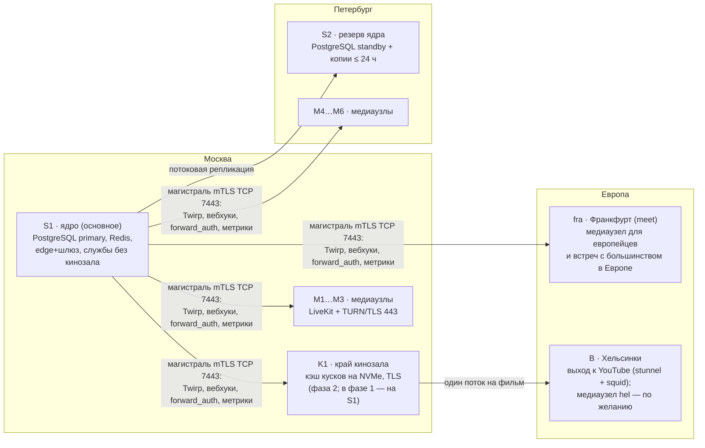

# Cord на 1000 активных: нагрузка, узкие места, сеть, что переписать и что купить (R227)

Статус: **отчёт архитектора и рекомендация**, на серверах продукта ничего не менялось и не нагружалось. Дата: 09.11.2026.
Основа: T09 (`docs/load/2026-11-02-load-report.md`), R218 (`dedicated-servers.md`, перепроверен — §8), `docs/capacity.md`,
`docs/codecs.md`, `distributed-media.md`, `server-selection.md`, `admin-panel.md` (Р-111), `data-retention.md` (Р-131),
`backlog/DECISIONS.md` (Р-95…Р-131), код ветки `release/1.2` (`d6ff08c`) и **новые замеры на стенде A 09.11.2026** (§1).

Рамка от владельца (09.11, последнее слово): **Россия — первый приоритет** по ёмкости и задержке; но люди из России
созваниваются с людьми из Европы, поэтому **медиа в Европе тоже важно** — отказаться от него, только если это критически
сложно. Вывод этого отчёта: **не сложно** — европейский медиаузел (Франкфурт, meet) уже работает в той же модели узлов и
остаётся (§6.10–6.11). Узкие места ищем **и в железе, и в коде** — база, Java, Python, плохо спроектированные части.

Пометки: **[изм. 09.11]** — снято сегодня на A (условия — §1); **[изм. T09]** — замер 02.11; **[код]** — прочитано в
репозитории; **[ист.]** — страница провайдера или чужая документация (§12); **[оценка]** — расчёт, который предстоит
проверить; **[вывод]** — заключение из фактов выше.

---

## 0. Коротко — прямые ответы

| Вопрос | Ответ |
| --- | --- |
| Что значит «1000 активных»? | Две разные нагрузки. **1000 одновременно во встречах** (CCU) — то, что считаем ниже. **1000 в день** (DAU) — это ≈ 150–250 одновременно в вечерний пик [оценка: 15–25 % DAU], то есть нагрузка «Баланса» R218 уже сегодня (§2.1). |
| Сколько это трафика? | Типичный вечер на 1000 CCU: **≈ 3,7 Гбит/с отдачи SFU** + 0,35 кинозала, приём ≈ 0,85, ≈ 430 тыс. пакетов/с отдачи. Если камеры включены у всех — **≈ 9 Гбит/с**. После слоёв по размеру плитки (пересмотр Р-32) — **≈ 2,5 Гбит/с** [оценка, §2]. |
| Упрёмся ли в 1 Гбит/с на 2–3 серверах? | **Да.** 2–3 сервера по 1 Гбит/с (≈ 0,7 Гбит/с в плане на узел) кончаются на **≈ 400–550 одновременных** в типичной смеси и на **≈ 150–230**, если камеры у всех. Одна комната «20 человек, все с камерами 720p» (≈ 950 Мбит/с) в 1G-узел **не влезает вовсе**. На VDS раньше канала кончается ЦП: узел на 2 vCPU — ≈ 150 Мбит/с (§5.1). |
| Десятки дешёвых VPS, 2–3 VDS или выделенные? | **Выделенные 1 Гбит/с безлимит в России, 5–7 медиаузлов + 2 машины ядра.** VPS «1 Гбит/с» — это общий порт гипервизора, steal и неизвестный предел пакетов; на 2 vCPU не помещается даже комната из 10 человек с камерами 720p. Выделенный 6-ядерный за 7 000 ₽ стоит как VPS на 2 vCPU (5 480 ₽) и даёт ≈ в 4–5 раз больше устойчивой ёмкости. VPS — только как почасовой резерв под маленькие встречи (§5). |
| Что ломается первым? | Не канал. **(1)** Глобальный предел `STREAM_MAX_ROOMS=8` — на весь продукт, а не на узел: восемь встреч на всё сразу [код]. **(2)** Ядро в больших активных комнатах: каждое событие → каждый участник перечитывает полный снимок; 20 сообщений/с у 200 человек — 1,44 ядра Java + 0,75 PostgreSQL, ≈ 1 700 транзакций/с, p95 события 1,27 с [изм. 09.11]. **(3)** Входы: 62/с при 610 строках `rooms` → 27,5/с при 2 010 [изм. 09.11]. **(4)** Память SFU 1 ГиБ → 150–200 участников на узел. Затем — канал узлов и машины кинозала (§3). |
| Проблема в Java? | **Нет — в устройстве.** JVM ядра — 600–660 МиБ и старт за 25–30 с [изм. 09.11]; ЦП уходит на разбор всего JSON комнаты и походы в базу **на каждый сокет на каждое событие**, а не на язык. Переписывать на Go/Rust не нужно: тот же алгоритм на другом языке даст ту же квадратичность. Нужно перепроектировать две части ядра: **состояние комнаты и рассылку событий**, **учёт мест при входе** (§4). |
| Проблема в Python кинозала? | **Нет.** Один процесс uvicorn отдаёт кусок из общей памяти со скоростью **≈ 12 Гбит/с на ядро** (5,8 Гбит/с при 0,49 ядра) [изм. 09.11]. Узкое место кинозала — **порт машины**, где он стоит, маленький кэш (192 МиБ на 120 с) и yt-dlp в том же процессе (GIL), а не язык (§4, п. 8). |
| Проблема в базе? | **В том, как ею пользуются**: снимок комнаты — один JSON, переписываемый целиком; сверка медиа переписывает каждую открытую комнату каждые 2 с **без изменений**: 280 UPDATE/с и 0,5 МБ/с WAL «в простое» на 2 010 комнатах [изм. 09.11]. PostgreSQL стоит на умолчаниях (`shared_buffers` 128 МБ) [код]. Резервных копий нет (Р-131: «не делаются, пока владелец не решит») — это главный риск данных (§6.3). |
| Европа и встречи «Россия + Европа»? | **Оставляем один медиаузел во Франкфурте** (meet после переезда ядра в Москву) — для европейцев и смешанных встреч; из России до него ≈ 40–50 мс, сегодня он доступен без VPN. Встреча ставится туда, где **большинство** её людей: россиян больше — российский узел, европейцев — Франкфурт; границу пересекает меньшинство. Где бы ни стоял SFU, путь «Москва ↔ Берлин» пересекает границу один раз — задержка между ними почти та же; каскад узлов ради этого не нужен (§6.11). |
| Kubernetes? | **Нет и на 1000 CCU** (Р-111 в силе): 7–9 машин в двух городах без общей частной сети, SFU на host-сети, выкатка через дренаж встреч — k8s добавит слой, не убрав ни одной проблемы из §3 (§6.8). |
| Частная сеть? | **Нет.** Между узлами — меньше 1 Мбит/с управления и 2–5 Мбит/с репликации базы; mTLS по TCP 7443 уже работает. WireGuard ТСПУ режет по сигнатуре [ист. 14 R218] (§6.7). |
| Что купить и сколько стоит? | Фаза 1 — **≈ 35 тыс. ₽/мес** (3 выделенных Selectel: ядро в Москве, медиа в Петербурге) → **≈ 330–370 CCU** в типичной смеси (+ ≈ 130–160 на `fra` в Европе). Фаза 2 — **≈ 76–85 тыс. ₽/мес** (+4 медиаузла, два провайдера) → **≈ 1000 CCU** при условии слоёв по плитке и правок ядра; без них — **≈ 115–120 тыс. ₽** (§7). |
| Что сделать до покупки? | Поднять `STREAM_MAX_ROOMS`, `mem_limit` SFU, настроить PostgreSQL, включить сжатие `/api`, убрать безусловную запись сверки, переделать вход без общего замка, снимок — один раз и дельтами, ограничить качество кинозала окном. Это **×2–3 по ёмкости ядра и ×1,5–2 по каналу** без единого рубля (§9). |

---

## 1. Что измерено 09.11.2026 (новое)

Стенд A (`callcord.ru`, эта машина): KVM, 4 vCPU Ryzen 9 5950X, 7,8 ГиБ (занято 4 ГиБ + 2,8 ГиБ swap — рядом работают
другие сессии), steal во время прогонов 3–12 %. Перед каждой серией `backlog/bin/active-meetings.sh` → «Живых встреч нет»
(код 0). Каждый прогон ≤ 75 с, сторож `docs/load/2026-11-09/bench/watchdog.py` снимает тестеры при занятости хоста > 85 %
два замера подряд. Ключ и секрет LiveKit читались из `/opt/ModernStreamingSystem/.env` скриптами `scripts/load/*` в
окружение процесса, нигде не печатались и в репозиторий не попали. Итоги прогонов — `docs/load/2026-11-09/`.

| # | Что | Итог [изм. 09.11] | Сравнение с T09 |
| --- | --- | --- | --- |
| И1 | SFU, «как в Cord»: 10 человек, камера одним слоем, все смотрят всех (`lk load-test` 10/10/10, 5×5, `--no-simulcast`) | **0,72–0,79 ядра SFU** при ≈ 205–225 Мбит/с отдачи (≈ 230–270 Мбит/с через `lo` в обе стороны) → **≈ 270–290 Мбит/с отдачи на ядро**; память SFU 211 МиБ на 30 участников тестера → **≈ 3,7 МиБ на участника** | T09: 0,75 ядра на 193 Мбит/с (257 на ядро), 5–8 МиБ на участника — совпадает в пределах 10 %. Прогон сторож остановил на 35-й секунде (хост 91–95 % из-за соседей): устойчивое окно — 25 с |
| И2 | Теневое ядро (образ стенда 1.3.0, своя PostgreSQL и Redis, порт 18481): 10 комнат × 20, сообщение от каждого раз в 10 с | 19,9 сообщения/с → **794 события/с** людям, **449 перечитываний снимка/с** по 22 КБ (**81 Мбит/с** JSON); ядро **1,44 ядра** (пик 1,94), PostgreSQL **0,75**; задержка события p50/p95/p99 — **344 / 1 266 / 2 005 мс**; в базе **≈ 1 700 транзакций/с** (137 797 за ≈ 80 с — ≈ 86 транзакций на одно сообщение чата), ≈ 34 тыс. строк/с прочитано; WAL **18,9 МБ за ≈ 80 с** (≈ 12,7 КБ на сообщение); снимок комнаты из 20 человек в `rooms.state` — **13 476 байт** | T09: 1,31 + 0,79 ядра, p95 0,57 с. ЦП — тот же; задержка хуже из-за занятого хоста (92 % вместе с нагрузчиком) |
| И3 | Волна входов (50 параллельно, половина — создание, половина — по приглашению) | **62,5 входа/с** (p50 0,69 с, p95 1,08 с) при **610** строках `rooms`; **27,5/с** (p50 1,68 с, p95 2,50 с, p99 3,20 с) при **2 010** | T09: 60/с при ≈ 500, 30/с при ≈ 900. Падение с числом строк подтверждено |
| И4 | Простой: 2 010 открытых комнат по одному человеку, без событий, 30 с | ядро **0,34** ядра, PostgreSQL **0,38**, SFU стенда **0,15** (только от `ListParticipants`); **≈ 1 000 транзакций/с, 280 UPDATE `rooms`/с** (ни одного HOT-обновления), WAL **≈ 0,5 МБ/с** (≈ 4 Мбит/с, ≈ 44 ГБ/сутки); полный проход сверки — **≈ 7 с** вместо 2 с (2 010 ÷ 280) | T09: 1 000 комнат — 0,78 + 0,29. Новое — что это **записи**, а не только чтения |
| И5 | Путь куска кинозала, по слоям (петля, ответ 2 МиБ из памяти, 16 параллельных keep-alive, HTTP/1.1, по 20 с) | Python (FastAPI + uvicorn h11, ответ как `facade._kept`): **5,8 Гбит/с при 0,49 ядра** (≈ 0,08 ядра на Гбит/с); Caddy `reverse_proxy` по HTTP: 5,6 Гбит/с при 0,79 (≈ 0,14 на Гбит/с); Caddy TLS + `reverse_proxy`: 3,2 Гбит/с при 0,80 (≈ 0,25 на Гбит/с); Caddy TLS `file_server`: 3,5 Гбит/с при 0,79 (≈ 0,22 на Гбит/с) | T09 опасался «одного процесса Python на пути байтов» по коду — замер это снимает: **≈ 0,5 ядра на 1 Гбит/с** на весь путь служба → шлюз → TLS (без ядра ОС) |

**Как повторить.** SFU — `scripts/load/sfu_run.py` (как в T09). Ядро — `scripts/load/core-shadow.sh` с портом 18481 вместо
18080 и `CORE=http://127.0.0.1:18481` для `corelt.mjs`/`joinlt.mjs`; счётчики базы — `docs/load/2026-11-09/bench/pgstat.sh`.
Кинозал — `bench/segapp.py` в образе `modern-streaming-services`, `bench/Caddyfile` в `caddy:2.11.4-alpine`,
нагрузчик `bench/bench-client.mjs`. Модель §2 — `bench/model.py`.

**Найдено по ходу (для главной сессии).** Порт 18080, который `core-shadow.sh` занимает теневым ядром, в этот день держал
`scripts/stand-proxy.mjs` другой сессии (прокси на `https://callcord.ru`). `core-shadow.sh` проверяет здоровье по порту и
сказал «core up», хотя его контейнер упал («Port 18080 was already in use»), — и первые 10 запросов `POST /rooms` нагрузчика
ушли через прокси на настоящий стенд. Стенд отказал всем десяти (`403 PROOF_INVALID`, проверка «не бот»), ничего не создано.
Скрипту нужны проверка свободного порта и проверка здоровья **своего** контейнера (`docker inspect`), а не порта.

**Что не мерили и почему.** Браузерные прогоны через `scripts/test-addresses` — SFU и ядро откалиброваны точнее тестером и
теневым ядром, а несколько Chrome на 4 vCPU рядом с чужими сессиями дали бы числа про эту машину, а не про Cord. TURN/TLS —
нужен внешний клиент. Канал и PPS VPS/выделенных — только на арендованной машине (план — §10).

---

## 2. Модель нагрузки на 1000 активных

### 2.1 Что значит «активных»

- **CCU — одновременно во встречах.** Всё ниже — на 1000 CCU в вечерний пик.
- **DAU — разных людей за день.** У звонков друзей вечерний пик держит ≈ 15–25 % DAU одновременно [оценка: в среднем
  40–60 мин в день, ⅔ — в 3–4 вечерних часа]. 1000 DAU → **≈ 150–250 CCU** — это фаза 1 (§7), а не 1000.
- Проверить долю на продукте можно без нагрузки: аналитика R210 (`visitor_days`) даёт DAU, `cord_node_*` и LiveKit
  `livekit_participant_total` — CCU по минутам (§10).

### 2.2 Ставки из кода

| Что | Значение | Где |
| --- | --- | --- |
| Камера по умолчанию | **480p30, 1,2 Мбит/с** (H.264; VP9/H.265 ×0,8, AV1 ×0,7); 720p30 — 2,5 | `web/src/media/capabilities.ts:59` (`CAMERA_DEFAULT`), `profiles.ts:98–115` [код] |
| Слои камеры | веб и телефон — **один слой** (Р-32); simulcast — только клиент Windows; `adaptiveStream` + `dynacast` включены, но при одном слое умеют только **паузу** невидимой плитки, а не слой поменьше | `session.ts:743–744`, `docs/codecs.md` [код] |
| Показ экрана | старт **1080p**; «Чёткость» до 15 кадров — до 4 Мбит/с, «Плавность» 1080p30 — 6; потолок 1080p30; **один показ на встречу** (`MAX_SCREENS=1`); звук показа с RED ≈ 0,26 | `application.yml` (`quality`, `max-screens`), `profiles.ts:77–91` [код] |
| Голос | ≈ 0,13 Мбит/с на говорящего на подписчика (Opus + RED), молчащие не шлют (DTX) | T09 §7 |
| Музыка | ≈ 0,5 Мбит/с на слушателя; бот — 0,026 ядра, ≈ 23 МиБ и ≈ 100 UDP-сокетов; контейнер служб — 30–35 ботов | T09 §4 |
| Кинозал | HLS с машины, где стоят службы: 1080p — 5–8 Мбит/с на зрителя; **`capLevelToPlayerSize: false`** — качество не ограничено размером окна | `web/src/ui/cinema/theater/engines/hls.ts:99` [код] |
| Пределы | 20 человек во встрече; **8 встреч на весь продукт** (`max-rooms` считается по всем строкам `rooms`, не по узлу — §3, п. 1) | `application.yml`, `RoomService.java:134–136, 508–512` [код] |

### 2.3 Типичный вечерний пик, 1000 CCU [оценка, `bench/model.py`]

Допущения: камера включена у половины в маленьких встречах и у четверти в больших; средняя камера 1,5 Мбит/с (смесь 480p
и 720p); показ в 15–50 % встреч, 3 Мбит/с в среднем; говорят 1–2 человека; музыка в 10–15 % встреч.

| Класс встреч | Людей | Встреч | Отдача SFU, Мбит/с | На встречу |
| --- | --- | --- | --- | --- |
| 1:1 | 250 | 125 | 273 | 2,2 |
| 3–6 (ср. 4,5) | 350 | 78 | 1 220 | 15,7 |
| 7–12 (ср. 10) | 200 | 20 | 1 306 | 65 |
| 13–20 (ср. 17) | 100 | 6 | 777 | 132 |
| кинозал, разговор (ср. 4,7) | 70 | 15 | 50 | 3,3 |
| игры (ср. 3,75) | 30 | 8 | 41 | 5,2 |
| **Итого SFU** | **1 000** | **252** | **≈ 3 670** | **3,7 на человека** |
| Кинозал (мимо SFU) | 70 зрителей | | **≈ 350** (5 Мбит/с) | |

Видно главное свойство (T09): **30 % людей в встречах от 7 человек дают 57 % трафика**, потому что каждый смотрит каждого
в полном качестве.

| Величина | Типичный пик | Если камеры у всех (T09-смесь, 720p у трети, показ 1080p30) | После слоёв по плитке |
| --- | --- | --- | --- |
| Отдача SFU | **3,7 Гбит/с** | **9,1 Гбит/с** | **2,5 Гбит/с** |
| Приём SFU | 0,85 Гбит/с | 2,0 | 0,7 |
| Пакетов/с отдачи (видео ≈ 1 100 Б, звук 50/с на подписку) | ≈ 430 тыс. | ≈ 990 тыс. | ≈ 310 тыс. |
| Ядра SFU (≈ 250 Мбит/с видео и 30 тыс. пакетов звука на ядро [изм.]) + ОС (≈ 1 ядро на 0,9 Гбит/с [изм. T09]) | ≈ 17 + 4 | ≈ 40 + 10 | ≈ 13 + 3 (мелкие слои дороже на мегабит — T09 §3) |
| Память SFU (≈ 4–6 МиБ на участника + 60 МиБ на узел) | 4–6 ГиБ на парк | то же | то же |
| TURN (доля не измерена; 10–20 % — индустрия) | ≈ 0,55 Гбит/с через релей, +2–4 ядра (pion в пространстве пользователя) и +0,1–0,3 ядра TLS на edge | ≈ 1,4 Гбит/с | ≈ 0,4 |

### 2.4 Ядро, база, сокеты — типичный пик [оценка по И2–И4]

| Что | Число | Откуда |
| --- | --- | --- |
| Сокеты событий | ≈ 1 000–1 300 (до 3 на участника) | `abuse.per-member.sockets: 3` |
| ping/pong | ≈ 500 сообщений/с в каждую сторону | ping раз в 2 с |
| Изменения комнат | ≈ 12/с (входы-выходы ≈ 1, чат ≈ 5–6, ходы игр ≈ 4, кинозал ≈ 1) | [оценка] |
| События людям и перечитывания снимка | ≈ 100/с и ≈ 100/с по ≈ 10 КБ (≈ 8 Мбит/с JSON) | ×N на изменение |
| ЦП ядра + PostgreSQL | ≈ 0,5 + 0,3 ядра; в больших активных комнатах — 1,5–3 ядра и p95 события > 1 с | И2 |
| Записи в базу | ≈ 140 UPDATE `rooms`/с (из них ≈ 125 — сверка медиа без изменений), по ≈ 12 INSERT/DELETE `room_events`, ≈ 20 `command_receipts`, ≈ 6 `messages` | И2, И4 |
| Транзакций/с | ≈ 900–1 200 (без `@Transactional` каждый запрос `JdbcClient` — своя транзакция) | И2, И4 |
| WAL | ≈ 0,5 МБ/с ≈ 45–50 ГБ/сутки (без `wal_compression`) — важно для реплики и копий (§6.3) | И2, И4 |

### 2.5 Худшие правдоподобные сценарии

| # | Сценарий | Что даёт | Чем кончается |
| --- | --- | --- | --- |
| W1 | Комната 20, у 10 человек камеры 720p, все смотрят всех, плюс показ 1080p30 | **≈ 600 Мбит/с одна комната** (10 × 19 × 2,5 + 19 × 6,26) | 85 % плана 1G-узла; встреча целиком на одном узле — новые встречи уходят на соседей, идущие остаются |
| W1′ | Комната 20, камеры 720p **у всех** | **950 Мбит/с** | **не помещается в 1G-узел**; предел «все с камерами» в 700 Мбит/с — 24 человека при 1,2 Мбит/с, 19 при 2,0, 17 при 2,5 |
| W2 | 30 встреч по 6 человек, в каждой показ 1080p30 «Плавность» | ≈ 30 × 5 × 6,26 ≈ **940 Мбит/с** только на показы | «несколько показов 1080p» = несколько узлов; в одной встрече показ один (R202, `MAX_SCREENS=1`) |
| W3 | 50–60 кинозалов по 5 зрителей, разные фильмы, 1080p | **2,0–2,4 Гбит/с** с машины кинозала; ≈ 350–420 Мбит/с внутрь через прокси YouTube в Хельсинки; кэш 192 МиБ живёт ≈ 4–5 с | порт машины ×2–2,5 сверх 1G; при 4K (`capLevelToPlayerSize: false`) — ×2 ещё |
| W4 | «Все зашли в 20:00»: 500 входов за минуту, всплески 50/с | при 2 000 строк `rooms` вход — 27,5/с (И3) | очередь 10–20 с, p95 входа 2,5–3 с и хуже |
| W5 | Доска на 20 человек, 32 картинки по 4 МиБ, все открыли | **2,5 ГиБ** из PostgreSQL через кучу Java и шлюз — 21 с полного 1G-порта машины ядра | см. §4, п. 7 |
| W6 | 20 человек водят мышью по доске + 2 таких доски | T09: p95 курсора 1,6 с → 9–27 с | рассылка O(N²) под замком доски |
| W7 | Падение медиаузла с 150 людьми | эвакуация за ≈ 3 с (живой тест msk 09.11) на соседей — **если у них есть 25 % запаса** | без запаса Р-103 встречи переезжают в переполненный узел |

Итог: **типичный пик — ≈ 3,7 Мбит/с на человека SFU + 0,35 Гбит/с кинозала; худший правдоподобный — ≈ 9 Мбит/с на
человека и ≈ 2,4 Гбит/с кинозала**. Доля людей с включённой камерой — самое большое неизвестное: ×2,5 между строками.
Её можно снять на продукте без нагрузки (`cord_client_publish_seconds_total{source="camera"}` к числу участников, §10).

---

## 3. Узкие места по компонентам — в порядке, в котором они ломаются

«Предел» — при какой нагрузке; «Сила» — S (часы), M (дни), L (1–3 недели).

| # | Компонент | Свидетельство | Предел | Что сделать | Сила |
| --- | --- | --- | --- | --- | --- |
| 1 | **Глобальный `max-rooms`** | `RoomService.create` и `checkDoor` считают занятые встречи по **всем** строкам `rooms` и сравнивают с `stream.max-rooms` (по умолчанию 8) [код `RoomService.java:134–136, 508–512`]; реестр узлов для узла управления берёт то же число (`node-config.mjs:87`). R218 читал это как «8 встреч на узел управления» | **8 встреч на весь продукт**, сколько бы узлов ни было (8 + 2 + 2 по реестру не складываются), если в `.env` meet не стоит больше — проверить | сейчас — `STREAM_MAX_ROOMS` = сумма `maxRooms` узлов; в коде — убрать глобальный предел, полнота — только по реестру (`MediaNodes.full`) | S / M |
| 2 | **Ядро: события и снимки** | И2: 20 сообщений/с у 200 человек — 1,44 + 0,75 ядра, 1 700 транзакций/с, p95 1,27 с. На каждое событие каждый сокет читает строку комнаты и разбирает весь JSON (`RoomSocket.flush` → `RoomService.replay`, `RoomSocket.java:274–284`, `RoomService.java:2164–2185`), а каждый браузер перечитывает полный снимок с перепиской до 1000 сообщений (`web/src/core/meeting.ts:439–446`, `RoomService.java:961–981`) | комнаты от 15 человек с живым чатом, игрой, доской; ≈ 500 событий/с на ядро | §4, п. 2 | L |
| 3 | **Ядро: вход** | И3: 62,5 → 27,5 входа/с при 610 → 2 010 строк. Общий `system_lock FOR UPDATE` и разбор всех строк `rooms` в каждой двери (`RoomService.java:117, 134, 257, 286, 385, 399, 591, 699, 761`), избранном и вложениях | волна входов при тысячах сохранённых встреч | §4, п. 3 | M |
| 4 | **Память SFU** | `mem_limit: 1g` в `compose.yaml` и `compose.node.yaml` [код]; ≈ 3,7–8 МиБ на участника [изм.] | **150–200 участников на узел** — раньше канала на голосе и 1:1 | 3 ГиБ + `GOMEMLIMIT` 2,5 ГиБ на выделенных; 1,5–2 ГиБ на машинах по 4 ГБ | S |
| 5 | **ЦП узлов на VDS** | 2 vCPU ≈ 150 Мбит/с, 4 vCPU с ядром рядом ≈ 450–500 [изм. T09]; steal 3–12 % сегодня, 4–25 % (до 60 %) и 376 зависаний хоста за 15 суток [изм. T09] | `msk`/`hel` — одна встреча на 10 человек с камерами; meet — ≈ 70–100 человек в смеси | выделенные узлы (§5, §7) | — |
| 6 | **Канал медиаузла 1G** | 845–848 Мбит/с TCP, 900 UDP без потерь [изм. T09, ВМ]; план — 700 (Р-103) | ≈ 190 человек в типичной смеси на узел; одна комната ≤ 17–24 человек со всеми камерами | число узлов; слои по плитке (§9) | — |
| 7 | **Машина ядра — единая точка отказа** | одна машина: ядро, PostgreSQL, Redis, шлюз, службы, кинозал; **реплики нет, копий нет** (Р-131) | любое падение meet = нет входов во всю систему; диск — потеря метаданных за всё время | горячий резерв PostgreSQL в другом городе, холодный резерв ядра, копии в рамках Р-131 (§6.3) | M |
| 8 | **Кинозал на машине ядра** | байты: служба → шлюз → edge → зритель (Р-99′); путь стоит ≈ 0,5 ядра на Гбит/с (И5), но **делит порт** с SFU и ядром; кэш 192 МиБ × 120 с в памяти процесса (`transport/segments.py:23`); качество не ограничено окном | ≈ 50–65 зрителей при SFU на той же машине, ≈ 100–140 без него; кэш перестаёт помогать при ≈ 30–50 разных фильмах | машина без SFU; `capLevelToPlayerSize: true` и потолок 1080p; кэш 1–2 ГиБ на диске; отдельный край кинозала в фазе 2 (§6.5) | S / M |
| 9 | **Прокси YouTube на B** | stunnel + squid на 2 vCPU рядом с SFU `hel` | ≈ 7 Мбит/с внутрь на каждый **разный** фильм: 50 фильмов — ≈ 350 Мбит/с и ≈ 0,3–0,5 ядра TLS [оценка] на машине, где SFU | на B — только прокси (снять `hel` или `maxRooms` 1); замер stunnel из России (Р-99 не проверен) | S |
| 10 | **Издатели музыки** | ≈ 100 UDP-сокетов и 23 МиБ на бота, `pids_limit 256`, `mem_limit 1g` у контейнера служб [изм. T09, код] | **30–35 ботов на весь продукт** — при музыке в 10–20 % встреч на 1000 CCU нужно 25–50 | отдельный контейнер издателей с `pids_limit`/памятью; ICE бота только на публичном интерфейсе (1–2 сокета вместо ≈ 100) | M |
| 11 | **Картинки доски** | `BYTEA` в `room_board_files` до 32 × 4 МиБ; GET читает картинку в кучу Java, **без `Cache-Control`** (`BoardController.java:89–111`) | W5: 2,5 ГиБ на одно открытие большой доски | §4, п. 7 | S |
| 12 | **PostgreSQL на умолчаниях** | `command: postgres -c listen_addresses…` — `shared_buffers` 128 МБ, `wal_compression` выкл. [код `compose.yaml:164`, изм. на теневой базе] | WAL ≈ 45–50 ГБ/сутки на 1000 CCU; кэш меньше рабочего набора | §9, п. 4 | S |
| 13 | **Сжатие `/api`** | `@api` в `infra/Caddyfile:121–133` без `encode` (статика сжимается) [код] | 81 Мбит/с JSON снимков на 200 болтающих (И2) | `encode zstd gzip` на `@api` — JSON ×5–8 меньше | S |
| 14 | **Фоновые проходы по всем комнатам** | сверка раз в 2 с: разбор всех строк, `ListParticipants` **по одной комнате последовательно**, безусловная запись (`MediaReconciler.java:52–93`, `MediaService.java:294–350`); сроки раз в 1 с — замок каждой строки (`MediaReconciler.java:44–50`); `onNode`/`evacuate` — `repository.all()` (`MediaService.java:127–175`) | И4: проход 7 с на 2 010 комнатах; на 250 — ≈ 1 с, но строки сохранённых встреч (7 дней) тоже идут в разбор | §4, п. 4–5 | M |
| 15 | **Шлюз, edge, TLS** | Caddy: ≈ 0,14 ядра на Гбит/с прокси, ≈ 0,25 с TLS на крупных ответах (И5); API — сотни запросов/с | не узкое место на 1000 CCU; рукопожатия TLS волны входа — доли ядра | у edge нет `cpu_shares` (T09 §14, п. 12): при нехватке ЦП первыми страдают люди на TURN/TLS — дать вес | S |
| 16 | **Узел на комнату** | встреча целиком на одном узле, каскада в LiveKit OSS нет [код, Р-95…Р-105] | W1′; вебинар 1080p — ≈ 85–100 зрителей на узел | держать запас 25 % (Р-103); для эфиров > 100 — ретранслятор (T09 §10, вариант A) | L |
| 17 | **Предел 20 человек** | `max-participants 20` [код] | комнаты на 30–50 человек упрутся в п. 2 раньше, чем в SFU (T09: 4 × 45 — p95 1,3 с) | 20 → 30 после п. 2–3; → 50 после слоёв по плитке | S после L |
| 18 | **Реестр и отказ узла** | живой отказ `msk` 09.11 — ≈ 3 с до связи у всех [журнал]; реестр — файл на машине ядра, перечитывается раз в 10 с | отказ машины ядра: новых входов нет, `forward_auth` узлов к ядру не проходит, эвакуировать некому; идущее медиа на живых узлах продолжается до переподключения [вывод] | резерв ядра (§6.3); алерт «ядро недоступно» с машины вне ЦОД ядра | M |
| 19 | **Наблюдаемость** | VictoriaMetrics и пульт на A (Франкфурт, steal, зависания хоста) скрапят продукт через туннели | пропадает A — продукт работает, но слепой; оповещения зависят от машины разработки | vmalert + Alertmanager — в регионе продукта; A — только панели (§6.9) | M |
| 20 | **DNS и сертификаты** | DNS `cordcam.ru` у Cloudflare (серое облако, Р-109); сертификаты Let's Encrypt HTTP-01 на каждом узле (Р-107) | российские провайдеры с 2025 г. режут соединения с Cloudflare (DNS не затронут по известным данным) [ист. 13 R218]; три имени на узел — 21–27 имён на 7–9 машин, в пределах LE | второй авторитетный DNS в России (например, бесплатный DNS Selectel) — запись NS у регистратора на оба; у Caddy по умолчанию есть запасной ZeroSSL — проверить, что конфигурация edge (`edge-config.mjs`) его не отключает | S |
| 21 | **Туннели пульта** | SSH и магистраль A → meet | на работу продукта не влияют; после переезда ядра — путь A → Москва через границу | магистраль 7443 как основной путь пульта | S |

---

## 4. Узкие места в коде и что переписать

Рейтинг — по тому, **что раньше ломается на 1000 CCU** и сколько ёмкости даёт исправление на единицу усилий. Общий вывод:
**язык не узкое место нигде.** Плохо спроектированы две части ядра — состояние комнаты с рассылкой и учёт мест при входе;
их надо **перепроектировать**, остальное — **точечные правки**. Переписывать ядро на другой язык или службы с Python
на Go/Rust по замерам не оправдано.

| # | Что | Свидетельство | Правка или переделка | Ожидаемый выигрыш | Сила |
| --- | --- | --- | --- | --- | --- |
| 1 | **Глобальный предел встреч** | §3, п. 1 [код] | **правка**: полнота только по реестру; `max-rooms` — потолок узла управления, а не системы | снимает потолок «8 встреч на всё» | 1 день |
| 2 | **Состояние комнаты и рассылка событий** | И2 (≈ 86 транзакций и ≈ 50 чтений с разбором строки комнаты на одно сообщение — 78 513 индексных чтений `rooms` за ≈ 80 с при 20 сообщениях/с; p95 1,27 с), T09 §5.1 (квадрат по размеру комнаты) | **переделка**: у комнаты один владелец в памяти ядра (как уже сделано у доски — `BoardRooms`, запись в базу раз в 3 с); снимок строится **один раз** на изменение, сокетам уходит готовая строка (без чтения базы на каждый сокет); событие несёт **дельту** с `seq`, браузер перечитывает снимок только при разрыве `seq`; чат — из снимка в отдельную ручку со страницами; база пишется после изменения (одна строка), журнал `room_events` — пачкой | ЦП ядра и транзакции **×10–20** для комнат от 10 человек; задержка события < 100 мс; трафик снимков **×10** меньше; предел комнаты 30–50 человек | 2–3 недели (ядро + `meeting.ts` + контракт) |
| 3 | **Учёт мест при входе** | И3; `oneMeeting`, `openRooms`, `busy` разбирают **все** строки `rooms` под общим замком [код] | **переделка части**: таблица мест `seats(profile_hash, room_id, origin)` и столбцы `closed_at`, `created_by`, `created_from` с индексами; замок — `pg_advisory_xact_lock(hash(profile))` и строки комнаты; общий — только вокруг счётчика встреч узла | входы **×20–50** (с 27–62/с до > 1 000/с), волна W4 без очереди | 3–5 дней |
| 4 | **Сверка медиа пишет без изменений** | И4: 280 UPDATE/с, 0 HOT, WAL 0,5 МБ/с в простое; `MediaService.observe` зовёт `repository.save` безусловно (`MediaService.java:349`) | **правка**: писать только при `changed` или изменившемся `mediaSid`; `last_seen_at` — только когда он меняется (он в индексе `room_idle` и ломает HOT); `fillfactor` 80 у `rooms` | записи `rooms` в простое ×10 меньше, WAL ×5–10, меньше раздувания таблицы | 1 день |
| 5 | **Фоновые проходы по всем строкам** | И4; T09 §14, п. 2 | **правка**: только открытые комнаты (`closed_at` столбцом + индекс); `ListRooms` узла раз в 2 с вместо `ListParticipants` на каждую комнату; `ListParticipants` — параллельно и только для комнат, где вебхук LiveKit сообщил изменение; сверка — сеть безопасности раз в 10–15 с; проход сроков — по таймеру ближайшего срока, а не замком каждой строки раз в секунду | −0,3–1 ядра ядра и базы; проход ≤ 1 с при тысячах сохранённых встреч | 2–3 дня |
| 6 | **Слой камеры по размеру плитки** (клиент) | Р-32: один слой у веба; зритель тянет полный битрейт каждой плитки | **решение владельца по Р-32** (формулировка — T09 §15, п. 1), затем SVC `L3T3_KEY` для VP9/AV1 в Chrome и simulcast для H.264, пейджинг ≤ 12 плиток | канал **×1,5** в среднем (3,7 → 2,5 Гбит/с на 1000 CCU) и ×2–3 в комнатах от 6 человек; **−3 медиаузла ≈ −35–40 тыс. ₽/мес** в фазе 2 | 1,5–2 недели |
| 7 | **Доска** | T09 §5.3 (20 курсоров — p95 1,6 с; две доски — секунды); схлопывание эфемерных сообщений есть только для медленного сокета (`Ephemeral.merge`), в обычном режиме — O(N²) сообщений; картинки — `BYTEA` через кучу Java, без кэша браузера (`BoardController.java:89–111`), очередь сокета до 16 МиБ | **правки**: курсоры комнаты — одной пачкой раз в 50 мс (O(N) сообщений вместо O(N²)); очередь сокета 1–2 МиБ; картинки ужимать в браузере до WebP ≤ 1 МиБ и 2048 px; `Cache-Control: private, max-age=86400, immutable` (имя файла у Excalidraw — хеш содержимого); картинки — файлом в томе `uploads` (срок 24 ч по Р-131), а не в WAL базы | доска на 20 активных без задержек; W5 — 2,5 ГиБ → ≈ 0,3–0,6 ГиБ и один раз; −4 МиБ WAL и реплики на картинку | 3–5 дней |
| 8 | **Службы: кинозал, yt-dlp, музыка, Telegram в одном процессе** | И5: Python отдаёт кэш ≈ 12 Гбит/с на ядро — **не узкое место**; узкие — один процесс на всё (`uvicorn` без воркеров, `services/Dockerfile`), yt-dlp в пуле потоков того же процесса (`resolve.py:206, 324`; GIL — разборы роликов тормозят цикл событий, который отдаёт куски), кэш 192 МиБ × 120 с (`segments.py:23`), `mem_limit 1g`/`pids_limit 256` на всё вместе с музыкой | **разделить, не переписывать**: (а) `cinema-edge` — отдача кусков с кэшем на диске 1–2 ГиБ (тот же Python или Caddy/nginx `proxy_cache` перед ним — оба годятся по И5); (б) разбор yt-dlp — в пуле **процессов**; (в) издатели музыки — свой контейнер; (г) `capLevelToPlayerSize: true` и потолок 1080p | кинозал перестаёт зависеть от разборов и музыки; кэш держит 50+ фильмов; канал кинозала ×1,5–3 меньше на маленьких окнах | 1 неделя |
| 9 | **PostgreSQL как он настроен** | умолчания (§3, п. 12) | **правка**: `shared_buffers` 2–4 ГБ (на 64 ГБ), `effective_cache_size` 16–32 ГБ, `wal_compression=zstd` (JSON сжимается в разы), `max_wal_size` 4 ГБ, `checkpoint_timeout` 15 мин; `synchronous_commit=off` — по решению владельца (теряется ≤ 0,6 с записей при падении; содержимое и так живёт ≤ 24 ч); индекс по `messages.expires_at` и раздельные удаления вместо `created_at<=? OR expires_at<=?` (`Lifecycle.java:112`) | WAL ×3–5 меньше, меньше чтений с диска; ровнее задержка | 2–3 часа |
| 10 | **Запись квитанций команд** | каждая команда кладёт **полный ответ** в `command_receipts` (`RoomService.receipt`, вход — с целым снимком) [код] | **правка**: хранить ответ входа без снимка (снимок отдаётся заново) | −5–15 КБ записи на вход | 1 день |
| 11 | **JVM** | 604–659 МиБ RSS теневого ядра, старт 25–30 с (И2–И4); 14 мин в 10.2026 — на ВМ в swap и под сборкой; пул Hikari 12 при виртуальных потоках — достаточно, упор в замки, а не в соединения; JDK 25 не прикрепляет виртуальные потоки в `synchronized` (JEP 491) | **ничего не переписывать**. По желанию: AppCDS/AOT-кэш (старт −30–50 %), `-XX:+UseZGC` (паузы < 1 мс при куче 1,3 ГиБ). GraalVM native: старт ≈ 1 с и −50 % памяти, но без JIT пиковая скорость ниже, а Spring AOT и рефлексия Jackson — постоянная цена сборки | старт и память — не узкое место; выигрыш ≈ 0 для 1000 CCU | — |
| 12 | **Шлюз и edge (Caddy)** | И5: ≈ 0,14 + 0,25 ядра на Гбит/с; API — сотни запросов/с | **ничего не переписывать**: вес `cpu_shares` у edge; `encode` на `/api` | — | 1 час |

**Почему не переписывать ядро на Go/Rust.** Замер И2 показывает, куда уходит ЦП: ≈ 50 чтений с разбором JSON строки комнаты и ≈ 86
транзакций на одно сообщение, плюс N полных снимков с перепиской. Это алгоритм (O(N) чтений базы на событие и O(N²) на
комнату), а не цена байткода. Тот же алгоритм на Go стоил бы в 1,5–2 раза меньше ЦП, а переделка п. 2 — в 10–20 раз, и за
2–3 недели вместо месяцев переписывания 128 файлов ядра (`RoomService` — 2 228 строк). После п. 2–5 одно ядро на 4 ядрах
держит тысячи сокетов — это ёмкость с большим запасом для 1000 CCU [оценка по T09 §13].

**Почему не переписывать кинозал на Go/Rust/nginx.** И5: одно ядро Python отдаёт из кэша ≈ 12 Гбит/с — в 12 раз больше
1G-порта машины. Переписывание ничего не даст по ЦП; даст разделение процессов (п. 8) и кэш по диску — это делается в том же коде.

---

## 5. Сеть: упрёмся ли в 1 Гбит/с, и VPS против VDS против выделенных

### 5.1 Прямой ответ

- **Один узел 1G** честно отдаёт ≈ 850 Мбит/с [изм. T09, ВМ во Франкфурте], планируем **700** (Р-103: новые встречи не
  ставятся выше 75 %). Это **≈ 190 CCU** в типичной смеси (3,7 Мбит/с) или **≈ 75–80** при камерах у всех (9,1).
- **2–3 сервера по 1 Гбит/с** — 1,4–2,1 Гбит/с в плане, если все — медиаузлы; если на одном из них ядро и кинозал, медиа
  остаётся ≈ 1,0–1,7. Упор — **≈ 400–550 CCU** в типичной смеси, **≈ 150–230** при камерах у всех. До 1000 CCU нужно
  **≈ 3,7 Гбит/с** медиа (≈ 2,5 после слоёв) плюс запас на отказ узла — **6 + 1** узлов 1G сейчас или **4 + 1** после слоёв.
- **На текущих VDS** канал не достигается: ЦП кончается раньше (2 vCPU ≈ 150 Мбит/с, 6 vCPU с ядром рядом ≈ 500–600).
- **2,5/5/10G не нужны** (R218 §4.1 в силе): в России порт больше 1G почти всегда тарифицирует трафик (Selectel — модель
  «300 ТБ»), а 1 Гбит/с круглые сутки — 324 ТБ/мес. Растём числом 1G-узлов.

### 5.2 Что на деле значит «1 Гбит/с безлимит»

| | VPS на общих узлах | VDS (как meet, A) | Выделенный |
| --- | --- | --- | --- |
| Порт | общий порт гипервизора; 1 Гбит/с — «до», соседи делят его | общий, но соседей меньше; meet и A — ≈ 850 Мбит/с [изм. T09] | свой порт |
| Устойчиво | неизвестно до замера; на дешёвых тарифах обычно правило честного использования (при постоянной нагрузке канал ограничивают) — **у Timeweb на странице: «трафик бесплатный и безлимитный»**, правило о постоянной нагрузке не нашли [ист. 2] | ≈ 0,85 Гбит/с | 0,85–0,95 Гбит/с |
| Пакеты/с | предел virtio-net и защита хостера от флуда; у нашего хостера A/meet фильтр резал UDP между серверами от 0,5 Мбит/с и блокировал на минуты [изм., `distributed-media.md`] | то же | сетевая карта держит > 1 млн пакетов/с |
| Steal | 5–25 % обычно, пики до 60 % [изм. T09 на VDS] | 3–25 % | 0 |
| Что нужно узлу на 700 Мбит/с | ≈ 80–130 тыс. пакетов/с и ≈ 3,5–4 vCPU **без** steal | | 6 физических ядер — с запасом |

### 5.3 Россия: ТСПУ, UDP, задержки, белые списки

- **Задержки из Москвы** [ист. 12 R218, 09.11]: Петербург 9 мс, Казань 13, Новосибирск 44, Хабаровск 100; Хельсинки 40,
  Франкфурт 49. Для российской аудитории узлы — **Москва и Петербург**; Сибирь — отдельным узлом, только если аналитика R210
  покажет заметную долю (`cord_node_choice_total` по стране создателя).
- **ТСПУ** умеет резать протоколы по сигнатуре: WireGuard и OpenVPN — повсеместно с 2026 г. [ист. 14 R218]; звонки WhatsApp
  и Telegram — в том числе по признаку STUN (Magic Cookie) [ист. 3, 4]; QUIC — блокируется [ист. 3]. Применяется к
  выбранным сервисам и направлениям: российские WebRTC-сервисы работают [вывод]. Отсюда: (1) медиа — на российских адресах;
  (2) на каждом узле запасной путь **TURN/TLS на 443** (уже есть) и ICE-TCP 7881; (3) отдельный IPv4 под TURN, чтобы блок
  TURN не задел SFU (R218 §4.4); (4) доля TURN — метрикой, а не догадкой (§10).
- **Замедление зарубежных хостеров.** С июня 2025 г. российские провайдеры, по сообщениям, обрезают соединения с Cloudflare
  примерно после 16 КБ, и то же сообщалось про ряд зарубежных хостеров (OVH, Hetzner, DigitalOcean) [ист. 13 R218]. Это
  касалось TCP/TLS; про UDP-медиа данных нет. Хостера meet и A это пока не задело — владелец и сегодняшние встречи
  подтверждают: из России во Франкфурт ходят без VPN. Риск в том, что это может начаться в любой день и без объявления:
  у WebRTC тогда первым ломается сигнал (WSS по TCP), а не медиа. Отсюда правило §6.11: россиян — на российские узлы,
  Франкфурт — для встреч, где большинство в Европе; выбор узла по замеру сам обойдёт замедленный узел.
- **Отключения мобильного интернета и «белые списки».** При ограничениях мобильной сети работают только сервисы из перечня
  Минцифры; условие включения — **все вычислительные ресурсы в России** [ист. 5]. С узлом во Франкфурте и прокси YouTube за
  рубежом Cord в перечень не попадёт; если это когда-нибудь станет целью, европейскую часть придётся вынести в отдельную
  установку. Сейчас это не цель — но всё, кроме YouTube в кинозале и европейских встреч, должно работать и без зарубежных
  машин (§6.10).
- **Персональные данные.** С Р-131 база хранит полный IP с именем — это персональные данные; по 152-ФЗ запись и хранение
  данных граждан России — в базах на территории России, передача за рубеж — с уведомлением РКН (не юридическая консультация,
  уточнить у юриста) [вывод]. Сейчас база — во Франкфурте; перенос ядра в Москву закрывает и этот вопрос; копии — во втором
  российском ЦОД, а не за рубежом (поправка к R218 §8). Медиаузел во Франкфурте базы не держит: через него идут медиа и
  сигнал участников его встреч, журнал SFU — уровня `warn`.

### 5.4 Сравнение вариантов

Ёмкость — устойчивая отдача SFU на узел; цена — с НДС, помесячно, 09.11.2026 (Selectel — по R218 §6.1, Timeweb VPS — §12,
ист. 1–2). «На 100 CCU» — только медиа, при типичной смеси 3,7 Мбит/с (≈ 370 Мбит/с на 100 человек).

| | Десятки VPS у разных провайдеров | 2–3 VDS | 3–4 → 6–7 выделенных |
| --- | --- | --- | --- |
| Устойчиво на узел | 2 vCPU — ≈ 150 Мбит/с (ЦП) [изм. T09]; 4 vCPU — ≈ 250–350 при steal [оценка] | 6 vCPU — ≈ 500–600 [оценка] | 6 ядер i7-8700 — 700 (порт), 4 ядра E3 — ≈ 450 [оценка R218] |
| Крупнейшая встреча, что влезает | 2 vCPU: 10 человек с камерами 480p (≈ 110 Мбит/с) — да, 720p (225) — нет | 20 человек 480p — да | 20 человек 480p, 10 камер 720p + показ — да; 20 × 720p — нет нигде |
| Отказы | много мелких доменов отказа — хорошо; но частые «подвисания» узлов (steal, соседи) — правило двух признаков Р-105 спасает от ложных переездов, но не от рывков звука | 2–3 больших домена; фильтры хостера (наш случай) | 2 провайдера × 2 города; без соседей |
| Россия: UDP, ТСПУ | как у всех российских адресов; дешёвые хостеры чаще под массовыми блокировками подсетей [оценка] | — | — |
| Эксплуатация | узел = 3 имени, сертификаты, магистраль, брандмауэр, метрики, выкатка 1–2 ч вручную (`distributed-media.md` §5.15); 25–30 узлов — постоянная работа; реестр и выбор узла это выдерживают (опрос `ListRooms` раз в 2 с на узел) | просто | 7–9 машин — посильно с `fleet` и `node.sh` |
| ₽ на 100 CCU | Timeweb MSK Ultra 2 vCPU / 4 ГБ, 1 Гбит/с, безлимит — **5 480 ₽** [ист. 1] → 2,5 VPS → **≈ 13 700 ₽**; дешёвые линейки 4 vCPU / 8 ГБ за 1 800–3 300 ₽ (по выдаче поиска, на странице не проверено) → **≈ 2 400–4 400 ₽**, но с неизвестным steal и пределом пакетов | зависит от цены VDS: 0,7 VDS на 100 CCU | CL21R-SSD 7 000 ₽ / 700 Мбит/с → **≈ 3 700 ₽**; AEL20 8 540 / 450 → ≈ 7 000; Timeweb i9-10900K 15 900 / 700 → ≈ 8 400 |
| На 1000 CCU (типично, 3,7 Гбит/с + запас) | ≈ 30 VPS по 2 vCPU (≈ 165 тыс. ₽) или ≈ 15 по 4 vCPU (≈ 35–50 тыс. ₽ с неизвестным качеством) | не хватит | 6 + 1 узлов, ≈ 70–90 тыс. ₽ медиа |

### 5.5 Рекомендация

**Основа — выделенные серверы с безлимитом 1 Гбит/с в Москве и Петербурге у двух провайдеров** (Selectel основным, Timeweb
или HOSTKEY вторым), узлы по 6–8 физических ядер. На каждом — ровно одна роль (медиа, ядро+база, кинозал), чтобы
«первым ломается meet, где всё вместе» не повторилось. В Европе — один медиаузел `fra` (meet) для европейцев и встреч с
большинством в Европе (§6.11); выделенный там — только когда его не хватит. **VPS — не основа**: дешёвые линейки по цене за 100 CCU близки к
выделенным, но без гарантий steal, пакетов и правила честного использования, а в 2 vCPU не помещается даже встреча на
10 человек с камерами 720p. Разумная роль VPS — почасовой резерв для маленьких встреч в вечер большого события, когда
подключение узла станет автоматическим (сейчас — 1–2 ч руками).

---

## 6. Целевая архитектура: Россия, горизонтальный рост

### 6.1 Схема

Встреча живёт на одном медиаузле; клиент меряет путь до узлов, ядро ставит встречу по замеру создателя и ступени нагрузки
(Р-100, Р-103), а для сохранённых встреч — по большинству участников прошлого раза (§6.11); медиа и сигнал участника ходят
прямо на узел; между машинами — только управление. Это та же модель, что работает сегодня, — меняются машины и роли, не
устройство. Модель нагрузки §2 — на всех 1000 CCU; европейская доля и смешанные встречи с большинством в Европе ложатся
на `fra`, остальное — на российские узлы.

### 6.2 Роли

| Машина | Что на ней | Почему отдельно |
| --- | --- | --- |
| S1 (Москва) | ядро, PostgreSQL primary, Redis, edge + шлюз, `tusd`, службы (музыка, Telegram, разбор ссылок кинозала), центр магистрали | ядро не делит ЦП с SFU (урок meet); 14 ядер — запас под рост ядра до правок §4 |
| S2 (Петербург) | PostgreSQL hot standby, холодный резерв ядра (тот же образ, остановлен), копии; можно — медиаузел с низким `uplinkMbps` | другой город и ЦОД; повышение за минуты (§6.3) |
| K1 (фаза 2) | край кинозала: отдача кусков с кэшем 1–2 ГиБ на NVMe, TLS; ходит к службам S1 за подписью и плейлистами и через B — к YouTube | кинозал — это порт, а не ЦП (И5): 1G-порт целиком под 150–190 зрителей по 5 Мбит/с |
| M1…M6 | только LiveKit (+ встроенный TURN), edge узла, node-exporter | без состояния; добавляются по шаблону `distributed-media.md` §5.15 |
| fra (Франкфурт, meet) | только LiveKit + TURN, как M1…M6, после переезда ядра в Москву | европейцы и смешанные встречи с большинством в Европе (§6.11) |
| B (Хельсинки) | прокси YouTube; медиаузел `hel` — по желанию | §6.10 |
| A (Франкфурт) | разработка, пульт, панели | людей нет (Р-110) |

### 6.3 Ядро и база: отказоустойчивость при Р-131

- **Активный + резерв, а не кластер.** Состояние встреч эфемерно, содержимое живёт ≤ 24 ч, метаданные — год. Потеря
  последних секунд записей при падении допустима [вывод]. Значит: **асинхронная потоковая репликация** S1 → S2 по
  магистрали (2–5 Мбит/с, §2.4; ×3–5 меньше с `wal_compression`), повышение резерва скриптом (`pg_ctl promote`, ядро на S2 —
  `docker compose up`, DNS апекса с TTL 60, Р-107) — **RTO 5–15 мин руками, RPO — секунды**. Patroni/etcd на двух машинах
  не нужны: им нужен третий голос, а автоматическое повышение без него опаснее ручного.
- **Копии при Р-131.** WAL и базовые копии содержат чат и доску — значит, **копия с WAL хранится не дольше 24 ч** (ночная
  базовая копия + архив WAL, вчерашнее удаляется), иначе содержимое переживёт свой срок в копиях. Метаданные (участники,
  аудит, итоги встреч, аналитика, обращения без текста) — **отдельной ночной выгрузкой только этих таблиц** (`pg_dump -t`)
  со сроком до года. Обе — на S2 и в объектное хранилище в России (Selectel S3). Сейчас копий нет вовсе (Р-131) — **решение
  владельца нужно до переезда**: без копий отказ диска meet = потеря избранного, аудита, аналитики и обращений.
- **Пул соединений.** Одно ядро — пул 12, PgBouncer не нужен; станет нужен при двух активных ядрах.

### 6.4 Что без состояния, что нет

- **Без состояния:** медиаузлы (комната пересоздаётся при эвакуации), край кинозала (кэш), шлюз и edge, издатели музыки.
- **С состоянием в памяти ядра:** сокеты, номера событий, доски (`BoardRooms`), часы игр, превью показа, сторожа узлов.
  Второй **активный** экземпляр ядра — только после переделки §4, п. 2: тогда владелец комнаты — экземпляр по
  согласованному хешу `roomId` на шлюзе, лидер фоновых задач — по аренде в Redis (T09 §9, этап 2). Для 1000 CCU не нужен:
  одного ядра после правок хватает с запасом; второй — для отказа, а не для ёмкости.

### 6.5 Кинозал — с машины ядра на край

Фаза 1: служба кинозала на S1 **без SFU** рядом — порт S1 отдан ядру и кинозалу (≈ 100–140 зрителей по 5 Мбит/с), кэш
кусков 1–2 ГиБ на диске, `capLevelToPlayerSize: true`. Фаза 2: край K1 — тот же код отдачи кусков (И5: Python справляется)
или Caddy/nginx с кэшем перед ним; S1 подписывает адреса и отдаёт плейлисты, K1 — байты. Вторая K2 — когда пик кинозала
выше ≈ 150 зрителей. CDN не нужен: зрители кинозала одной встречи смотрят одно место фильма, кэш отдаёт кусок N раз,
а внутрь идёт один поток на фильм.

### 6.6 TURN

Встроенный TURN LiveKit на каждом медиаузле, UDP 3478 и TLS 443 через edge узла (как сейчас, `livekit-config.mjs`). Релей —
только к своему SFU (`deny_peer_cidrs`). Отдельный TURN-кластер не нужен до измеренной доли > 20 %; второй IPv4 под имя
`turn-<узел>` — по желанию. Edge — вес `cpu_shares` как у SFU (§3, п. 15).

### 6.7 Частная сеть — нет

Между машинами ходит: управление (< 1 Мбит/с на узел), репликация (2–5 Мбит/с), копии (сотни МБ за ночь), метрики. Всё — в
mTLS по TCP 7443 (`distributed-media.md` §5.5′). Частная сеть Selectel работает внутри пула; между Москвой и Петербургом —
платный «Глобальный роутер» [R218 §4.3] — платить незачем. WireGuard — нет (ТСПУ).

### 6.8 Kubernetes — пересмотр Р-111

Порог Р-111 «≥ 6–8 машин» в фазе 2 достигается (7–9 машин), поэтому вопрос заново. Ответ **тот же — нет**:

| Что дал бы k8s | Что у нас вместо | Чего k8s не решает |
| --- | --- | --- |
| планировщик подов | роли машин фиксированы (§6.2); одна роль — одна машина | встреча не переносится между узлами — k8s её не «перепланирует» |
| самолечение | `restart: unless-stopped`, эвакуация встреч ядром (≈ 3 с), алерты | падение ядра (§3, п. 18) решается резервом базы, а не подом |
| выкатка | `node.sh drain` → конец встреч → `deploy` | rolling update рвёт встречи — нужен свой контроллер дренажа |
| сеть | магистраль mTLS | без частной сети между городами — оверлей по UDP через ТСПУ и фильтры хостеров |

Пересмотреть при: > 15 машин, нескольких **активных** экземплярах ядра или втором операторе, знающем k8s. Пока — Compose +
реестр узлов + `fleet` + `node.sh`; узкое место эксплуатации — ручное подключение узла (1–2 ч), его и автоматизировать.

### 6.9 Мониторинг и оповещения

- VictoriaMetrics, vmalert и Alertmanager — **на S2** (в России, но не на машине ядра); A — только Grafana и пульт.
- Внешняя проба `cordcam.ru` и TURN/TLS — **с машины другого провайдера** (B или копеечный VPS): «ядро недоступно» должно
  прийти, даже если лёг весь ЦОД S1.
- Ряды и пороги: отдача узла к `uplinkMbps` (> 70 % неделю — покупать узел), память SFU к лимиту, steal, ступень узла,
  p95 входа (> 1 с), p95 события (> 300 мс), транзакции/с и WAL/с базы, доля TURN, доля встреч с потерями > 1 %, кэш кинозала
  (попадания), очередь сокетов доски, издатели музыки к пределу.
- Ночная канарейка: `lk load-test` 2 × 2 на каждый узел (T09 §9) — только без встреч.

### 6.10 Европа: зачем каждая машина и что без неё

- **fra (meet, Франкфурт) — европейский медиаузел.** После переезда ядра в Москву его 6 vCPU свободны под SFU: ≈ 0,5–0,6
  Гбит/с, **≈ 130–160 CCU** в типичной смеси [оценка; VDS со steal]. Это не «второй регион»: ни ядра, ни базы, ни служб —
  обычный узел реестра, как M1…M6. Держать его не сложно, отказываться незачем: он уже подключён, отказ эвакуирует его встречи на
  российские узлы за ≈ 3 с. Купить выделенный в Европе — когда европейский пик отдачи стабильно выше 60–70 % его
  `uplinkMbps` (Hetzner AX42 ≈ €80–100, T09 §8.4).
- **B (Хельсинки) — выход кинозала к YouTube** (stunnel + squid): YouTube режут для российских адресов (Р-99′), с российской
  машины кинозала его не скачать. Медиаузел `hel` — по желанию; он дублирует `fra` (Хельсинки ≈ 40 мс от Москвы, Франкфурт
  ≈ 49). Если важна стоимость — прокси YouTube переносится на meet (одна европейская машина на обе роли), B выводится.
- **Без европейских машин**: встречи россиян, игры, музыка, доска и площадки кинозала, доступные из России (VK Видео,
  Rutube, ivi), работают; не работает YouTube в кинозале, а европейцы ходят на российские узлы (≈ 40–50 мс — терпимо).
  Поэтому Европа — помощник, а не часть, без которой система встаёт.
- **Риск:** stunnel к B из России не проверен (Р-99). Если DPI его режет — разбор ролика и загрузку кусков переносим в Европу
  целиком (служба кинозала на B или meet), а российский край K1 кэширует и отдаёт.

### 6.11 Встречи «Россия + Европа»: куда ставить, задержка, нужен ли каскад

**Задержка.** Москва — Франкфурт ≈ 40–50 мс RTT (замер с `msk` 09.11 и WonderNetwork, R218 ист. 12); Петербург —
Франкфурт ≈ 35–40 [оценка]. Звук между москвичом и берлинцем идёт «человек → SFU → человек» и пересекает границу **один
раз, где бы ни стоял SFU**: в Москве длинное плечо у берлинца, во Франкфурте — у москвича; сумма почти та же — ≈ 25 мс в
одну сторону по сети, «рот–ухо» с буфером и кодеком ≈ 100–150 мс, в пределах комфортных 150 мс в одну сторону (ITU-T G.114)
[оценка]. Франкфурт как место встречи **годится**; «середина» (Хельсинки, Рига, Варшава) почти ничего не выигрывает.

**Что зависит от места SFU — встречи внутри одной стороны.** Если SFU во Франкфурте, два москвича во встрече говорят
друг с другом через Франкфурт: ≈ 50 мс в одну сторону вместо ≈ 5. И каждый россиянин на зарубежном узле — это его UDP и
WSS через границу, под риском §5.3. Поэтому правило — **ставить встречу на сторону большинства**:

| Состав | Узел | Почему |
| --- | --- | --- |
| только россияне | российский (Москва/Петербург) | ≈ 5–10 мс, ничего через границу |
| россиян больше | российский | границу пересекает меньшинство; внутренние разговоры — быстрые |
| поровну | по создателю (как сейчас) | разницы по задержке нет |
| европейцев больше | `fra` | то же зеркально |
| только европейцы | `fra` | — |

**Как выбирать (предложение, решать владельцу — оно уточняет Р-100, не отменяя Р-102).** Сейчас узел выбирает замер
создателя в момент создания: остальных ещё нет, а переезд идущей встречи ради задержки запрещён (Р-102). Это верно и
остаётся. Добавить:

1. **Входящие тоже присылают свой замер узлов** (`node-probe.ts` уже меряет на главной у каждого); ядро хранит в метаданных
   встречи «лучший узел и RTT» каждого участника.
2. **Сохранённая встреча при следующем запуске** ставится на узел с **наименьшей медианой RTT** участников прошлого раза,
   при равенстве — где меньше людей за границей. Для повторяющихся компаний («по пятницам с друзьями из Берлина») это
   решает задачу без единого переезда посреди встречи.
3. **Посреди встречи — подсказка, а не переезд**: когда людей ≥ 3 и у большинства лучший узел другой с выигрышем медианы
   > 20 мс, создатель видит «Перевести встречу во 🇩🇪 Франкфурт — у большинства ближе» и переводит одним нажатием (Р-104;
   без разрыва — после Р-105′). Автоматически — никогда (Р-102).
4. Метрика `cord_room_cross_border_participants` — сколько людей сидит не на своей стороне; по ней видно, нужно ли больше.

Сила: ядро ≈ 2–3 дня (поле замера при входе, медиана, подсказка в снимке), веб — 1–2 дня.

**Нужен ли каскад узлов (одна встреча на двух SFU).** В нашей модели его нет намеренно (встреча на одном узле, Р-95…Р-105),
и для встреч «Россия + Европа» до 20–30 человек он **не нужен**: задержку между сторонами он не уменьшает (граница
пересекается так же один раз), экономит только межграничный трафик — копию на каждого дальнего подписчика вместо одной
на узел, что на наших объёмах — единицы Мбит/с. Цена — свой ретранслятор (T09 §10, вариант A: 3–4 недели) и потеря
простоты «одна встреча — один узел». Понадобится, только если: (а) эфир или вебинар больше одного узла (> ≈ 100 зрителей с
показом 1080p); (б) провайдеры начнут резать прямой путь россиян к зарубежным хостерам, а путь сервер — сервер останется
живым: тогда россияне смешанной встречи сидят на московском узле, европейцы — на `fra`, между узлами — одна копия дорожек.
Пока (б) не случилось, ответ на него проще: смешанная встреча идёт на российский узел, европейцы до Москвы доходят.

---

## 7. Поэтапный план: что купить, что поменять, сколько выдержит

Цены — помесячно, с НДС, по проверке 09.11.2026 (Selectel — R218 §6.1 по карточкам конфигураций; Timeweb VPS — §12, ист. 1).
Ёмкость — **CCU в типичной смеси (3,7 Мбит/с)** / **при камерах у всех (9,1)**.

| Фаза | Что купить | ₽/мес | Что поменять в конфигурации и коде | Ёмкость |
| --- | --- | --- | --- | --- |
| **0. Сейчас, на текущих VDS** | ничего | 0 | §9, пп. 1–6 (часы–дни): `STREAM_MAX_ROOMS`, `mem_limit` SFU, PostgreSQL, сжатие `/api`, сверка без пустых записей, ограничение качества кинозала; замер канала `msk`/`hel` (разрешение владельца) | **≈ 120–180 / 70–90 CCU** (meet ≈ 0,5 Гбит/с + `msk` + `hel` по 0,15, под steal); сейчас — **8 встреч на всё**, если `STREAM_MAX_ROOMS` не поднят |
| **1. Первые выделенные в России** | S1 **CL34-NVMe** (i5-14500, 14 ядер, 64 ГБ, Москва) — 19 600; M1 **CL21R-SSD** (i7-8700, 6 ядер, 64 ГБ, Петербург) — 7 000; S2 **AEL20-SSD** (E3-1230, 4 ядра, 32 ГБ, Петербург; standby базы + медиа ≈ 450 Мбит/с) — 8 540. Каждая сначала на сутки (397–1 111 ₽) для проверки §10 | **35 140** (31 626 за год) | перенос ядра в Москву (R218 §8, шаги 1–5), **S1 без SFU** (или ≤ 200 Мбит/с), кинозал на S1 с кэшем на диске; реплика на S2, копии по §6.3; meet — медиаузлом `fra` (`compose.node.yaml`); §9, пп. 7–8 (вход без общего замка, проходы только по открытым) | Россия: медиа ≈ 0,45 + 0,7 + (`msk` 0,15) ≈ 1,3 Гбит/с → **≈ 330–370 / 130–150 CCU**; плюс `fra` ≈ 0,5–0,6 Гбит/с (≈ 130–160 CCU европейцев и смешанных встреч); ядро без правок §4, п. 2 — комфортно до ≈ 250–300 в активных комнатах; кинозал ≈ 100–140 зрителей |
| **2. Горизонталь до 1000** | + M2, M3 — Timeweb i9-10900K (10 ядер, 64 ГБ, безлимит 1G) — 2 × 15 900 (второй провайдер); + M4 — AEL10-SSD (4 ядра) — 9 500 или второй CL21R при наличии — 7 000; край кинозала K1 — пока на S1; **итого 6 машин в России + meet (`fra`) и B в Европе** (их нынешняя цена — сверх суммы) | **≈ 76 000–85 000** | §4, п. 2 (снимок один раз, дельты) и п. 6 (слои по плитке — после решения по Р-32); выбор узла по большинству для сохранённых встреч и подсказка перевода (§6.11); предел встречи 20 → 30; издатели музыки — свой контейнер; мониторинг на S2 | медиа в России ≈ 3,0 Гбит/с → **≈ 1000 CCU типично после слоёв** (≈ 800 без них — до 1000 нужно ещё **+3 узла ≈ +35–40 тыс. ₽, итого ≈ 115–120 тыс.**); при камерах у всех — ≈ 330 (≈ 550–600 после слоёв); плюс `fra` для Европы |
| **3. Рост дальше** | +узлы по 7–16 тыс. ₽ по правилу «пик отдачи > 60–70 % `uplinkMbps` неделю»; K1 отдельной машиной (≈ 7–16 тыс.), когда кинозал > 120 зрителей; второй CL34 в другом московском ЦОД — когда простой ядра станет дороже 20 тыс. ₽ | ≈ 110 000–150 000 на 1500–2000 CCU или 1000 с камерами у всех | ретранслятор эфиров (T09 §10 A) для встреч > 50; второй активный экземпляр ядра — только если понадобится; колокация — при > 10–12 узлов | линейно: +1 узел ≈ +190 CCU типичных |

Порядок покупок внутри фазы: **сутки → замер (§10) → месяц**; выбор узлов по наличию (CL21R и AEL20 — по 1–2 шт. в наличии
на 09.11, R218 §9). Запасные варианты медиаузла: Timeweb i9-10900K 15 900 ₽ (безлимит 1G), HOSTKEY Ryzen 9 5950X ≈ 17 000 ₽
(лимит 30 ТБ ≈ 93 Мбит/с в среднем — узлу на 700 Мбит/с пика нужно ≈ 45–50 ТБ/мес, сверх — ≈ 200 ₽/ТБ), Selectel AR44-NVMe
(Ryzen 9 7950X) 23 700 ₽ — ЦП с избытком, порт тот же.

---

## 8. Критический пересмотр `dedicated-servers.md` (R218)

| R218 | Что не так или что уточнить |
| --- | --- |
| «8 встреч на узел управления … не больше 12 встреч по реестру (8 + 2 + 2)» | `max-rooms` — **глобальный**: ядро отказывает в создании, когда занятых встреч во всей системе ≥ `STREAM_MAX_ROOMS` (`RoomService.java:134–136`), и в двери встречи — тоже (`:508–512`). На продукте с умолчанием это **8 встреч на всё**, узлы `hel`/`msk` эту границу не раздвигают. Первое, что сломается на любом железе |
| «≈ 8 Мбит/с на человека» в встречах 2–6 | это при камерах **у всех** и показе в 30 % встреч; при типичной доле камер — ≈ 3–4 Мбит/с. Ёмкость «Баланса» поэтому — **≈ 330–370 CCU типично**, ≈ 130–150 — при камерах у всех. Числа R218 — нижняя граница, не ожидание |
| S1 — ядро, база, кинозал **и SFU** на 300 Мбит/с | повторяет то, что ломается первым сейчас (всё на meet). Лучше S1 без SFU: ядру — ЦП без соседа реального времени, кинозалу — порт целиком (≈ 100–140 зрителей вместо 50–65) |
| «Байты кинозала проходят через один процесс Python — на сотне зрителей не измерено» | измерено (И5): ≈ 12 Гбит/с на ядро из кэша; не риск. Риски — порт, кэш 192 МиБ × 120 с и yt-dlp в том же процессе (§4, п. 8) |
| Память SFU 5–8 МиБ на участника | сегодня 3,7 МиБ на участника тестера при 30 участниках (И1); для плана оставляем 5 |
| Копия бэкапов на meet за рубежом; meet — медиаузел `fra` | медиаузел `fra` — **верно**, владелец 09.11 подтвердил: медиа в Европе важно для встреч «Россия + Европа» (§6.10–6.11). Копии — не на meet, а во втором российском ЦОД (152-ФЗ, §5.3) |
| Выбор узла по замеру создателя | для встреч «Россия + Европа» мало: добавить замер входящих, медиану прошлого раза для сохранённых встреч и подсказку перевода (§6.11) |
| Резерв PostgreSQL + бэкапы на S3 | по Р-131 копии сейчас **не делаются**; копия с WAL — не дольше 24 ч, метаданные — отдельной выгрузкой до года (§6.3). Нужно решение владельца |
| «YouTube через Хельсинки из России» | по-прежнему не проверено; запасной путь — служба кинозала целиком на B, российский край — кэш (§6.10) |
| «На сколько хватит: ≈ 200 человек … ядро — комфортно до ≈ 200–300» | согласен по ядру: без §4, пп. 2–3 оно — граница «Баланса» в больших активных комнатах и в волнах входа, раньше канала |
| Остальное: 1G безлимит вместо 10G, частная сеть не нужна, без Kubernetes, 6–8 ядер на медиаузел, провайдеры и цены | в силе; на 1000 CCU выводы те же (§5, §6.7, §6.8) |

---

## 9. Что сделать до покупки железа (по выигрышу на единицу усилий)

| # | Что | Где | Выигрыш | Сила |
| --- | --- | --- | --- | --- |
| 1 | `STREAM_MAX_ROOMS` = сумма `maxRooms` узлов (сейчас ≈ 12–16), затем убрать глобальный предел в коде | `.env` meet; `RoomService` | снимает потолок «8 встреч на всё» | часы / день |
| 2 | `mem_limit` SFU: 3 ГиБ на meet, 1,5–2 ГиБ на `msk`/`hel` + `GOMEMLIMIT` | `compose.yaml`, `compose.node.yaml` | 150–200 → 300–500 участников на узел | часы |
| 3 | `encode zstd gzip` на `@api` | `infra/Caddyfile` | трафик снимков ×5–8 меньше | час |
| 4 | PostgreSQL: память, `wal_compression`, контрольные точки; индекс `messages.expires_at` | `compose.yaml` (`command`), миграция | WAL ×3–5, ровнее задержки | часы |
| 5 | Сверка медиа пишет только изменившееся; `last_seen_at` — только при изменении | `MediaService.observe` | записи в простое ×10 меньше | день |
| 6 | Кинозал: `capLevelToPlayerSize: true`, потолок 1080p; кэш кусков 1–2 ГиБ (диск) | `hls.ts`, `segments.py` | канал кинозала ×1,5–3 меньше; кэш держит 50+ фильмов | 1–2 дня |
| 7 | Вход без общего замка и без разбора всех строк (§4, п. 3) | `RoomService`, миграция | входы ×20–50 | 3–5 дней |
| 8 | Проходы только по открытым комнатам, `ListRooms` вместо `ListParticipants` на комнату (§4, п. 5) | `MediaReconciler`, `Lifecycle`, `MediaService` | −0,3–1 ядра, проход ≤ 1 с | 2–3 дня |
| 9 | Снимок один раз, дельты по `seq`, чат отдельной ручкой (§4, п. 2) | ядро, `meeting.ts`, контракт | ядро ×10–20 в больших комнатах | 2–3 недели |
| 10 | Слои камеры по плитке + пейджинг — после решения владельца по Р-32 (§4, п. 6) | `web/src/media` | канал ×1,5 (×2–3 в комнатах ≥ 6) | 1,5–2 недели |
| 11 | Доска: курсоры пачкой, очередь 1–2 МиБ, ужатие картинок, кэш браузера, файлы вне базы (§4, п. 7) | `board/*`, веб доски | доска на 20 активных | 3–5 дней |
| 12 | Службы: издатели музыки — свой контейнер, yt-dlp — пул процессов (§4, п. 8) | `compose.yaml`, `services/` | музыка > 35 ботов; кинозал не стопорится разборами | 1 неделя |
| 13 | Edge — `cpu_shares` как у SFU; второй авторитетный DNS в России | `compose.yaml`, регистратор | TURN/TLS не страдает первым; DNS без Cloudflare-зависимости | час |
| 14 | Узел встречи по большинству: замер входящих, медиана прошлого раза у сохранённых встреч, подсказка перевода (§6.11) | ядро, веб | встречи «Россия + Европа» на стороне большинства, без переездов посреди встречи | 3–5 дней |

Пп. 1–6 — ≈ 1 неделя одного исполнителя: ×2 ёмкости текущего парка по памяти SFU и ядру. Пп. 7–9 — до фазы 2 обязательно:
без них 1000 CCU не держит ядро. П. 10 — единственное, что заметно меняет счёт за железо (−35–40 тыс. ₽/мес на 1000 CCU).

---

## 10. План замеров для главной сессии (продукт не нагружать)

1. **Снять настоящую смесь с продукта (без нагрузки)**: из VictoriaMetrics продукта за 7 вечеров — пик CCU, распределение
   размеров встреч (`cord_rooms`, снимки), доля публикующих камеру (`cord_client_publish_seconds_total{source="camera"}` к
   секундам участников), доля показа, отдача узлов `livekit_*_bytes`, Мбит/с на CCU по узлам, доля TURN (тип выбранного
   кандидата — если клиент его не шлёт, добавить в 10-секундную сводку `quality`). Это заменит допущения §2.3 числами.
2. **Проверить `STREAM_MAX_ROOMS` в `.env` meet** (`grep '^STREAM_MAX_ROOMS=' /opt/ModernStreamingSystem/.env` на meet) — если
   нет, продукт держит 8 встреч.
3. **Канал `msk` и `hel`** (разрешение владельца, окно без встреч на узле): `iperf3 -c <внешний> -P 8 -t 20 [-R]` и
   `-u -b 300M/600M/900M -l 1200` по 5 минут; выставить `uplinkMbps`.
4. **Каждая новая машина на сутки** (R218 §4.4): UDP 1 200 Б 300/600/900 Мбит/с с домашних провайдеров в России (МТС, Билайн,
   МегаФон, Ростелеком, Дом.ру), TCP 7443 до S1; `lk load-test` 10 × 10 и вебинар 1 → 150 на самой машине; steal = 0; трассы с
   четырёх операторов. Критерий — потери < 0,1 %, джиттер < 5 мс, нет блоков на минуты.
5. **Повторить И2–И4 после правок §9** на стенде, тем же способом (теневое ядро на 18481) — сравнить с таблицей §1.

---

## 11. Риски и неизвестное

- **Доля камер и размер встреч** — ×2,5 по каналу между «типично» и «камеры у всех»; решает замер §10, п. 1.
- **Числа ЦП SFU** сняты на ВМ со steal и тестером на той же машине; на выделенных i7-8700/E3 — пересчитать (§10, п. 4).
- **ТСПУ** может начать резать WebRTC/STUN шире, чем сейчас; запасной путь — TURN/TLS 443 на российских адресах; полностью
  от этого не защититься.
- **Отключения мобильного интернета** с «белыми списками» отрезают мобильных пользователей Cord, где бы ни стояли серверы.
- **YouTube через B из России** не проверен; без европейской машины YouTube в кинозале нет (§6.10).
- **Замедление зарубежных хостеров** российскими провайдерами (§5.3) может задеть `fra` в любой день: смешанные встречи
  тогда идут на российские узлы; если начнут резать и путь сервер — сервер, европейцы теряют российские встречи.
- **Копий нет** до решения владельца (Р-131); перенос ядра без копий — риск потерять метаданные при сбое переноса.
- **Наличие дешёвых конфигураций** Selectel — 1–2 штуки; цены растут.
- **Ядро — единственный экземпляр** и после фазы 2; резерв — ручное повышение за 5–15 минут.

---

## 12. Источники (проверено 09.11.2026)

1. Timeweb Cloud, VPS (линейка Ultra, Москва: 2 vCPU / 4 ГБ / 50 ГБ NVMe — 5 480 ₽; канал 1 Гбит/с; «Трафик бесплатный и
   безлимитный»; почасовая оплата) — https://timeweb.cloud/services/vds-vps
2. Там же — правило о постоянной нагрузке на странице не нашли; цены дешёвых линеек 4 vCPU / 8 ГБ (1 800–3 300 ₽) — из
   выдачи поиска (обзоры Timeweb и tproger.ru, 2026), на странице не проверены.
3. ТСПУ: блокировка STUN по Magic Cookie для звонков мессенджеров, QUIC — https://habr.com/p/971480/ ,
   https://www.securitylab.ru/blog/personal/Bitshield/356016.php , https://novayagazeta.eu/articles/2026/04/28/polnyi-gid-po-blokirovkam-runeta
4. Блокировка звонков WhatsApp и Telegram — https://ntc.party/t/ркн-объявил-о-блокировке-звонков-в-telegram-и-whatsapp/18462
5. «Белые списки» при отключениях мобильного интернета, условие «вычислительные ресурсы в России» —
   https://rozetked.me/articles/43447-belye-spiski-chto-eto-i-kakie-resursy-dostupny , https://t-j.ru/full-whitelist/ ,
   https://kod.ru/spisok-servisov-shutdown
6. Selectel, HOSTKEY, Timeweb (выделенные), FirstDEDIC, Yandex BareMetal, пинги WonderNetwork, ТСПУ и WireGuard, Cloudflare в
   России — источники 1–18 в `docs/architecture/dedicated-servers.md` §11 (проверены там же 09.11.2026).
7. LiveKit: benchmark, deployment, distributed — `docs/load/2026-11-02-load-report.md` §16.
8. JEP 491 (виртуальные потоки без прикрепления в `synchronized`, JDK 24+) — https://openjdk.org/jeps/491
9. Внутренние: замеры `docs/load/2026-11-09/` (И1–И5) и `docs/load/2026-11-02/` (T09); код — `RoomService.java`,
   `RoomRepository.java`, `RoomSocket.java`, `MediaReconciler.java`, `MediaService.java`, `Lifecycle.java`, `BoardRooms.java`,
   `BoardController.java`, `services/cord_services/cinema/{facade,routes,resolve}.py`, `transport/segments.py`,
   `compose.yaml`, `compose.node.yaml`, `infra/Caddyfile`, `scripts/livekit-config.mjs`, `scripts/node-config.mjs`,
   `web/src/media/{profiles,capabilities,session}.ts`, `web/src/core/meeting.ts`, `web/src/ui/cinema/theater/engines/hls.ts`.
