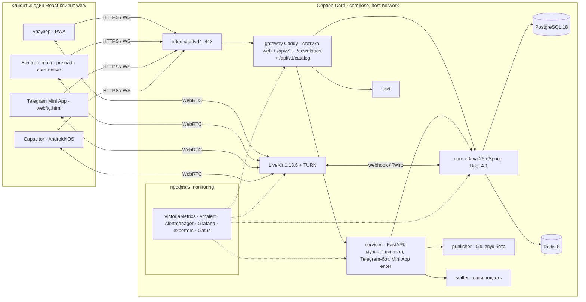

# Целевая архитектура Cord после бэклога (октябрь 2026)

Архитектор, 19.10.2026. Сверено с `main` a7ed543, веткой `epic/E05-media` b3397d9 и рабочими деревьями
E06-A / E07 / E08 (`.claude/worktrees/agent-*`). Ссылки `путь:строка` — от корня `ModernStreamingSystem`,
`W/` — от корня `ModernStreamingSystem.Windows`. Этот документ задаёт **один вектор** для 18 эпиков:
границы, одну модель личности, одну схему настроек, один план контрактов и порядок работ. Решения
владельца (`backlog/DECISIONS.md`) здесь не пересматриваются — только исполняются.

## 0. Коротко

1. **Один React-клиент — четыре оболочки.** Веб с сервера Cord; Electron грузит тот же веб с сервера
   (ADR §2.2), Mini App — второй HTML-вход `web/tg.html` на том же origin, Capacitor — `server.url`.
   Ни одна оболочка не несёт своей версии интерфейса.
2. **Одна личность без учётных записей — профиль устройства**, один заголовок `X-Cord-Profile`, одно
   место разбора (`access/Identity`), одна запись в снимке (`Member.profileHash`). На ней держатся
   предел избранного (10), одна активная встреча (T52), пределы антибота (E11) и статистика (E10).
3. **Сервер — источник правил, клиент — исполнитель.** Качество (умолчание и потолок), пределы, права
   (`you.can`), каталог серверов, коды ошибок — всё приходит из `application.yml` → `capabilities` /
   снимок / подписанный JSON. Клиент ничего из этого не зашивает.
4. **Контракт меняется очередью, а не гонкой.** `contracts/openapi.json` и `web/src/api/generated.ts`
   перегенерирует только интегрирующая сессия при слиянии в `main`, в порядке раздела 3.
5. **Машина `cord.nikg.tech` — стенд, не прод**, пока хост замирает (62 soft lockup за двое суток,
   steal 38–56 %, `backlog/journal/ENV-cord.nikg.tech.md`). Всё, что меряется временем, здесь — нижняя
   граница, а не приёмка.

## 1. Целевая архитектура

### 1.1 Компоненты и границы



| Компонент | Владеет данными | Что в него переезжает по бэклогу |
| --- | --- | --- |
| **core** (`server/`) | комнаты и снимок (`rooms.state` JSON), участники, избранное и **группы избранного** (E02), права (`Permissions`), пределы (`RateLimits` → `abuse`), `startedAt`, статистика встреч и аудит (E10-B), блокировки (E11-B), обращения в поддержку (E13), **каталог серверов** (раздача) | правило «боты не люди» одним методом; `you.can`; квоты по профилю/IP; `Identity`; коды ошибок как реестр |
| **services** (`services/`) | музыка (SQLite), Яндекс, Telegram-привязки и **запросы привязки** (E09), кинозал: кэш ссылок, подписанные адреса, **счётчик трафика** (E11-B), метрики своих трёх вещей | права спрашивает у ядра по имени действия (`you.can`, `participantCan`), код ошибки пробрасывает (`core.py:45-50` сейчас теряет), `X-Cord-Actor: tg:<HMAC>` для бота |
| **gateway** (`infra/Caddyfile`) | статика веба, заголовки безопасности, проксирование | `/tg` с `frame-ancestors https://web.telegram.org` (E09), `metrics` на 127.0.0.1:2019 (E10-B), `header_up -X-Service-Secret` и `X-Real-IP` на `/api/v1/services/*` (E11-B) |
| **web** (`web/`) | интерфейс, предпочтения устройства (`cord:preferences:v1`), профиль (`cord:profile:v1`), история ссылок кинозала (устройство, `preferences.cinemaLinks`) | дизайн-система (E16), слой переводов (E14), `core/permissions.ts`, `media/levels.ts`, `media/capabilities.ts`, `core/identity.ts`, `ui/loader/FullscreenLoader` |
| **Electron** (`W/desktop/`, ADR 0001) | окно, трей, обновление, каталог (проверка подписи), DPAPI-профиль, клавиши, захват звука приложения, оверлей | мост v2 `window.cordDesktop` + прокладка v1; **интерфейс — с сервера** |
| **Mini App** (`web/tg.html`, `web/src/telegram/`) | `initData` → `POST /api/v1/services/telegram/webapp/enter` → invite → тот же `MeetingView` | за флагом `TELEGRAM_WEBAPP_ENABLED` |
| **бот** (`services/cord_services/telegram.py`) | команды чата, привязка с подтверждением в комнате, закреп с url-кнопкой `startapp` | языки по `language_code` (E14-B), пределы `telegram.*` (E11-B) |

Границы, которые не двигаются: правила игр и снимок «глазами участника» — только в ядре
(`RoomService.java:486-547`); новое поле `RoomState` — `@JsonInclude(NON_NULL)` (`RoomState.java:15`
читает с `ignoreUnknown`); `room` не зависит от `api`/`events`/`media` (`ArchitectureTest`).

### 1.2 Одна модель личности (П13, П3, E11, E09, E10)

Учётных записей нет и не будет. «Кто» — ровно три вещи, и каждую разбирает **одно** место —
новый `access/Identity` (компонент + фильтр после `RequestGuard`), а не каждый контроллер:

| Личность | Откуда | Ключ в ядре | Кто читает |
| --- | --- | --- | --- |
| **Профиль устройства** | заголовок `X-Cord-Profile: <43 символа base64url>` — тот же секрет, что сегодня уходит как Bearer только в `/favorites` (`web/src/core/favorites.ts:8-26`, `FavoriteService.java:22-26`) | `profileHash = SHA-256(secret)` | избранное (10), T52, `abuse.per-profile.*`, `unique_devices` в статистике (HyperLogLog, не хранится) |
| **Адрес** | `X-Real-IP` от шлюза с `X-Internal-Secret` (`ClientAddress.java:21-27`) | IPv4 — адрес; **IPv6 — сеть /64** | `abuse.per-ip.*`, блокировки, `ip_hash` в аудите |
| **Актор службы** | `X-Cord-Actor: tg:<HMAC id>` — принимается только вместе с верным `X-Service-Secret` | как профиль, но своя корзина | пределы бота, аудит |

Решения:

- Заголовок **необязателен**: старый клиент (WinUI 0.7.x, старый веб в кэше) без него работает;
  без профиля правила T52/P3 не применяются, а антибот опирается на IP и PoW. Это осознанная дыра:
  «обход новым профилем допустим» (П13).
- `Member.profileHash` (NON_NULL) ставится в `newMember` (`RoomService.java:371-384`) и в
  `returnMember`; наружу в `Participant` **не отдаётся никогда**.
- **T52 в ядре:** после `lockGlobal()` в `create/join/joinCode/rejoin/joinSaved` — поиск открытой
  комнаты, где у этого `profileHash` живое участие (`occupiesSeat()`, `RoomState.java:169-174`), и это
  не та же комната. Нашлось → `409 ALREADY_IN_MEETING` с `properties: {roomId, title}`. Повтор запроса с
  заголовком `X-Cord-Leave: <roomId>` закрывает прежнее участие обычным `leave` (со звуком выхода у
  остальных) и пускает. Так тела `Contracts.Create/Join/JoinCode/Rejoin` не меняются, и OpenAPI не
  трогается. RECOVERING — то же участие, боты (`service != null`) не считаются. В браузере тот же
  факт виден сразу через Web Locks `cord:active-meeting` + BroadcastChannel — но ядро решает.
- **Mini App и Capacitor** получают профиль как обычный веб: у WebView свой `localStorage` на origin.
  Electron пишет `cord:profile:v1` через `bootstrap` (ADR §3.1). Один механизм, четыре оболочки.
- Пределы (E11) и предел избранного (П3) — **один механизм** `RateLimits` с периодом параметром
  (сейчас окно зашито 60 с — `RateLimits.java:16-19`) и ключом из `Identity`.

### 1.3 Снимок: что в нём, что нет (`you.can`, `startedAt`, игры)

Снимок уже собирается на участника (`snapshotFor`, `RoomService.java:486-547`) и целиком
перечитывается каждым на любой `room.changed`; 20 участников — 20 чтений на каждое изменение.
Правило роста: **в снимок попадает состояние O(1) на зрителя, не история и не производные списки**.

| Поле | Размер | Решение |
| --- | --- | --- |
| `you: {can: string[]}` (E06-A, `Contracts.RoomYou`, NON_NULL) | ≤ 40 имён ≈ 600 Б | принять: это замена пяти копий правила в вебе и четырёх в службе; растёт только с числом действий |
| `startedAt: Long` (E02 → делает ядро в пакете WP1) | 8 Б | в `RoomState` (NON_NULL) и в снимке (nullable); ставится, когда **второй человек** стал CONNECTED (`MediaService.java:101-107`, `media.restored`); сбрасывается там же, где `closedAt` при повторном открытии (`RoomService.java:171-175`) |
| `DurakSeat.auto`, счётчики карт, колода (E08) | десятки байт | принять; чужие карты по-прежнему не выходят |
| итоги игр | килобайты | как сейчас — отдельная ручка `/games`, в снимке метка времени (`RoomService.java:549-566`) |
| `messages` (до 1000 за срок) | до сотен КБ | **самое тяжёлое уже сейчас**; E11-B делает кольцо (`chat.room-history`), E10-B добавляет метр размера снимка; дифф-доставка — не в этом бэклоге |
| `participantCan` | только `/internal/services/{id}` | для бота; в браузерный снимок не идёт |

Бюджет: сериализованный снимок комнаты из 20 человек без переписки ≤ 24 КиБ — тест в
`RoomServiceTest` (WP1). Поле больше 1 КиБ на зрителя — отдельная ручка.

### 1.4 Качество: сервер задаёт, клиент исполняет (П2, T44, T48, T10)

Сейчас `capabilities` отдаёт зашитые `[720,1080,1440]` × `[15,30,60]` (`ApiController.java:73-87`), веб
их не читает, а свои списки держит в `media/profiles.ts:3-4`, `core/preferences.ts:110-121`,
`ui/Settings.tsx:149-219` и `Prejoin.tsx`.

- `application.yml` → `stream.media.quality.{default,ceiling,settle}` → `Capabilities.quality`
  (раздел 3). Старые поля `resolutions`/`frameRates` остаются и выводятся из потолка.
- Веб: новый `media/capabilities.ts` — единственный читатель; `profile()` в `preferences.ts`
  **мигрирует** сохранённые «Авто» и 1440 к ближайшему допустимому; «Авто» и 1440 из выбора уходят.
  Лестница (`auto-quality.ts`) превращается в «удержание выбранного»: вниз только после `settle`
  (несколько секунд) и только на время.
- **Камера под демонстрацией** — по П2 не ужимается по умолчанию; `companionCamera`
  (`profiles.ts:285`) остаётся за явным переключателем «Камера уступает показу» (E03, по умолчанию
  выкл.). Цена — третий кодировщик и +2,5 Мбит/с; E05 шаг 5 меряет.
- **T48:** «показ виден зрителям после кадра целевого качества» — событие **отправителя**
  (`screen.started` уже есть в `COMMAND_TYPES`, `Contracts.java:58`): он сообщает, что верхний слой
  кодируется в целевом размере, или истёк `settle`. Зрителю, чей канал тянет только нижний слой,
  показ всё равно открывается — иначе слабый канал никогда не увидит экран.
- **Electron** ничего своего не публикует: захват идёт тем же `getDisplayMedia` через
  `setDisplayMediaRequestHandler` (ADR §4.1), звук приложения — дорожкой в тот же `media/session.ts`.
  Значит, правила качества действуют автоматически; свой WGC-модуль не пишем.
- LiveKit: `room.max_participants` в `livekit.json` (`scripts/configure.mjs:156`) = `max-participants`
  + 4 (боты и переходные сессии), иначе 21-й человек упрётся в SFU, а не в ядро.

### 1.5 Один источник уровня голоса (T23 → E04, E08, E01, E03)

`media/levels.ts`: один `AudioContext`, `AnalyserNode` на свою дорожку микрофона и на каждую
принятую аудиодорожку (они и так играют в `Stage.tsx:101-124`), опрос ≤ 30 раз/с через один
`requestAnimationFrame`-тикер, только пока вкладка видима. Выход — `Store<Record<participantId,
{level: 0..1, tier: 0|1|2|3|4}>>` (0 — молчит, 1–4 — ступени `--voice-1..4`; так сделано в E04) с атакой
1 кадр и спадом 150–250 мс. Читают: плитки и список (E04),
`GamePeople` (E08), индикатор микрофона в настройках (E03 — заменяет `useMicLevel.ts:30-57` с опросом
100 мс), оверлей Electron через `overlay.state` ≤ 10 Гц (ADR §3.3). `ActiveSpeakersChanged`
(`session.ts:421-425`) остаётся только для тех, на кого нет подписки. Цвета ступеней — токены
`--voice-1..4` из E16, и ни одного литерала.

### 1.6 Каталог серверов (T05, П4) — один файл для веба и Electron

По ADR §8: JWS (EdDSA/Ed25519), `payload` — `{format: "cord.servers/1", seq, issuedAt, expiresAt,
servers[]}`, подписан **офлайн** скриптом владельца (`scripts/sign-catalog.mjs`, ключ не на сервере).
Файл `infra/catalog/servers.jws` лежит в репозитории (данные публичные, репозиторий закрытый) и
раздаётся ядром: `GET /api/v1/catalog` в списке `OPEN` `RequestGuard` (как `capabilities`),
`Cache-Control: max-age=3600`. Публичные ключи `[текущий, следующий]` — `contracts/catalog-keys.json`,
вшиты в веб и в Electron; схема — `contracts/server-catalog.v1.schema.json`. В браузере каталог
читает `web/src/core/servers.ts` (сейчас хранит один origin, `servers.ts:13-26`) для раздела
«Серверы» в настройках: выбор другого сервера = переход на другой origin. В Electron — рейл/список
с флагами (`W/desktop`). Ручного адреса нет нигде.

### 1.7 Коды ошибок — один реестр на ядро, службу, веб и бот (E14-A)

Ядро уже отдаёт `code` в RFC 7807 (`Problem.java:7-11`, `ApiErrors.java:10-17`), ~100 кодов
строками; служба отдаёт только `detail` и теряет код ядра (`core.py:45-50`); веб показывает
`detail` как есть (`api/client.ts:12-19`). Решение: `contracts/errors.json` — реестр
`{code: {status, params[], ru}}`; тест ядра проверяет, что каждый `new Problem(…, "CODE", …)` в
исходниках есть в реестре; служба отвечает `{code, detail, params}` и пробрасывает код ядра; веб —
`t('error.' + code, params)` с запасным `detail`; бот — тот же реестр по `language_code`. Русский
`detail` остаётся для старых клиентов.

### 1.8 Маршруты веба

Роутера нет (`App.tsx:36-42`, `/download` — `App.tsx:324-325`). Новые страницы: `/activity` (E10-B,
за `ADMIN_PASSWORD`), `/support` (E13), `/dev/ui` (витрина E16, только dev-сборка), `/tg` — **отдельный
HTML-вход**, не маршрут (защита по источнику Bot API 10.2 и iframe Telegram Web). Решение: остаёмся
на переключении по `location.pathname` в `App.tsx`; библиотека маршрутов не добавляется.

## 2. Одна схема настроек

Формат: сроки — словами через `Term` (`config/Term.java:33-102`: `4 seconds`, `15 minutes`, `never`);
частоты — новый разбор `N per <срок>` там же; размеры — `DataSize` Spring (`100GB`); уровни качества —
`<высота>p<fps>`. Каждое значение переопределяется переменной окружения, как `retention.*`
(`application.yml:48-58`). Префикс остаётся `stream` (`StreamProperties.java:11`).

### 2.1 `application.yml` (ядро)

| Ключ | По умолчанию | Формат | Читает | Эпик | Конфликт с кодом сейчас |
| --- | --- | --- | --- | --- | --- |
| `stream.max-participants` | **20** | число людей; боты не считаются | `checkSeat`, `capabilities`, `livekit.json` (+4) | E05 (T06) | `@Max(10)` `StreamProperties.java:27`; «десять» в тексте `RoomService.java:245`; javadoc `RoomState.java:8`; бот занимает место `RoomService.java:243-245`, тест `RoomServiceTest.java:261-286`; `configure.mjs:156` = 10 |
| `stream.max-screens` | 2 | число | `MediaService.java:47-51` | — | `@Max(2)` оставить |
| `stream.max-rooms` | **8** (см. 5.2) | число; считаются комнаты с хотя бы одним CONNECTED или моложе 30 с | `create`, `checkSeat` | E05 шаг 5 / E11 A1 | сейчас 5, считает любую занятую (`RoomService.java:63-71`) |
| `stream.media.quality.default` | `720p30` | уровень | `capabilities.quality.default` | E05 (T44) | зашито в `ApiController.java:73-87`, `preferences.ts:110-111` (1080/30 авто) |
| `stream.media.quality.ceiling` | `1080p60` | уровень | `capabilities.quality.ceiling`, фильтр списка | E05 (T44) | 1440 в `profiles.ts:3`, `Settings.tsx:181` |
| `stream.media.quality.settle` | `4 seconds` | `Term` | `capabilities.quality.settleMs`; T48 отправитель | E05 (T44/T48) | — |
| `stream.media.quality.camera-yields-to-screen` | `false` | bool | `capabilities.quality`, `upstream.ts` | E05 (П2) | сейчас всегда ужимает в «Авто» (`profiles.ts:285`) |
| `stream.favorites.max-saved` | **10** | число на профиль, по всем группам | `FavoriteService.save` между :65 и :69 под замком | E05 (T06) → E02 UI | предела нет (`FavoriteService.java:59-62`), `docs/architecture.md:116` |
| `stream.meeting.one-active-per-profile` | `true` | bool | `Identity` + входы | E05 (T52) | нет профиля во входах |
| `stream.meeting.max-duration` | `24 hours` | `Term`/`never` | `Lifecycle` | E11-B (A2) | потолка нет |
| `stream.meeting.warn-before` | `15 minutes` | `Term` | событие `meeting.warning` | E11-B | — |
| `stream.meeting.presence-check` / `presence-answer` | `2 hours` / `5 minutes` | `Term` | `Lifecycle`, веб-плашка | E11-B | — |
| `stream.meeting.idle-integrations` | `10 minutes` | `Term` | `Lifecycle`, служба | E11-B | кино гаснет только без людей (`Lifecycle.java:143-148`) |
| `stream.meeting.waiting` / `waiting-expires` | `10` / `2 minutes` | число / `Term` | `checkSeat` | E11-B (A5) | WAITING занимает место (`RoomState.java:169-174`) |
| `stream.abuse.human-check` / `proof-cost` | `proof-of-work` / `auto` | слово / число | `/api/v1/proof`, create, join-by-code | E11-B | — (ALTCHA, `docs/abuse-model.md` §3) |
| `stream.abuse.per-ip.*` | `rooms-created: 10 per hour`, `open-rooms: 3`, `admissions: 30 per minute`, `code-joins: 5 per minute`, `code-misses: 20 per hour`, `waiting-per-room: 2`, `sockets: 30`, `socket-opens: 60 per minute`, `reads: 300 per minute`, `signaling: 60 per minute`, `password-misses: 10 per hour`, `uploads: 2GB per 1 day` | `N per <срок>` | `RateLimits` с периодом; ключ IPv6 /64 | E11-B | окно только 60 с (`RateLimits.java:16-19`); `admissions` 30 и `code` 10 зашиты в `ApiController.java:92,131` |
| `stream.abuse.per-profile.*` | `rooms-created: 6 per hour`, `open-rooms: 2` | то же | `Identity` | E11-B | — (`saved-rooms` и `active-meetings` живут выше, не здесь — одно значение в одном месте) |
| `stream.abuse.per-member.*` | `chat-messages: 20 per minute`, `chat-burst: 5`, `sockets: 3` | то же | `message.send`, `RoomSocket` | E11-B (A6, A13) | 120 команд/мин общим ключом (`RateLimits.java:51-56`); сокеты без потолка |
| `stream.abuse.server.code-misses` | `300 per minute` | то же | «щит» | E11-B (A3) | — |
| `stream.chat.links` / `executable-attachments` / `room-history` | `warn` / `warn` / `1000` | слово / слово / число | веб, `AttachmentService`, `message.send` | E11-B | потолок 1000 отказывает всем (`RoomService.java:1020-1027`) |
| `stream.blocks.default-term` / `auto-block` / `auto-block-term` | `1 day` / `10 refusals per 10 minutes` / `30 minutes` | `Term` / частота | таблица `blocks` (V10) | E11-B | — |
| `stream.retention.audit` / `meeting-stats` / `activity-daily` | `3 months` / `1 year` / `never` | `Term` | уборка в `Lifecycle` | E10-B | — |
| `stream.admin-password` | `${ADMIN_PASSWORD:}` | строка | `AdminAccess` (как `ServerAccess`, `ServerAccess.java:24`) | E10-B | — |
| `stream.audit-ip-key` | `${AUDIT_IP_KEY}` | 32 байта | HMAC IP в аудите | E10-B | — |
| `stream.catalog.file` | `${CATALOG_FILE:infra/catalog/servers.jws}` | путь | `GET /api/v1/catalog` | E01-B (T05) | — |
| `stream.support.*` | `enabled: true`, `notify-telegram-chat: ${SUPPORT_TELEGRAM_CHAT_ID:}` | bool / id | таблица `support_tickets` (V11) | E13 | — |

Пределы кинозала живут в службе (у неё свой процесс и своя память): `CINEMA_LINK_TTL=1 hour`,
`CINEMA_TRAFFIC_PER_MEETING=100GB`, `CINEMA_TRAFFIC_PER_DAY=500GB`, `CINEMA_TRAFFIC_WARN_AT=80%`,
`CINEMA_LINK_HOSTS_DENY=` — через `.env`, разбор теми же словами (`services/cord_services/config.py`,
новый общий разбор `term()`).

### 2.2 `.env` (пишет `scripts/configure.mjs:107-133`, расширяется им же)

| Переменная | По умолчанию | Кто читает | Эпик |
| --- | --- | --- | --- |
| `ADMIN_PASSWORD` | пусто = «Активность» выключена | ядро, Caddy `forward_auth` для `/ops/grafana/` | E10-B |
| `AUDIT_IP_KEY` | генерируется | ядро | E10-B |
| `LIVEKIT_METRICS_PASSWORD` | генерируется | `livekit.json` блок `prometheus`, scrape | E10-B |
| `COMPOSE_PROFILES` | пусто; `monitoring` на проде | compose, `setup.sh --monitoring`, `update.sh` | E10-B |
| `METRICS_RETENTION` / `LOGS_RETENTION` | `3 months` / `14 days` | `configure.mjs` → флаги VictoriaMetrics/Logs | E10-B |
| `ALERT_TELEGRAM_CHAT_ID`, `HEALTHCHECKS_URL` | пусто (шаг владельца) | Alertmanager | E10-B |
| `TELEGRAM_WEBAPP_ENABLED` | `false` | служба: каталог `telegram.webapp`, `/tg` вход | E09 (П5) |
| `TELEGRAM_WEBAPP_SHORT_NAME`, `TELEGRAM_INITDATA_MAX_AGE` | пусто / `1 hour` | служба | E09 |
| `CINEMA_*` (2.1) | как выше | служба | E11-B / E07 |
| `SUPPORT_TELEGRAM_CHAT_ID` | пусто | ядро → бот | E13 |

`CORD_MEET_TELEGRAM_BOT_TOKEN` остаётся в `.local/telegram.env` (`compose.yaml:74-77`). Переменные
качества/пределов ядра — через `STREAM_*`, как сейчас `STREAM_MAX_PARTICIPANTS` (`docs/deployment.md`).

### 2.3 Профили compose и `setup.sh`

| Профиль | Службы | Включение |
| --- | --- | --- |
| (без профиля) | edge, gateway, core, services, sniffer, postgres, redis, livekit, tusd | всегда |
| `monitoring` | victoriametrics, vmalert, alertmanager, grafana, node/postgres/redis-exporter, gatus; второй очередью victorialogs + fluent-bit | `setup.sh --monitoring`; ≈ 410 МиБ (`docs/observability.md` §6) |
| `antivirus` (по желанию) | clamav | не по умолчанию: ≈ 1–1,5 ГБ памяти (`docs/abuse-model.md` A7) |

Все новые контейнеры — `network_mode: host`, только 127.0.0.1, `mem_limit`, `logging:
*default-logging`, образы по digest — как в `compose.yaml:12-16`.

## 3. Один план контрактов

### 3.1 Снимок, REST, WebSocket

Правила: новое поле снимка — `@JsonInclude(NON_NULL)` в записи и в `RoomState`; в
`OpenApiConfig.java:37-87` схема делает все поля `required`, поэтому новое поле **убирается из
required** (`:88-100`) и объявляется `nullable` (`:115-146`); новый тип команды — только в
`Contracts.COMMAND_TYPES` (`Contracts.java:57-58`); новый тип события — в enum `OpenApiConfig.java:30-36`
и `contracts/events.schema.json`.

| # | Добавление | Тип | NON_NULL / nullable / required | Владелец | Статус |
| --- | --- | --- | --- | --- | --- |
| 1 | `Snapshot.you` = `RoomYou{can: string[]}`; `/internal/services/{id}.participantCan` | объект | NON_NULL; nullable; не required; `RoomYou.can` required | **E06-A** | в работе (worktree, не закоммичено) |
| 2 | `Snapshot.startedAt` | `Long` мс | NON_NULL; nullable; не required | E02 → **делает WP1** | ждёт |
| 3 | `Capabilities.quality` = `{default:{resolution,fps}, ceiling:{…}, settleMs, cameraYieldsToScreen}`; `Capabilities.favoritesMax`, `Capabilities.catalogSeq` | объект, числа | required (всегда есть) | **WP1 / E05** | ждёт |
| 4 | `409 ALREADY_IN_MEETING {roomId, title}`; заголовки `X-Cord-Profile`, `X-Cord-Leave` | ProblemDetail + заголовки | без изменения схем тел; описать в `contracts/headers.md` | **WP1 / E05** | ждёт |
| 5 | `409 FAVORITES_FULL {max: 10}` | ProblemDetail | — | WP1 | ждёт |
| 6 | `DurakSeat.auto`, счётчики карт, положение колоды, новые `GameVisualEvent.type` (`throw`, `transfer`, `take`, `beat`) | строки/числа | nullable; не required; enum в `OpenApiConfig.java:108-114` | **E08** | в работе |
| 7 | `GET/PUT/DELETE /favorites/groups`, `favorites[].groupId`, `Favorite.pinned` | REST | `groupId` nullable | E02 | ждёт (V8) |
| 8 | `GET /api/v1/catalog` (JWS), `contracts/server-catalog.v1.schema.json`, `contracts/catalog-keys.json` | статичный JSON | вне OpenAPI (схема своя) | E01-B | ждёт |
| 9 | события WS `meeting.warning`, `presence.check`, `cinema.traffic`; `429 CHAT_RATE`, `403 BLOCKED`, `429 ROOMS_PER_HOUR`, `429 CODE_MISSES`; `GET /api/v1/proof`, заголовок `X-Cord-Proof` | события, коды | enum событий + реестр ошибок | E11-B | ждёт |
| 10 | `/api/v1/admin/activity/*`, `POST /api/v1/client-report`, `POST /api/v1/support` | REST | под `/api/v1/` — иначе `generate-api.mjs:7-9` их отфильтрует и типов в вебе не будет | E10-B, E13 | ждёт |
| 11 | служба: `{code, detail, params}` во всех ошибках; `POST /telegram/webapp/enter`, `GET/POST/DELETE /rooms/{id}/telegram{,/requests/{rid},/binding}`; `catalog.telegram.webapp` | FastAPI (вне OpenAPI ядра) | — | E14-A, E09 | ждёт |
| 12 | `contracts/errors.json` + тест ядра «каждый код в реестре» | реестр | — | E14-A | ждёт |

Миграции Flyway (следующая — V8, `server/src/main/resources/db/migration/`): **V8** группы избранного
(E02), **V9** `meeting_stats` + `activity_daily` + `audit_events` (E10-B), **V10** `blocks` (E11-B),
**V11** `support_tickets` (E13). Номера закреплены сейчас, чтобы две ветки не взяли один.

### 3.2 Очередь регенерации `contracts/openapi.json` + `web/src/api/generated.ts`

CI сверяет сгенерированное с закоммиченным (`.github/workflows/verify.yml:76-81`), а прод-ядро
springdoc не отдаёт (`compose.yaml:54`; обход — `backlog/knowledge/memory/cord-openapi-regeneration.md`).
Правило: **ветка эпика меняет Java-контракт и может перегенерировать локально, но в `main` файлы
перегенерирует только интегрирующая сессия, по одному слиянию за раз**, в этом порядке:

1. E06-A (`you`) → regen → `main`.
2. WP1: `startedAt`, `Capabilities.quality`/`favoritesMax`, `maxParticipants` 20 → regen.
3. E08 (`DurakView`) → regen.
4. E02 (группы избранного, V8) → regen.
5. E10-B (admin, client-report, V9) → regen; E11-B (события, коды, V10) → regen; E13 (V11) → regen.

Веб-ветки, которые не трогают Java, `generated.ts` не касаются. Служба и бот не участвуют в OpenAPI
ядра — их схемы меняются своими ветками без очереди.

### 3.3 Мост Electron v2 (`window.cordDesktop`) и прокладка v1

По ADR §3: `{protocol: {major: 2, minor}, features[], app, bootstrap, send(), invoke(), on()}`; веб
проверяет **флаги возможностей**, не версии. Схема — `contracts/desktop-bridge.v2.schema.json`,
копия в `W/desktop/` сверяется хэшем (как `BridgeProtocol.cs` сейчас повторяет список веба).
Веб-сторона: `core/desktop.ts` (сейчас v1 через `window.chrome.webview`, `desktop.ts:52-64`)
получает `isDesktop()`, `desktop.features.has('ptt')` и адаптер v1 ↔ v2, чтобы одни и те же 10 мест
(`core/session.ts`, `App.tsx`, `main.tsx`, `ui/*`) не ветвились по оболочке. Новые сообщения:
`capture.sources/select`, `overlay.state` (из `media/levels.ts`), `hotkey {action, phase}`,
`thumbar`, `deeplink`, `power`, `notify/attention/progress/badge`. Прокладка v1 в Electron живёт два
выпуска после того, как каталог целиком отдаёт веб с v2 (`/api/v1/info` сообщает версию веба — добавить
в `capabilities.webBuild` вместо новой ручки).

### 3.4 Каталог и подпись

Формат и поля — §1.6 и ADR §8; `name` по языкам П9 (`ru` обязателен), `country` ISO 3166-1 alpha-2,
`default` ровно у одного, `seq` только растёт, `expiresAt` + 30 дней льготы. Первая запись каталога —
один сервер: `{id: "de-1", country: "DE", url: "https://meet.nikg.tech/", default: true}` (страна
по размещению прода, `docs/deployment.md`: Франкфурт); стенд `cord.nikg.tech` в каталог не входит,
сборки прототипа Electron получают тестовый каталог с тестовым ключом.

## 4. Порядок и параллельность

### 4.1 Что идёт сейчас и чего касается

| Ветка | Файлы | Пересечения |
| --- | --- | --- |
| `epic/E05-media` (T38, T49 готовы) | `web/src/core/meeting.ts`, `core/room-cues.ts`, `media/volume.ts`, `ui/Stage.tsx` | дальше T44/T48 — `media/*`, `Settings.tsx`, `Prejoin.tsx`, `ApiController`, `StreamProperties`, `application.yml`; T06/T52 — `RoomService` ← **ждёт слияния E06-A** |
| `epic/E06-A-permissions` | `RoomService.java` (31 замена `owner()/integrations()/gameHost`), `Contracts.java`, `OpenApiConfig.java`, `ServiceController.java`, новый `Permissions.java`; дальше `services/core.py`, `app.py`, `web/src/core/permissions.ts`, `Services.tsx` + 10 файлов веба | **первая в очереди**: все остальные правки `RoomService` ложатся поверх |
| `epic/E07-cinema` | только `web/src/ui/cinema/**`, `core/cinema/**`, `services/.../cinema/providers/link.py`, `facade.py` | с ядром не пересекается; с E16 — через CSS кинозала |
| `epic/E08-games` | `game/Durak.java`, `DurakView.java`, тесты; дальше `web/src/ui/Durak*.tsx`, `durak.css`, `GamePeople.tsx`, звуки | `OpenApiConfig` (enum событий) — после E06-A; `FullscreenLoader` — ждёт E16 |
| E14-A (началась 19.10 02:39 **в главном дереве** на ветке `epic/E05-media`: в `web/package.json` добавлены `i18next 26.5.2`, `react-i18next 17.1.0`, `i18next-resources-to-backend 1.2.3`) | `web/package.json`, `package-lock.json`, далее `web/src/i18n/*` | **опасно**: правки ложатся в чужую ветку; перенести в свою ветку/worktree до коммита, библиотеку записать в DECISIONS (совпадает с WP4) |

**Горячие файлы** (один агент за раз, остальным — ждать слияния или работать в новых файлах):
`server/.../room/RoomService.java`, `Contracts.java`, `OpenApiConfig.java`, `StreamProperties.java` +
`application.yml`, `Lifecycle.java`; `web/src/ui/MeetingView.tsx`, `Settings.tsx`, `Stage.tsx`,
`Services.tsx`, `App.tsx`, `styles.css`, `media/session.ts` (1687 строк), `core/preferences.ts`;
`services/cord_services/app.py`, `core.py`, `telegram.py`; `infra/Caddyfile`, `compose.yaml`,
`scripts/configure.mjs`. Правило для параллельных агентов: новое поведение — **в новом модуле**
(`media/levels.ts`, `media/capabilities.ts`, `core/identity.ts`, `access/Identity.java`,
`room/Permissions.java`), а в горячий файл — минимальная точка подключения одним коммитом.

### 4.2 Критический путь

```
E06-A ─┬─► WP1 «Личность и пределы» (ядро) ─► regen ─► E02/E03 ядро-части ─► E11-B ─► E13
       │
E16 токены+примитивы+Loader ─► E02 ─► E03 ─► E04 ─► E06-B ─► E08 UI ─► E15-B
       │                       └──────────────────────► E01-B (экраны клиента) ─► E09 ─► E12
E14-A (шаг а) ───────────────► каждый новый экран пишется через t()
E10-B ядро (метры, V9) ──────► E11-B (аудит и рычаги) ─► E10-B страница «Активность»
```

E14-A делится: **шаг (а)** сейчас — библиотека, `t()`, реестр ошибок, проверка CI «кириллица
только в разрешённых файлах» с allowlist всех нынешних файлов; **шаг (б)** — вынос строк делает тот
эпик, который переписывает экран (E02/E03/E04/E06-B/E08), остаток — E14-B. Иначе один PR на 149
файлов конфликтует со всеми ветками сразу (`backlog/journal/E00/map-web.md`: ~1200 литералов).

### 4.3 Следующие пакеты работ

| # | Пакет | Модель | Файлы | Зависит от |
| --- | --- | --- | --- | --- |
| **WP1** | **Личность и пределы (ядро):** `access/Identity` + `X-Cord-Profile`/`X-Cord-Leave`, `Member.profileHash`, T52 (`ALREADY_IN_MEETING`), избранное 10 (`FAVORITES_FULL`), `max-participants` 20 без ботов (+ `@Max`, текст, javadoc, тест, `livekit.json` +4), `max-rooms` считает CONNECTED, `RateLimits(period)` + IPv6 /64, `stream.abuse` каркас с четырьмя пределами из A1/A3, `startedAt`, бюджет снимка; минимальный веб: заголовки в `api/client.ts`, `confirm()` на 409 (диалог — E02) | **Fable** (задаёт вектор для E02/E11/E10) | `RoomService`, `RoomState`, `FavoriteService`, `RateLimits`, `ClientAddress`→`Identity`, `StreamProperties`, `application.yml`, `MediaService`, `configure.mjs`, `api/client.ts`, `core/favorites.ts` | слияние E06-A |
| **WP2** | **Качество из конфигурации (E05 T44/T48):** `stream.media.quality` → `Capabilities.quality`; `media/capabilities.ts`; миграция `profile()`; без «Авто»/1440; «удержание» вместо лестницы; плитка «готовится показ» по `screen.started`; переключатель «камера уступает показу»; живой замер `getStats` | Opus | `media/profiles.ts`, `auto-quality.ts`, `upstream.ts`, `session.ts` (точечно), `preferences.ts`, `Settings.tsx` `QualityFields`, `Prejoin.tsx`, `ApiController`, `StreamProperties` (общий блок с WP1 — согласовать имена по 2.1) | веб-часть — сейчас; ядро — после WP1 |
| **WP3** | **E16 фундамент:** слои токенов (сырые → смысловые → компонентные), шкалы отступов/радиусов/теней/z-index/движения, примитивы (Button, IconButton, Field, Slider с `:focus-visible`, Switch, Tabs, Menu, Dialog, Toast, Badge SOON, Card, `Resizer` + `usePanelWidth`), `FullscreenLoader` по спеке, `index.html` с фоном до JS, витрина `/dev/ui`, 2–3 HTML-макета направления | **Fable** | `styles.css` (токены), новые `ui/tokens.css`, `ui/primitives/*`, `ui/loader/*`, `index.html`, `vite.config.ts`, `infra/Caddyfile` (хеш скрипта темы) | — (параллельно WP1/WP2) |
| **WP4** | **E14-A шаг (а):** выбор библиотеки (решение в DECISIONS), `t()`, каталог `ru` для новых файлов, `contracts/errors.json` + тест ядра, служба пробрасывает `code` (`core.py:45-50`), `ApiError.code` → текст, CI-проверка с allowlist | Opus | новые `web/src/i18n/*`, `contracts/errors.json`, `server/.../shared/Problem.java` (без изменения кодов), `services/.../core.py`, `web/src/api/client.ts` | — |
| **WP5** | **E01-B каркас `W/desktop/`:** main/preload/shell по ADR, мост v2 + прокладка v1, проверка каталога, `desktop.yml` на windows-2022, прототип с цифрами (`metrics.json`) — закрывает и E01-A шаг 3 | Opus | только репозиторий Windows + `contracts/desktop-bridge.v2.schema.json`, `contracts/server-catalog.v1.schema.json` | — |
| **WP6** | **E10-B ядро:** метры Micrometer по §4 `docs/observability.md`, V9, `POST /client-report`, `AdminAccess`; профиль `monitoring` в compose + `infra/monitoring/` как код | Opus | `config/Metrics*.java`, `Lifecycle` (уборка — точечно), миграция V9, `compose.yaml`, `configure.mjs`, `setup.sh` | WP1 (ключи профиля/IP), очередь regen |
| **WP7** | **E04 T23 `media/levels.ts`:** модуль уровня с тестом на синтетическом сигнале, ступени, подключение плитки и списка; токены `--voice-1..4` согласованы с WP3 | Opus | новые `media/levels.ts`, точечно `Stage.tsx`, `Sidebar.tsx`, `useMicLevel.ts` (удаляется) | — |
| **WP8** | **E09 прототип:** `/tg-probe` (getUserMedia, плитка, `requestFullscreen`), `verify_init_data` в службе с тестами, `Caddyfile` для `/tg`, `tg.html` со статической загрузкой из WP3, флаг `TELEGRAM_WEBAPP_ENABLED` в каталоге служб | Opus | `web/tg.html`, `web/src/telegram/*`, `services/.../telegram_webapp.py`, `Caddyfile` (блок `/tg`) | WP3 для разметки загрузки (можно заглушкой) |

Интегрирующая сессия между пакетами: слить, перегенерировать контракты по очереди 3.2, выкатить на
стенд, `e2e` против `https://cord.nikg.tech`. Одновременно — не больше одного тяжёлого прогона на
машине (`tsc -b` 10 мин, `vite build` 14 мин, `verify` ядра 35 мин — `backlog/CONTEXT.md`): общий
`flock backlog/.build.lock` для агентов, как `.deploy.lock` для выкатки.

## 5. Риски и честные оценки

### 5.1 Хост замирает — «прод на этой машине» пока невозможен

62 `soft lockup` на всех 4 vCPU по 21–35 с, steal 38–56 %, диск 6,7 МБ/с
(`backlog/journal/ENV-cord.nikg.tech.md`). Для SFU это обрыв медиа у всех участников раз в час. Старый
прод (6 vCPU) страдает тем же с 14.10 (`backlog/knowledge/memory/vm-host-stalls.md`), вероятно тот же
хостер. Что делаем: (1) переключение DNS — только после переноса ВМ/выделенных ядер
(`OWNER-ACTIONS.md` №3); (2) все замеры времени на стенде помечаются «steal N %» и не считаются
приёмкой T38/T50/E05-5; (3) мониторинг (E10-B) с первого дня считает `cord_host_soft_lockups_total`
и алерт `HostStalled` гасит остальные (`docs/observability.md` §8); (4) сборки — только когда нет
встреч (`backlog/bin/deploy.sh`), и не параллельно.

### 5.2 Ёмкость: 20 участников + 2×1080p60 на 4 vCPU не сходится «в лоб»

Счёт по `profiles.ts:17-21` (1080p60 = 10 Мбит/с) и `docs/capacity.md` (150 Мбит/с на ядро, канал
кончается раньше ядер): два экрана × 10 Мбит/с × 19 подписчиков = **380 Мбит/с**; 20 камер по
0,6–2,5 Мбит/с × 19 = 228–950 Мбит/с. Такая комната одна занимает 0,6–1,3 Гбит/с и 4–9 ядер — больше
машины. Сходится только с тем, что уже есть: адаптивные подписки (плитка 20-из-20 получает 360p ≈
0,5 Мбит/с → ≈ 190 Мбит/с на камеры) и экран в верхнем слое только у тех, кто его открыл крупно.
Итого ≈ 570 Мбит/с и ~4 ядра на **одну** полную комнату. Отсюда: `max-rooms` по умолчанию 8 — это
восемь обычных комнат (5–6 человек, 60–100 Мбит/с), а не восемь полных; E05 шаг 5 меряет `lk
load-test` на спокойной машине и уточняет; честный потолок в документации владельцу: «20 человек с
камерами и две демонстрации — на гигабитном канале и без замираний хоста». На нынешнем стенде это не
измерить.

### 5.3 Telegram WebView

Кнопка `web_app` в группах запрещена — только url-кнопка `t.me/<бот>?startapp=…&mode=fullscreen`
(`docs/superpowers/specs/2026-10-19-telegram-mini-app.md` §0, §3): формулировку T04 «кнопка вебаппа»
это выполняет. Демонстрации экрана в WebView телефонов нет; на iOS жалобы на чёрный кадр; Telegram
Web открывает Mini App в iframe, а `Caddyfile:20,25` ставит `X-Frame-Options DENY` и
`frame-ancestors 'none'` — для `/tg` нужен отдельный блок. Запасной путь — `openLink` в браузер.
Прототип (WP8) — первым, до любой привязки.

### 5.4 iPhone в фоне

«Полноценный разговор» на телефоне из браузера невозможен: веб-приложение с экрана «Домой» глушит
микрофон в фоне (WebKit 239602), карточки звонка нет (`docs/mobile.md` §0–1). Веб-часть (W1–W7)
делается сразу, а «как у Telegram» — только Capacitor (Android без аккаунтов, iOS после опыта с
WKWebView и $99/год у владельца). Нынешний `InstallHint` ведёт iPhone в худшее место — поправить в
E12 первым.

### 5.5 Electron: подпись, обновления, экспериментальные API

Без сертификата — SmartScreen и выключенная проверка Authenticode в updater; целостность держат
Ed25519-подпись манифеста и sha512 (ADR §5), причём подписанные манифесты в electron-builder есть
только в 27-alpha — до него свой провайдер. `contextBridge.executeInMainWorld` для прокладки v1 —
экспериментален, запасной путь `webFrame.executeJavaScript`. Переход со старого клиента — через
Inno-обёртку 1.0.0 (ADR §7.2): это единственный способ, которым обновятся 0.7.x. Оверлей и FACEIT —
проверяются только на живой машине владельца.

### 5.6 Противоречия в бэклоге и как они разрешаются

| Где | Противоречие | Решение |
| --- | --- | --- |
| T44 «сразу качество из конфигурации» | LiveKit стартует камеру с 1 Мбит/с, снаружи не настраивается (`docs/frontend.md` → «Чего это не лечит») | первые секунды камеры не починить; `settle` — окно, в котором лестница не спускается; показ экрана этого ограничения не имеет |
| T48 «показ после отличного качества» | у зрителя со слабым каналом верхний слой не придёт никогда | «целевое качество» — факт отправителя (`screen.started`), а не каждого зрителя |
| П2 «камера не уступает показу» | `upstream.ts` экономит ровно этим; +2,5 Мбит/с и третий кодировщик у отправителя | переключатель, по умолчанию выкл., как сказал владелец; E05 шаг 5 меряет цену |
| T06 «20 участников» | `@Max(10)`, LiveKit `max_participants: 10`, текст «десять», тест на бота-в-месте | WP1 меняет все четыре места одним коммитом |
| T25 «убрать „В эфире“» | 17 файлов e2e ждут этот текст | сначала `data-media-status` в шапке и правка e2e (E02 шаг 4), потом бейдж |
| T52 «одна встреча» без учётных записей | новый профиль обходит правило | по П13 это удобство, не защита; антибот — IP и PoW |
| T16 «полноценный разговор в фоне» из браузера | платформа не даёт | веб делает максимум, остальное — Capacitor и шаги владельца |
| T32 «как в Cloudflare» | DNS only, трафик встреч мимо Cloudflare | своя статистика из событий ядра; внешний сторож Healthchecks.io |
| T37 «невидимый антибот» + CSP + установки без Cloudflare | Turnstile требует чужой домен в CSP | ALTCHA (PoW, MIT, свой хостинг); CSP не трогаем |
| T54 «ни одной ссылки» + electron-builder | `repository`/`homepage` в `package.json` сами пишут GitHub в карточку Windows | в `package.json` нет этих полей, `publish: generic` явно; тест CI читает ключ удаления |
| E17 «прод здесь» | хост замирает | стенд; переезд — после решения владельца по хостингу |
| П3 «`max-rooms` из замера» | замер на замирающем хосте бессмыслен | формула из `docs/capacity.md` и старые числа; перемер на спокойной машине |
| E15 Figma | 20 чтений в месяц на Starter (`ENV`) | писать можно без лимита; читать — только для сверки, по одному вызову на страницу |
| E09 «SOON» (T30) и E09 реализация | владелец не включил | всё за `TELEGRAM_WEBAPP_ENABLED=false`; витрина показывает SOON по полю каталога служб |

## 6. Вектор дизайна (E16 → E02, E03, E04, E06-B, E07, E08, E01-B)

1. **Слои токенов.** Сырые (`--palette-*`, только в `tokens.css`) → смысловые (`--bg`, `--surface-1/2/3`,
   `--text`, `--muted`, `--line`, `--accent`, `--accent-hover`, `--accent-soft`, `--danger`,
   `--voice-1..4`) → компонентные (`--button-bg`, `--tile-ring`). Компоненты читают только смысловые и
   компонентные. Сегодня токенов 12 (`styles.css:8-63`), а литералов — 387 цветов, 38 радиусов,
   40 теней, 71 размер шрифта, 26 z-index, 25 `!important` (`backlog/journal/E00/map-web.md`).
2. **Медиасцена всегда тёмная.** `.media-stage { color-scheme: dark }` со своими токенами в обеих
   темах: видео и карты живут на чёрном (Discord, Cardbox), а панели и настройки — в теме человека.
3. **Шкалы, а не значения.** Отступы 4-пт (`--space-1..8`), радиусы `4/8/12/16/20/28`, тени три,
   z-index один список (`--z-stage 10, --z-panel 20, --z-dock 30, --z-menu 40, --z-dialog 50,
   --z-loader 60, --z-toast 70`; меню 40 и диалоги 50 уже договорены), типографика Inter Variable с
   семью размерами.
4. **Движение короткое и физичное.** `--motion-fast 120ms`, `--motion-base 200ms`, `--motion-slow 320ms`,
   кривые `--ease-standard` (`cubic-bezier(.2,0,0,1)`) и `--ease-emphasized`; анимируются только
   `transform`/`opacity`; бесконечные петли — CSS на компоновщике (решение спеки загрузки); `prefers-
   reduced-motion` — статичный кадр. Один язык движения: загрузка, появление плитки, раздача карт,
   панели.
5. **Плотность.** Касание 48 px, настольные строки 36–40 px, панели настроек с фиксированной
   геометрией (T26: переключение раздела не меняет размер окна — измеряется `getBoundingClientRect`),
   ручка-разделитель одна (`Resizer`, `col-resize`, видимая полоса при наведении и перетаскивании).
6. **Марка — только рисунок** (T24 сделано в SVG, коммит 70516c7): компонент `Logo` с вариантами, из
   него иконки, установщик, Open Graph. Текст «cord» как логотип не появляется больше нигде.
7. **Как меряется «дорого, но Cord».** Литералы после миграции: цветов ≤ 48, радиусов ≤ 6, теней ≤ 4,
   размеров шрифта ≤ 9, z-index ≤ 8, `!important` 0; контраст AA в обеих темах (axe на витрине);
   INP ≤ 200 мс p75; загрузка: фон на 0 мс, сцена на 150 мс, +≤ 3 КБ gzip; ни одного горизонтального
   переполнения на 320/390/768/1024/1280/1440/1920 × 2 темы (`web/scripts/shots.mjs`); e2e зелёные.

## 7. Предложения в `DECISIONS.md` → «Решено агентом» (19.10.2026, архитектор)

1. **Личность — один заголовок `X-Cord-Profile` и один класс `access/Identity`.** Профиль устройства
   приходит необязательным заголовком во все входы, хранится как `Member.profileHash` (NON_NULL) и
   никогда не отдаётся наружу; на нём — избранное 10, одна активная встреча, пределы на профиль и
   уникальные устройства в статистике. Причина: сегодня профиль знает только `/favorites`, а T52/П3/E11/E10
   требуют его в пяти местах — иначе четыре механизма вместо одного.
2. **T52 — `409 ALREADY_IN_MEETING {roomId, title}` и повтор с `X-Cord-Leave: <roomId>`.** Тела
   запросов и OpenAPI не меняются; RECOVERING — то же участие; боты не считаются. Причина: четыре
   записи входа, один фильтр.
3. **Качество — `stream.media.quality.{default: 720p30, ceiling: 1080p60, settle: 4 seconds,
   camera-yields-to-screen: false}` → `Capabilities.quality`; веб читает только `media/capabilities.ts`.**
   Причина: П2; сейчас списки зашиты в ядре и в четырёх файлах веба.
4. **T48 — «кадр целевого качества» фиксирует отправитель (`screen.started`), а не каждый зритель.**
   Причина: зрителю со слабым каналом верхний слой не придёт, и показ не открылся бы никогда.
5. **`max-participants: 20` — только люди; LiveKit `max_participants` = значение + 4.** Причина: бот
   занимает место в ядре и в SFU; без запаса 21-й упрётся в SFU, а не в понятный `ROOM_FULL`.
6. **`max-rooms` считает комнаты с CONNECTED или моложе 30 с; по умолчанию 8 до замера на спокойной
   машине.** Причина: A1 модели угроз — пять POST занимали сервер на две минуты; замер на замирающем
   хосте недействителен.
7. **Снимок растёт только на O(1) поля на зрителя; бюджет 24 КиБ без переписки — тестом.** `you.can`
   и `startedAt` принимаются; история и итоги — отдельными ручками. Причина: 20 участников × каждое
   `room.changed`.
8. **Один источник уровня голоса — `media/levels.ts` (AnalyserNode, ≤ 30 Гц, ступени 0–3).** Читают
   плитки, список, лица в играх, индикатор в настройках, оверлей Electron ≤ 10 Гц. Причина: T23 и
   «Пересечения задач»; `useMicLevel` с опросом 100 мс и `ActiveSpeakersChanged` с задержкой SFU не дают
   мгновенного отклика.
9. **Каталог серверов — `infra/catalog/servers.jws` в репозитории, подписан офлайн, раздаётся
   `GET /api/v1/catalog` (открытый маршрут), ключи в `contracts/catalog-keys.json`.** Стенд в каталог не
   входит. Причина: П4 и ADR §8; закрытый ключ на сервере сделал бы взлом сервера подменой каталога.
10. **Коды ошибок — реестр `contracts/errors.json`; служба пробрасывает `code` ядра; тексты собирает
    клиент.** Причина: E14 на четыре слоя; сегодня служба теряет код (`core.py:45-50`).
11. **Регенерация `openapi.json`/`generated.ts` — только интегрирующей сессией при слиянии в `main`,
    в порядке E06-A → WP1 → E08 → E02 → E10-B/E11-B/E13.** Миграции: V8 группы избранного, V9
    статистика и аудит, V10 блокировки, V11 поддержка. Причина: CI сверяет файлы; две ветки с
    регенерацией — гарантированный конфликт.
12. **E14-A в два шага: слой и реестр сейчас (allowlist нынешних файлов), вынос строк — эпиком,
    переписывающим экран.** Причина: один PR на 149 файлов конфликтует со всеми ветками.
13. **Роутера в вебе нет и не будет в этом бэклоге; `/activity`, `/support` — переключение по пути как
    `/download`; `/tg` — отдельный HTML-вход.** Причина: три страницы не стоят зависимости; Mini App
    обязан быть отдельным документом (защита по источнику Bot API 10.2, iframe Telegram Web).
14. **Профиль compose `monitoring` (VictoriaMetrics, vmalert, Alertmanager, Grafana OSS, экспортеры,
    Gatus; ≈ 410 МиБ), статистика и аудит — свои в PostgreSQL, внешний сторож Healthchecks.io, платного
    нет.** Причина: `docs/observability.md` §6, §13 — замер на стенде.
15. **Антибот — ALTCHA (невидимый PoW, MIT, свой хостинг) + пределы словами в `stream.abuse.*`;
    Turnstile — нет.** Причина: `docs/abuse-model.md` §3 — CSP и установки без Cloudflare.
16. **Телефоны — веб-максимум сразу (Media Session, PiP по кнопке, честные подсказки, захват микрофона
    на телефоне не останавливается при «выключен»), затем прототип Capacitor для Android; iOS — после
    опыта с WKWebView.** Причина: `docs/mobile.md` §0, §4.
17. **Telegram Mini App — главный Mini App по url-кнопке `startapp` + `mode=fullscreen`, SDK
    `@tma.js/sdk`, проверка `initData` HMAC с `auth_date ≤ 1 hour`, членство через `getChatMember`,
    `frame-ancestors https://web.telegram.org` только для `/tg`; всё за `TELEGRAM_WEBAPP_ENABLED`.**
    Причина: спека E09 §0, §8; П5.
18. **Загрузка — CSS 3D + `@keyframes` в `index.html`, уход WAAPI, без зависимостей; фон страницы задан
    до JS в обеих темах.** Причина: спека загрузки — единственный путь, где сцена рисуется до бандла и
    не замирает при его разборе.
19. **Electron — по ADR 0001:** интерфейс с сервера, `desktop/` в репозитории Windows, мост v2 с
    флагами возможностей и прокладкой v1, NSIS, обновления только с `/downloads/windows/desktop/` с
    Ed25519-подписью манифеста, переход 1.0.0 через Inno-обёртку, оверлей без инъекций. Причина: ADR
    §2–§7; владелец выбрал Electron (T53).
20. **Стенд `cord.nikg.tech` не считается продом до решения владельца по хосту; замеры времени на нём —
    нижняя граница с пометкой steal.** Причина: §5.1.
